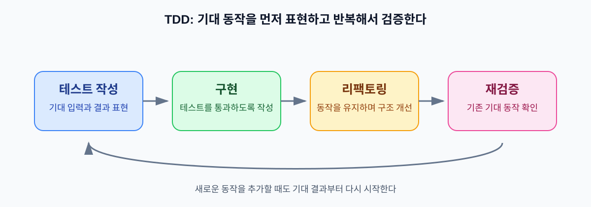

오늘은 코드의 가독성과 변경 가능성을 높이는 Clean Code와 Refactoring을 먼저 살펴봤다. 이어서 외부 입력을 안전하게 다루는 Secure Coding을 보고 마지막에는 원하는 동작을 테스트로 먼저 표현하는 TDD까지 연결했다. 서로 다른 주제처럼 보이지만 모두 코드를 읽고 바꾸고 검증하는 비용과 맞닿아 있었다.

이전에 [클린 코드를 읽고, 읽기 쉬운 코드의 기준이 달라졌다](/posts/clean-code-readable-code/)를 정리하면서 이름과 책임과 구조가 가독성에 영향을 준다는 점을 살펴봤다. 오늘은 그 기준을 리팩토링과 보안 경계와 테스트 흐름까지 넓혔다. 읽기 쉬운 코드는 다음 사람이 의도를 파악하기 쉽게 하고 안전한 코드는 외부 입력이 의도하지 않은 동작으로 이어지지 않게 한다. 테스트는 그 동작을 확인할 기준을 남긴다.

## 1. 읽기 쉽고 안전하게 바꿀 수 있는 코드가 필요한 이유

기능이 동작하면 일단 목적을 달성한 것처럼 보인다. 하지만 개발이 끝난 뒤에도 코드는 계속 읽히고 수정된다. 다른 개발자가 목적과 흐름을 빠르게 파악하지 못하면 작은 변경에도 전체 로직을 다시 추적해야 한다. 그만큼 유지보수 비용도 커진다.

외부 요청값까지 들어오면 읽기 쉬운 것만으로는 부족하다. 요청값이 필수 조건과 형식과 범위를 만족하는지 확인해야 한다. 데이터베이스 쿼리에 전달할 때는 입력값이 SQL 구문으로 해석되지 않게 해야 한다. [Clean Code & Secure Coding 원문](https://github.com/gyoogle/tech-interview-for-developer/blob/master/Computer%20Science/Software%20Engineering/%ED%81%B4%EB%A6%B0%EC%BD%94%EB%93%9C%28Clean%20Code%29%20%26%20%EC%8B%9C%ED%81%90%EC%96%B4%EC%BD%94%EB%94%A9%28Secure%20Coding%29.md)에서 다룬 보안 관점도 여기에 이어진다. 코드의 역할을 분명하게 드러내는 일과 외부 입력을 안전하게 처리하는 일은 서로 다른 기준이지만 함께 지켜야 한다.

이 기대를 코드 작성 시점부터 테스트로 남기는 방법이 TDD다. 테스트가 입력과 결과를 구체적으로 표현하면 구현이 그 기대를 만족하는지 짧은 주기로 확인한다. 오늘은 클린 코드에서 시작해 보안 경계를 거쳐 테스트로 검증하는 흐름을 한 번에 묶어 보았다.

## 2. Clean Code는 읽기 쉬운 코드의 상태다

학습 중에는 클린 코드의 목적을 “다른 개발자가 코드의 목적을 쉽게 이해하고 유지보수할 수 있도록 하는 것”이라고 정리했다. [Clean Code & Refactoring 원문](https://github.com/gyoogle/tech-interview-for-developer/blob/master/Computer%20Science/Software%20Engineering/Clean%20Code%20%26%20Refactoring.md)처럼 클린 코드는 코드 줄 수가 적거나 보기 좋게 정렬된 상태만을 뜻하지 않는다. 이름과 구조를 읽었을 때 작성자의 의도와 실행 흐름이 자연스럽게 드러나는 코드에 가깝다.

가독성에는 여러 요소가 함께 영향을 준다.

- 변수와 함수와 클래스의 이름만 읽어도 역할을 예상할 수 있어야 한다.
- 코드만으로 알기 어려운 비즈니스 규칙이나 기술적 제약은 주석으로 이유를 남긴다.
- 조건문을 단순하게 만들고 불필요한 중첩을 줄여 흐름을 위에서 아래로 읽을 수 있게 한다.
- 함수와 클래스가 서로 다른 책임을 한곳에 모으지 않도록 경계를 나눈다.

함수는 무조건 짧아야 하는 것이 아니다. 줄 수를 줄이려고 여러 책임을 억지로 분리하면 전체 흐름을 이해하려고 여러 곳을 오가야 하는 경우도 생긴다. 중요한 기준은 함수의 책임과 흐름이 명확한지다. 하나의 이름으로 설명할 수 있는 작업을 맡고 호출하는 쪽에서도 그 역할을 쉽게 이해할 수 있어야 한다.

주석도 같은 기준으로 봐야 했다. 코드가 무엇을 하는지는 이름과 구조로 설명하는 편이 좋지만 왜 이런 방식을 선택했는지는 코드만으로 남기기 어려울 때가 있다. 외부 시스템의 제약이나 특정 정책의 배경처럼 구현만 읽고는 알 수 없는 이유는 주석으로 남길 수 있다. 반대로 코드 내용을 그대로 반복하는 주석은 구현과 함께 낡기 쉽다.

## 3. Refactoring은 동작을 유지하며 내부 구조를 개선하는 작업이다

클린 코드와 리팩토링은 비슷하게 느껴지지만 같은 개념은 아니다. 클린 코드는 읽기 쉽고 이해하기 좋은 코드의 상태나 특성이다. 리팩토링은 외부에서 관찰되는 기능 동작을 유지하면서 내부 구조를 개선하는 작업이다.

리팩토링의 목적은 성능 최적화가 아니다. 이름을 바꾸고 중복을 줄이고 책임을 나누는 이유는 코드를 더 쉽게 이해하고 수정해 유지보수 비용을 낮추기 위해서다. 성능 문제는 별도의 측정과 최적화 기준으로 다뤄야 한다.

예를 들어 한 함수 안에 요청 검증과 비즈니스 규칙 확인과 저장이 모두 들어 있다면 각 책임을 읽기 쉬운 단위로 나누는 리팩토링 대상이 된다. 함수 이름을 구체적으로 바꾸거나 중첩된 조건을 단순하게 정리하는 것도 같은 방향의 개선이다. 외부에서 보이는 결과와 사용 방법은 그대로 두고 내부의 의도와 경계를 더 분명하게 만든다.

리팩토링 뒤에는 회귀 테스트로 기존 동작이 유지되는지 확인해야 한다. 구조를 바꾸는 동안 의도하지 않은 기능 변경이 생길 수 있기 때문이다. 이 지점에서 테스트는 “새 구조가 더 예뻐 보이는가”가 아니라 “기존에 약속한 동작을 계속 지키는가”를 확인하는 기준이 된다.

## 4. Secure Coding에서 입력 검증과 파라미터 바인딩을 나누다

외부 요청값은 신뢰하지 않고 서버에서 다시 확인해야 한다. 필수 여부와 형식과 범위와 업무 규칙을 검증해야 하며, 클라이언트가 값을 검사했다는 이유로 서버 검증을 생략할 수 없다. Spring 요청 DTO에서는 `@Valid`와 `@Min(1)` 같은 제약을 사용해 값의 범위를 표현할 수 있다.

```java
public record RestaurantRequest(
        @Min(1) long restaurantId
) {}

@PostMapping
void create(@Valid @RequestBody RestaurantRequest request) {
    // 요청 처리
}
```

이 검증은 `restaurantId`가 허용된 범위에 있는지 확인하는 역할이다. [Spring Boot: 빈 관리부터 전역 예외 처리까지의 핵심 정리](/posts/spring-boot-bean-exception/)에서 정리했던 Bean Validation도 같은 위치에서 요청 데이터의 제약을 검사한다.

입력값 검증과 SQL 파라미터 바인딩은 서로 다른 역할을 가진다. 검증은 값이 업무 규칙에 맞는지 확인하고 바인딩은 사용자 입력이 SQL 구문으로 해석되지 않도록 쿼리 구조와 값을 분리한다.

SQL 문자열에 사용자 입력을 직접 이어 붙이면 입력값이 데이터가 아니라 SQL 문법의 일부로 해석될 수 있다. 그러면 입력 내용에 따라 원래 의도한 조건이 바뀌거나 의도하지 않은 SQL이 실행될 위험이 생긴다. 반면 `PreparedStatement`나 JPA의 파라미터 바인딩은 쿼리 구조를 먼저 정하고 입력값을 데이터로 전달한다.

```java
@Query("select r from Restaurant r where r.name = :name")
List<Restaurant> findByName(@Param("name") String name);
```

위 예시에서 `:name`은 JPQL 구조와 분리된 값의 자리다. `name`에 SQL 문법처럼 보이는 문자가 들어와도 쿼리 구조가 바뀌는 것이 아니라 하나의 값으로 전달된다. `@Valid`로 입력값의 형식과 범위를 검증했다고 해서 SQL Injection까지 방지했다고 볼 수는 없다. 검증과 바인딩을 각각 적용해야 한다.

이 구분은 이전에 정리한 [데이터베이스의 안전성과 일관성 — SQL Injection부터 복제 지연까지](/posts/database-security-consistency-replication/)의 내용과도 이어진다. 안전한 쿼리의 출발점은 사용자가 보낸 문자열을 SQL 문장에 직접 붙이지 않고 쿼리와 데이터를 분리하는 데 있다.

## 5. TDD는 원하는 동작을 테스트로 먼저 표현하는 방식이다

처음에는 TDD를 “원하는 결과가 나오는 테스트”라고 표현했다. 더 정확히 말하면 TDD는 기대하는 동작을 테스트로 먼저 표현하고 그 테스트를 기준으로 코드를 작성하는 개발 방식이다. [TDD 원문](https://github.com/gyoogle/tech-interview-for-developer/blob/master/Computer%20Science/Software%20Engineering/TDD%28Test%20Driven%20Development%29.md)도 테스트 케이스를 먼저 작성한 뒤 코드를 개발하고 수정하는 흐름으로 설명한다. 구현을 모두 끝낸 뒤 결과를 확인하는 순서와 달리 어떤 입력에서 어떤 결과를 기대하는지 먼저 정한다.

Gyoogle 원문의 성적 계산 예시에서는 중간고사 35점과 기말고사 25점과 과제 25점의 합계가 85점이다. 80점 이상을 B로 정했다면 다음과 같이 기대 결과를 테스트에 남길 수 있다.

```java
@Test
void scoreResult() {
    Score score = new Score(35, 25, 25);
    SimpleScoreStrategy scores = new SimpleScoreStrategy();

    String resultGrade = scores.computeGrade(score);

    assertEquals("B", resultGrade);
}
```

이 예시에서 중요한 부분은 `Score`와 `computeGrade()`의 구현보다 테스트가 먼저 기대를 표현한다는 점이다. 테스트는 “35점, 25점, 25점을 입력하면 B를 기대한다”는 약속을 코드로 남긴다. 그래서 단순한 오류 검출 도구를 넘어 다른 개발자가 기대 입력과 결과를 파악하는 문서 역할도 한다. [Spring: 개발자의 자신감, 테스트](/posts/spring-developer-test/)에서 정리했던 테스트의 회귀 방지 역할도 이 기대를 계속 확인하는 흐름과 연결된다.

## 6. 테스트와 리팩토링은 한 흐름에서 만나지만 같은 개념은 아니다

TDD의 흐름은 기대 동작을 테스트로 작성하고 그 테스트를 통과하도록 구현한 뒤 내부 구조를 개선하고 다시 검증하는 순서로 이어진다. 학습 과정에서 이 단계를 보충 용어인 Red-Green-Refactor로도 정리했지만 오늘 활용한 원문은 테스트 우선 작성과 구현과 수정의 반복이라는 흐름으로 설명한다.



*그림 1. 기대 동작을 테스트로 먼저 표현하고 구현과 통과 여부를 확인한 뒤 내부 구조를 개선하고 다시 검증하는 흐름. 리팩토링은 테스트와 구분되는 내부 구조 개선 단계다.*

여기서 리팩토링은 TDD와 같은 말이 아니다. 리팩토링은 외부 동작을 바꾸지 않고 내부 구조를 개선하는 작업이고 TDD는 기대 동작을 테스트로 먼저 표현해 개발 순서를 이끄는 방식이다. TDD의 사이클 안에서 리팩토링 단계가 포함되고 리팩토링 후에는 같은 테스트가 회귀 테스트로 기존 동작을 확인한다.

새로운 동작을 추가할 때도 먼저 기대 결과를 테스트로 남기면 구현이 따라야 할 기준이 분명해진다. 구현 후 구조를 정리하더라도 테스트가 같은 결과를 요구하고 있으므로 변경 전후의 동작을 비교하기 쉽다.

## 7. 빠른 피드백과 초기 비용을 함께 봐야 한다

TDD의 장점은 오류를 개발 후반에 한꺼번에 찾는 대신 작업 중에 일찍 확인한다는 점이다. 기대 결과가 테스트에 남아 있으면 코드를 바꿀 때마다 짧은 주기로 피드백을 얻고 기존 동작이 깨졌는지도 확인하기 쉽다. 테스트 케이스가 코드와 함께 관리되면 요구한 동작을 설명하는 문서로도 쓰인다.

하지만 테스트 작성에는 초기 비용이 든다. 어떤 입력과 경계를 확인할지 설계하고 테스트 코드를 작성하는 과정이 개발 흐름에 추가되기 때문이다. 테스트를 만들었다고 해서 모든 동작이 자동으로 검증되는 것도 아니다. 무엇을 기대하는지 충분히 생각하지 않으면 테스트가 있어도 중요한 규칙을 놓칠 수 있다.

그래서 TDD를 무조건 테스트를 많이 작성하는 방법으로 이해하기보다 기대 동작을 명확히 하고 짧은 피드백을 얻는 개발 방식으로 보는 편이 좋다. 초기 설계와 작성에 드는 비용을 인정하면서도 이후 변경과 유지보수에서 줄일 수 있는 비용과 함께 판단해야 한다.

## 8. 학습 중 바뀐 이해

처음에는 클린 코드와 리팩토링을 모두 읽기 좋은 코드를 만드는 방법으로 생각했다. 다시 구분해 보니 클린 코드는 이름과 책임과 흐름이 분명한 코드의 상태이고, 리팩토링은 외부 동작을 유지한 채 그 상태에 가까워지도록 내부 구조를 개선하는 작업이었다. 리팩토링의 목적도 성능 최적화가 아니라 이해와 수정에 드는 비용을 낮추는 데 있었다.

시큐어 코딩에서는 입력값 검증과 SQL 파라미터 바인딩을 하나의 “검증”으로 묶으려 했다. 입력값 검증은 필수 여부와 형식과 범위와 업무 규칙을 확인하고, 파라미터 바인딩은 입력값을 SQL 코드가 아닌 데이터로 전달한다. 둘 중 하나가 다른 역할까지 대신하지 않는다는 점을 분리해서 이해했다.

TDD도 처음에는 원하는 결과를 확인하는 테스트 정도로 생각했다. 성적 계산 예시를 따라가면서 테스트는 구현 뒤의 확인 절차가 아니라 기대 입력과 결과를 먼저 표현하는 기준이 될 수 있다는 점을 알게 됐다. 테스트 설계와 작성으로 초기 비용은 늘지만 개발 중 피드백과 이후 회귀 확인과 문서 역할을 함께 얻을 수 있다는 점까지 고려해야 했다.

## 9. 오늘의 정리

- Clean Code는 다른 개발자가 코드의 의도와 흐름을 쉽게 파악하도록 이름과 책임과 구조를 정리한 코드의 상태다.
- Refactoring은 외부에서 관찰되는 동작을 유지하면서 내부 구조를 개선하는 작업이며 성능 최적화와는 목적이 다르다.
- 외부 요청값은 서버에서 필수 여부와 형식과 범위와 업무 규칙을 검증해야 한다.
- 입력값 검증은 업무 규칙을 확인하고 SQL 파라미터 바인딩은 입력값이 SQL 구문으로 해석되지 않게 하므로 둘은 서로 다른 역할을 한다.
- TDD는 기대하는 동작을 테스트로 먼저 표현하고 구현과 구조 개선과 재검증을 반복하는 개발 방식이다.
- 테스트 설계와 작성에는 초기 비용이 들지만 오류를 일찍 확인하고 기대 동작을 문서로 남기며 리팩토링 후 회귀를 확인하는 데 도움을 준다.

오늘은 읽기 쉬운 코드가 왜 변경하기 쉬운 코드로 이어지는지에서 출발했다. 클린 코드는 코드의 상태이고 리팩토링은 동작을 유지하며 내부 구조를 개선하는 작업이었다. 여기에 입력값 검증과 SQL 파라미터 바인딩으로 외부 입력의 경계를 나누고 TDD로 기대 결과를 먼저 표현하면 코드가 읽히고 안전하게 바뀌며 다시 검증되는 흐름을 만든다. 오늘의 코드는 개념을 정리하기 위한 예시이며 실제 테스트 실행 결과를 전제로 하지 않았다.

### 참고 자료 (Sources)

* **gyoogle/tech-interview-for-developer:** [Clean Code & Refactoring](https://github.com/gyoogle/tech-interview-for-developer/blob/master/Computer%20Science/Software%20Engineering/Clean%20Code%20%26%20Refactoring.md) — 클린 코드의 가독성, 리팩토링의 목적과 외부 동작 유지를 확인
* **gyoogle/tech-interview-for-developer:** [Clean Code & Secure Coding](https://github.com/gyoogle/tech-interview-for-developer/blob/master/Computer%20Science/Software%20Engineering/%ED%81%B4%EB%A6%B0%EC%BD%94%EB%93%9C%28Clean%20Code%29%20%26%20%EC%8B%9C%ED%81%90%EC%96%B4%EC%BD%94%EB%94%A9%28Secure%20Coding%29.md) — 가독성, 입력값 검증과 SQL 파라미터 바인딩의 관점을 확인
* **gyoogle/tech-interview-for-developer:** [TDD(Test Driven Development)](https://github.com/gyoogle/tech-interview-for-developer/blob/master/Computer%20Science/Software%20Engineering/TDD%28Test%20Driven%20Development%29.md) — 테스트 우선 작성, 성적 계산 예시, TDD의 장점과 초기 비용을 확인
