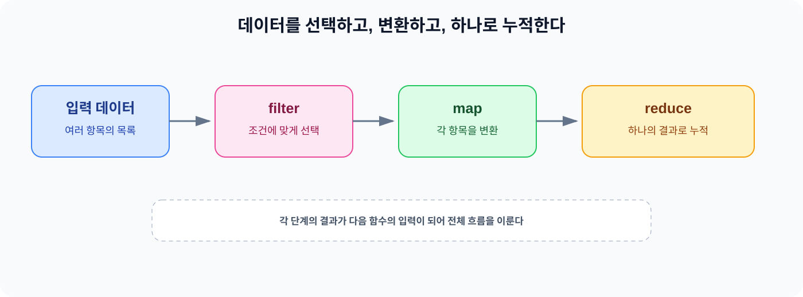
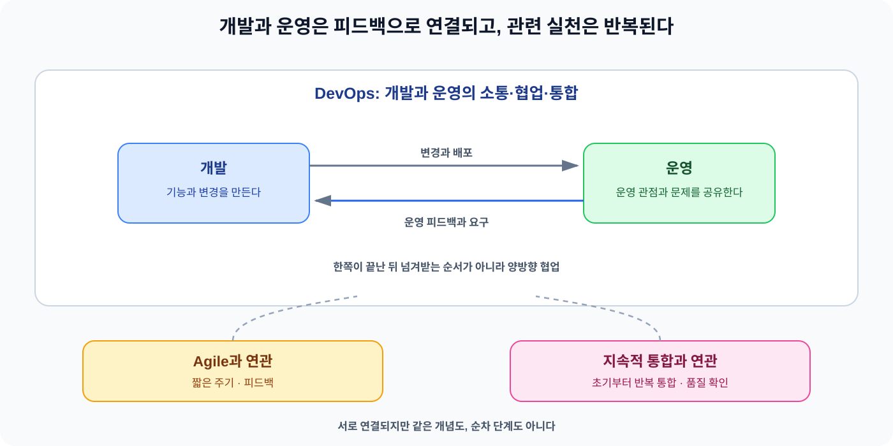

오늘은 같은 Software Engineering 범위에서 함수형 프로그래밍과 DevOps를 살펴봤다. 함수형 프로그래밍은 데이터를 함수에 전달하고 함수들을 조합해 결과를 만드는 관점이다. 부작용과 공유 상태를 어떻게 다루는지도 함께 살폈다. DevOps는 개발과 운영의 소통·협업·통합을 강조하는 환경이나 문화에 가깝다.

같은 범위에서 공부했지만 초점은 다르다. 함수형 프로그래밍은 함수와 데이터 처리 방식을 바라보는 관점이고 DevOps는 개발과 운영이 일하는 방식을 바라보는 관점이다. 데이터를 처리하는 함수형 프로그래밍부터 정리하고 개발과 운영의 협업을 다루는 DevOps를 이어서 살펴봤다.

## 1. 함수형 프로그래밍은 값을 함수로 변환하며 사고하는 방식이다

처음에는 함수형 프로그래밍을 함수라고만 답했다. 학습을 이어가며 함수형 프로그래밍은 값을 함수에 전달하고 함수들을 조합해 입력값에서 결과를 만들어 가는 프로그래밍 관점이라고 정리했다. 특정 언어나 문법 하나를 배우는 일이 아니라 함수를 중심으로 문제를 바라보는 사고에 가깝다.

명령형 프로그래밍은 어떻게 처리할지를 절차로 드러낸다. 목록을 순회하고 조건을 검사하고 그 결과를 변수에 담는 흐름을 코드에 직접 적는다. 반면 선언형 프로그래밍은 어떤 결과를 원하는지를 표현하는 데 초점을 둔다. 목록에서 조건에 맞는 항목을 고른 뒤 값을 변환하고 싶다면 filter와 map 같은 연산을 이어서 데이터 처리 의도를 나타낼 수 있다.

두 방식이 서로 다른 프로그램에서만 사용되는 것은 아니다. Java에서도 객체와 메서드를 중심으로 구조를 만들면서 일부 컬렉션 처리에는 함수형 스타일을 사용할 수 있다. 두 방식의 차이는 같은 작업을 표현할 때 반복과 조건의 절차를 직접 적을지, 데이터에 적용할 연산의 의도를 드러낼지에 있다.

## 2. 순수 함수와 부작용, 공유 상태를 구분한다

순수 함수는 같은 입력에 항상 같은 결과를 반환하고 함수 바깥의 상태를 변경하지 않는 함수다. 결과를 만들 때 전역 변수나 외부 객체의 현재 상태에 기대지 않고, 함수 바깥의 값도 몰래 바꾸지 않아야 한다. 이렇게 하면 결과를 예측하기 쉽고 문제가 함수 내부에 있는지 입력에 있는지 추적하기도 쉬워진다.

함수의 반환값 외부에 영향을 주는 동작은 부작용이다. 전역 변수의 값을 바꾸거나 화면에 출력하거나 DB에 저장하는 동작이 예다. 출력과 저장을 없애야 한다는 뜻은 아니다. 애플리케이션은 결국 외부와 상호작용해야 하므로 부작용을 모두 없애기보다 필요한 경계에 모으고 데이터 변환 로직에서는 공유 상태 변경을 줄이는 것이 핵심이다.

공유 목록을 여러 함수가 직접 바꾸면 어느 함수가 어떤 시점에 값을 변경했는지 추적하기 어려워진다. 반대로 입력을 바탕으로 새로운 결과를 만들고 상태 변경을 정한 경계에서 수행하면 함수의 동작을 테스트하기 쉬워진다. 함수형 프로그래밍을 부작용이 전혀 없는 코드로 오해하기보다 부작용을 눈에 보이는 경계에 두고 나머지 계산을 단순하게 만드는 관점으로 이해했다.

## 3. 함수 합성과 map, filter, reduce는 서로 다른 역할을 가진다

함수 합성은 한 함수의 결과가 다음 함수의 입력으로 이어지도록 함수를 연결하는 것이다. 각 함수의 역할을 나누고 결과를 다음 단계로 넘기면 전체 처리 흐름을 작은 함수들의 조합으로 표현할 수 있다. 연산마다 역할을 구분해야 전체 흐름을 읽을 수 있다.

map은 여러 항목을 각각 다른 값으로 변환한다. filter는 조건에 맞는 항목만 선택한다. reduce는 여러 항목을 하나의 결과로 누적한다. 오늘 연습에서 확인한 결과도 이 역할에 따라 map은 [9, 16], filter는 [5, 7], reduce는 10으로 정리할 수 있었다. 숫자만 외우기보다 선택과 변환과 누적이 서로 다른 연산이라는 점을 먼저 구분했다.

*데이터를 조건에 따라 선택하고 값을 변환한 뒤 하나의 결과로 누적하는 흐름*

## 4. Java의 함수형 인터페이스와 람다식, Stream API

함수형 인터페이스는 추상 메서드가 하나인 인터페이스다. 그 동작은 람다식으로 간결하게 표현할 수 있다. 예를 들어 x -> x * 2라는 람다식에 4를 전달하면 8이 나온다. 람다식은 동작을 값처럼 전달하는 표현이라고 이해했다.

Stream API는 컬렉션 처리에서 선택과 변환의 의도를 이어서 표현한다. 반복문에서는 인덱스로 목록을 순회하고 조건문으로 대상을 고른 뒤 출력이나 변환을 직접 작성한다. Stream에서는 filter로 선택하고 map으로 변환하는 흐름을 메서드 체인으로 드러낼 수 있다.

~~~java
List.of(1, 2, 3).stream()
    .filter(n -> n % 2 == 0)
    .map(n -> n * 2)
    .forEach(System.out::println);
~~~

위 코드는 1, 2, 3 중 짝수인 2를 filter로 고르고 map에서 4로 바꾼 뒤 forEach에서 사용한다. 화면에는 4가 출력된다. filter와 map은 데이터 변환 흐름을 만들고 System.out::println은 부작용이 발생하는 경계다.

Stream을 쓴다고 프로그램 전체가 함수형 프로그램이 되는 것은 아니다. Java는 객체지향 구조를 중심으로 두면서 필요한 곳에는 람다식과 Stream 같은 함수형 스타일을 함께 사용할 수 있다. 이전 객체지향 학습에서 정리한 객체와 책임의 구조를 유지한 채 컬렉션을 처리하는 부분만 함수 조합으로 표현하는 식이다.

## 5. DevOps는 개발과 운영의 소통·협업·통합을 강조한다

DevOps는 Development와 Operations를 합친 말이다. 소프트웨어 개발자와 IT 운영 전문가 사이의 소통과 협업과 통합을 강조하는 개발 환경이나 문화를 의미한다. 처음에는 개발과 운영이 함께 대응하는 일이라고만 이해했지만, 같은 문제를 함께 처리하는 데서 그치지 않고 서로의 업무와 요구를 일찍 공유하고 연결하는 관점까지 포함한다는 점을 보완했다.

DevOps의 목적은 제품과 서비스를 빠르게 개발하고 배포해 알맞은 시기에 출시하는 데 있다. 여기서 빠르다는 뜻은 개발만 빨리 끝낸다는 뜻이 아니다. 개발 과정에서 운영에 필요한 관점을 함께 확인하고 배포와 운영으로 이어지는 흐름을 연결해 대응 속도를 높이려는 의미로 이해했다.

## 6. 개발과 운영은 늦기 전에 정보를 공유해야 한다

개발이 끝난 뒤 출시 직전에야 운영 정보를 주고받으면 문제가 생겼을 때 대응이 늦어진다. 운영 환경에서 필요한 요구사항이 늦게 공유되거나 실제 문제가 늦게 발견되면 이미 진행한 개발을 다시 살펴야 하고 출시 일정에 맞춰 수정하기도 어려워진다.

개발과 운영이 초기에 정보를 주고받으면 요구사항과 제약을 개발 흐름에 반영할 수 있다. 운영에서 발견한 문제도 개발이 끝난 뒤 한꺼번에 넘기지 않고 피드백으로 돌아와 다음 판단에 영향을 줄 수 있다. 그래서 DevOps는 개발팀과 운영팀이 분리되어 있지 않다는 뜻이 아니라, 서로 다른 역할이 소통과 협업과 통합을 통해 같은 제품의 흐름에 참여한다는 뜻이다.

## 7. Agile 및 지속적 통합과 DevOps의 관계

Agile은 일정한 주기로 작동하는 결과를 만들고 피드백을 받아 다음 작업을 조정하는 접근이다. 짧은 주기와 피드백을 개발 과정에 넣는다는 점에서 DevOps와 맞닿아 있다. 다만 Agile이 끝난 뒤 DevOps가 운영을 이어받는 순서로 보면 안 된다. DevOps에서는 협업과 피드백이 개발 단계에 머물지 않고 배포와 운영까지 이어진다.

지속적 통합은 초기부터 통합 작업을 계속 수행하고 소프트웨어의 품질을 반복해서 확인하며 빠른 피드백을 얻는 관련 실천 개념이다. Agile의 짧은 주기와 지속적 통합의 반복적인 통합·품질 확인은 DevOps와 연결되지만, 지속적 통합 자체가 DevOps 전체와 같은 뜻은 아니다. 세 개념은 서로 연관되어 있지만 같은 개념도 아니고 앞뒤로 한 번씩 밟는 단계도 아니다.

*Agile과 지속적 통합은 DevOps와 연관된 실천이며 개발과 운영의 피드백은 양방향으로 이어진다*

## 8. 백엔드 코드에서 두 관점을 연결해 보기

백엔드에서 함수형 프로그래밍의 관점은 요청 데이터나 조회 결과를 변환하는 로직을 읽기 쉽게 만드는 데 활용하기 좋다. 이때 DB 저장이나 응답 전송 같은 부작용이 필요한 동작까지 없애라는 뜻은 아니다. 데이터를 선택하고 변환하는 과정에서는 공유 상태 변경을 줄이고, 저장과 전송처럼 외부에 영향을 주는 동작은 필요한 경계로 분명하게 나누는 것이 중요하다.

DevOps를 백엔드 개발과 연결해 생각할 때는 운영 관점의 요구와 문제가 늦지 않게 공유해야 하는 이유를 볼 수 있다. 서비스가 실제로 운영될 때 필요한 조건이나 운영 중 발견한 문제를 개발 과정에 미리 전달하면 다음 구현과 배포 판단에 반영할 수 있다. 함수형 프로그래밍이 코드 안의 데이터 처리 흐름을 정리하는 관점이라면 DevOps는 제품을 만들고 운영하는 협업 흐름을 정리하는 관점이다.

## 9. 학습 중 바뀐 이해

함수형 프로그래밍은 처음에 함수라고만 답했다. 학습을 이어가며 입력값을 함수에 전달하고 함수들을 조합해 결과를 만드는 관점까지 설명을 확장했다. 명령형 방식은 반복문으로 목록을 순회하고 조건을 검사하는 절차를 드러내고 선언형 방식은 filter와 map처럼 데이터 처리 의도를 나타낸다는 차이까지 정리했다.

전역 변수 변경을 부작용으로 식별했고 여러 함수가 공유하는 목록을 직접 변경하면 변경 추적이 어려워질 수 있다고 정리했다. 순수 함수가 같은 입력에 같은 결과를 반환하고 외부 상태를 변경하지 않는다는 조건도 문장으로 정리했다. 다만 이 조건을 완전한 문장으로 설명하는 것과 실제 코드에서 모든 외부 의존을 찾아 판단하는 것은 다르므로, 순수 함수의 조건을 더 정확하게 적용하는 연습은 더 필요하다.

함수 합성은 한 함수의 결과가 다음 함수로 전달되는 것으로 설명했다. map과 filter와 reduce의 결과는 각각 [9, 16], [5, 7], 10으로 맞게 계산했고 람다식과 Stream 예제의 계산도 확인했다. 반복문과 Stream을 비교하면서 Stream은 순회 절차보다 데이터 처리 의도를 드러낸다는 점을 이해했다. 동시에 Stream을 사용한다고 전체 프로그램이 함수형으로 바뀌는 것은 아니라는 구분도 남겼다.

DevOps는 처음에 개발과 운영이 함께 대응하는 것이라고 이해했다. 여기에 소통과 협업과 통합을 강조하는 환경이나 문화라는 설명과 빠른 개발·배포를 지향한다는 목적까지 구체화했다. Agile과 DevOps를 앞뒤로 이어지는 단계처럼 표현했던 이해도 바로잡았다. 협업과 피드백은 개발부터 배포와 운영까지 이어지는 흐름이고 Agile은 그 안에서 짧은 주기와 피드백을 강조하는 접근이다.

지속적 통합은 처음에 초기부터 시작한다는 답에서 출발했다. 이제는 초기부터 통합 작업을 계속 수행하고 품질을 확인해 빠른 피드백을 얻는 관련 실천 개념으로 정리했다. DevOps 전체와 같은 뜻은 아니며 Agile과도 서로 다른 개념이라는 점을 구분했다.

## 10. 오늘의 정리

- 함수형 프로그래밍은 값을 함수에 전달하고 함수를 조합해 결과를 만드는 관점이며 데이터 처리의 의도를 분명하게 표현한다.
- 순수 함수는 같은 입력에 같은 결과를 반환하고 외부 상태를 변경하지 않으며 부작용은 필요한 경계에 모으는 것이 중요하다.
- map은 변환, filter는 선택, reduce는 누적을 담당하고 함수 합성은 한 함수의 결과를 다음 함수의 입력으로 연결한다.
- Java에서는 함수형 인터페이스와 람다식과 Stream API를 활용하면서 객체지향 구조와 함수형 스타일을 함께 사용할 수 있다.
- DevOps는 개발과 운영의 소통·협업·통합을 강조하며 빠른 개발과 배포와 적절한 시기의 출시를 지향한다.
- Agile과 지속적 통합은 DevOps와 연결되는 실천 개념이지만 서로 같은 뜻도 아니고 순차 단계도 아니다.

오늘은 함수형 프로그래밍과 DevOps를 하나의 원리로 묶지 않고 각각의 초점을 나누어 정리했다. 함수형 프로그래밍에서는 데이터가 함수 사이를 어떻게 흐르는지와 부작용을 어디에 둘지를 보았다. DevOps에서는 개발과 운영의 정보와 피드백이 늦지 않게 이어져야 하는 이유를 살펴봤다. 하나는 코드 안의 데이터 처리 관점이고 다른 하나는 제품을 만드는 사람들의 협업 관점이라는 차이를 기억하려 한다.

### 참고 자료 (Sources)

* **오늘 학습 기록:** [Functional Programming](https://app.notion.com/p/3e2a108cd602815bb8dbee73e5fe0bb4) — 함수형 프로그래밍의 학습 범위와 답변·보완 과정을 확인
* **Gyoogle:** [Functional Programming](https://github.com/gyoogle/tech-interview-for-developer/blob/master/Computer%20Science/Software%20Engineering/Fuctional%20Programming.md) — 함수형 프로그래밍의 기본 개념과 Java 예제를 확인
* **오늘 학습 기록:** [DevOps](https://app.notion.com/p/3e2a108cd6028131aa03e5b0244989e8) — DevOps와 Agile과 지속적 통합에 대한 오늘의 학습 내용과 이해 변화를 반영
* **Gyoogle:** [DevOps](https://github.com/gyoogle/tech-interview-for-developer/blob/master/Computer%20Science/Software%20Engineering/%EB%8D%B0%EB%B8%8C%EC%98%B5%EC%8A%A4%28DevOps%29.md) — DevOps의 의미와 목적, Agile 및 지속적 통합과의 관계를 확인
* **이전 학습:** [Object-Oriented Programming](https://app.notion.com/p/3e2a108cd6028136ab6bdbaaa79ef1ce) — Java에서 객체지향 구조와 함수형 스타일을 함께 사용할 수 있다는 연결점을 확인
* **이전 학습:** [Agile](https://app.notion.com/p/3e2a108cd602811cbc3dc521877c6664) — Agile의 짧은 주기와 피드백을 연결할 때 참고
