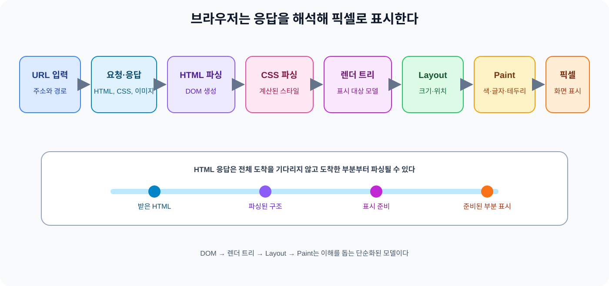
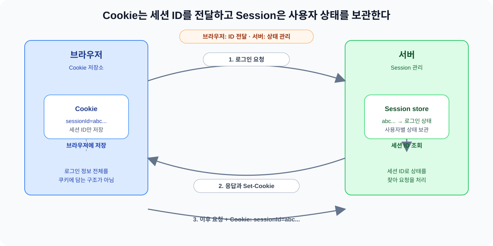

주소창에 URL을 입력한 뒤 브라우저는 서버의 응답을 어떻게 화면으로 바꿀까? HTTP 요청이 서로 독립적이라면 서버는 여러 요청을 같은 사용자의 흐름으로 어떻게 묶을까?

오늘은 두 질문을 한 흐름으로 묶었다. 브라우저가 자원을 요청하고 HTML과 CSS를 해석해 픽셀을 그리는 과정을 먼저 정리한 뒤, HTTP가 기본적으로 무상태인 상황에서 Cookie와 Session이 로그인 상태를 잇는 방식을 살펴봤다. 화면에 나타나는 결과와 요청 사이의 사용자 상태가 어떤 단계를 거쳐 만들어지는지 나누어 보는 데서 공부를 시작했다.

## 1. URL 입력부터 화면의 픽셀까지

브라우저가 웹 페이지를 표시하는 흐름은 다음처럼 줄여 볼 수 있다.

`URL 입력 → 필요한 자원 요청과 응답 → HTML 파싱과 DOM 생성 → CSS 파싱과 계산된 스타일 → 렌더 트리 구성 → Layout → Paint → 화면에 픽셀 표시`

브라우저는 서버에서 받은 HTML과 CSS를 그대로 화면에 올리지 않는다. HTML을 읽어 문서 구조를 만들고 CSS 규칙을 적용한 뒤 표시할 요소의 크기와 위치를 계산해 시각적인 결과를 그린다. 이미지나 글꼴처럼 더 필요한 자원이 있으면 그 요청도 이 흐름에 들어온다. 결국 응답은 해석과 계산을 거쳐 화면의 픽셀로 바뀐다.

*그림 1. URL 입력 뒤 자원 요청과 응답, 문서 구조와 스타일 계산, 배치와 그리기를 거쳐 화면이 만들어지는 흐름이다.*

이 흐름은 브라우저 내부를 설명하는 모델이다. 실제 브라우저는 자원을 병렬로 가져오거나 일부 단계의 결과를 재사용하면서 더 복잡하게 동작한다. 그래도 각 단계가 어떤 정보를 다음 단계로 넘기는지 구분하면 화면이 만들어지는 과정을 따라가기 쉬워진다.

## 2. 브라우저 구성 요소는 역할을 나누어 이해한다

브라우저 구성 요소는 고정된 프로세스 구조로 외우기보다 역할별로 나누어 보는 편이 낫다. 브라우저마다 내부 구현과 프로세스 구성이 다르다는 점을 기억한다.

사용자 인터페이스는 주소창과 뒤로 가기·앞으로 가기 버튼과 탭처럼 웹 페이지 바깥의 조작 영역을 담당한다. 브라우저 엔진은 사용자의 명령을 받아 동작을 조정하고 통신 모듈은 서버에 자원을 요청해 응답을 받는다. 자료 저장소는 쿠키와 캐시처럼 이후 동작에 사용할 데이터를 보관한다.

렌더링 엔진은 HTML과 CSS를 해석해 문서 구조와 스타일을 계산하고 화면에 그릴 준비를 한다. Chrome과 Chromium 기반 브라우저는 Blink를 렌더링 엔진으로 사용한다. [Chrome for Developers의 Blink 설명](https://developer.chrome.com/docs/web-platform/blink?hl=en)도 Blink를 Chromium 기반 브라우저의 렌더링 엔진으로 소개한다.

UI 백엔드는 스크롤바나 입력 컨트롤처럼 운영체제의 화면 기능과 연결되는 부분을 담당한다. JavaScript 해석기는 페이지의 JavaScript를 실행해 DOM이나 스타일을 변경하고 사용자 동작에 반응한다. 이 구성 요소들은 역할을 설명하기 위한 개념적 구분이다. 실제 브라우저에서는 여러 프로세스와 스레드와 모듈이 역할을 나누어 실행한다.

브라우저 엔진은 브라우저마다 다를 수 있다. Safari는 WebKit을 기반으로 하고 Firefox는 Gecko를 사용한다. [Gecko 문서](https://firefox-source-docs.mozilla.org/overview/gecko.html)는 Gecko가 HTML 파싱과 렌더링과 네트워킹과 JavaScript 등을 포함하는 Mozilla의 웹 렌더링 엔진이라고 설명한다. 여기에 플랫폼 정책에 따른 예외도 있다. Apple은 EU의 iOS·iPadOS에서 entitlement 조건을 만족하면 대체 브라우저 엔진을 허용한다고 안내한다. 브라우저 엔진을 모든 플랫폼에서 같은 내부 구조로 설명할 수 없는 이유다.

## 3. HTML과 CSS는 화면을 만들기 위한 중간 결과를 만든다

HTML 파서는 HTML 입력을 토큰화한 뒤 트리 구성 규칙에 따라 `Document`를 만든다. 이 구조에는 요소 사이의 부모·자식 관계가 담기며 일반적으로 DOM이라고 부르는 모델로 다룬다. [WHATWG HTML Standard의 파싱 모델](https://html.spec.whatwg.org/multipage/parsing.html)도 HTML 입력이 토큰화 단계를 거쳐 트리 구성 단계로 전달되고 `Document`가 만들어지는 흐름을 정의한다.

예를 들어 `body` 안에 `header`와 `main`이 있다면 DOM은 이 요소들이 어떤 부모·자식 관계로 묶였는지 표현한다. DOM은 화면의 위치나 색상을 바로 담은 그림이 아니라 문서의 구조와 내용을 다루는 모델이다. 화면을 그리는 계산은 그다음 단계에서 이어진다.

CSS 파서는 CSS 규칙을 읽어 DOM 요소에 적용할 규칙을 찾는다. 각 요소에 실제로 어떤 값이 적용되는지는 계산된 스타일로 정리된다. 같은 `color` 규칙이라도 상속과 우선순위와 다른 선언의 영향을 함께 고려한다. CSS 파일에 적힌 한 줄을 곧바로 화면에 옮기는 과정은 아니다.

렌더 트리는 DOM과 계산된 스타일을 바탕으로 화면에 나타날 요소를 설명하는 개념적 모델이다. 예를 들어 `display: none`인 요소는 DOM에는 남아 있지만 표시 대상에서는 제외되고 공간도 차지하지 않는다. DOM에 존재하는 것과 렌더 트리에 포함되어 화면에 보이는 것은 다르다.

Layout에서는 요소마다 크기와 위치를 계산한다. 부모의 너비와 자식의 배치와 줄바꿈 같은 조건이 결과에 영향을 준다. Paint에서는 계산된 위치에 텍스트와 색상과 배경과 테두리를 어떻게 그릴지 정한다. Layout이 위치와 크기를 계산한다면 Paint는 그 결과를 시각적인 표현으로 바꾸는 단계다.

## 4. 점진적 렌더링과 실제 렌더링 파이프라인

브라우저는 HTML 응답 전체를 받을 때까지 기다리지 않고 데이터가 들어오는 동안 파싱을 진행한다. 표시할 준비가 된 내용은 다른 내용이나 일부 자원이 도착하기 전에 나타난다. 점진적 렌더링은 이 흐름을 말한다. “로딩 순서대로 응답한다”는 뜻이 아니라 응답 스트림을 받는 동안 파싱과 표시 준비가 겹칠 수 있다는 의미다.

진행 속도는 자원과 문서 상태에 따라 달라진다. 필요한 CSS를 아직 받지 못했거나 특정 자원의 처리를 기다리는 중이면 표시가 늦어질 수 있다. HTML 일부를 먼저 받았다고 화면 전체가 곧바로 완성되는 것은 아니다.

`DOM → 렌더 트리 → Layout → Paint` 흐름은 개념을 잡기 위한 모델이다. Chromium의 RenderingNG는 스타일 계산과 Layout과 Pre-paint와 Paint와 Commit과 Layerize처럼 단계를 더 나누며 상황에 따라 필요하지 않은 단계는 건너뛸 수 있다고 설명한다. [RenderingNG architecture](https://developer.chrome.com/docs/chromium/renderingng-architecture?hl=en)를 확인한 뒤 Layout과 Paint를 모든 브라우저의 고정된 내부 순서로 외우지 않기로 했다.

## 5. HTTP가 무상태라서 Cookie와 Session이 필요하다

HTTP 요청은 이전 요청과 연결된 사용자 상태를 기본값으로 포함하지 않는다. 로그인 성공 응답을 받은 뒤의 페이지 요청에도 서버가 로그인 사용자를 자동으로 알아볼 정보는 없다. 여러 요청을 한 사용자의 흐름으로 묶으려면 브라우저가 요청 사이에 식별자를 보내고 서버가 그 식별자로 상태를 조회한다.

Cookie는 서버가 브라우저에 보내고 브라우저가 저장했다가 조건에 맞는 이후 요청에 다시 보내는 데이터다. Session은 여러 요청에 걸친 사용자 상태를 서버가 관리하는 방식이다. 둘은 같은 종류의 저장 방식이 아니다. 일반적인 세션 로그인에서는 Cookie에 세션 ID를 담고 서버가 그 ID로 Session을 찾아 로그인 상태를 확인한다.

RFC 6265는 Cookie와 `Set-Cookie` 헤더로 무상태에 가까운 HTTP 위에서 서버가 세션 상태를 유지하는 방식을 정의한다. [MDN의 Using HTTP cookies](https://developer.mozilla.org/en-US/docs/Web/HTTP/Guides/Cookies)도 브라우저가 쿠키를 저장했다가 이후 요청에 돌려보내고 서버가 세션 ID를 확인하는 기본 로그인 흐름을 설명한다.

*그림 2. 브라우저에는 세션 ID가 저장되고 서버에는 사용자별 Session 상태가 저장되며 두 값이 세션 ID로 연결된다.*

## 6. 세션 로그인은 세션 ID를 주고받는 흐름이다

일반적인 세션 로그인은 다음 순서로 이어진다.

1. 브라우저가 로그인 정보를 서버에 보낸다.
2. 서버가 자격 증명을 확인하고 로그인 상태와 사용자 식별 정보 등을 Session에 저장한다.
3. 서버가 응답의 `Set-Cookie` 헤더로 세션 ID를 보낸다.
4. 브라우저가 쿠키를 저장하고 이후 조건에 맞는 요청에 `Cookie` 헤더로 세션 ID를 보낸다.
5. 서버가 세션 ID로 Session을 찾아 로그인 상태를 확인하고 요청을 처리한다.

쿠키에 로그인 정보 전체가 들어간다고 보면 안 된다. 일반적인 세션 방식에서 브라우저가 전달하는 값은 세션 ID이고 사용자별 상태는 서버 Session에서 찾는다. 세션 ID만으로 다른 사용자의 상태로 처리될 수 있으므로 세션 ID 자체의 보호가 필요하다. [OWASP Session Management Cheat Sheet](https://cheatsheetseries.owasp.org/cheatsheets/Session_Management_Cheat_Sheet.html)는 세션 ID가 예측하기 어렵고 의미 없는 식별자여야 하며 인증 뒤에는 세션 ID를 재생성하는 것도 중요하다고 설명한다.

## 7. 만료와 로그아웃은 브라우저와 서버를 따로 본다

Cookie는 `Expires`나 `Max-Age`로 만료 시점을 정한다. `Max-Age`는 만료까지의 시간을 초 단위로 지정하고 `Expires`는 날짜와 시간을 지정한다. 두 속성이 함께 있으면 `Max-Age`가 우선한다. 속성이 없는 세션 쿠키는 보통 브라우저 세션이 끝날 때까지 유지되지만 세션 복원 기능에 따라 달라질 수 있으므로 브라우저를 닫으면 항상 삭제된다고 단정하지 않는다.

서버 Session의 생명주기도 쿠키와 다르다. Servlet API의 `HttpSession`은 클라이언트 요청 사이의 유휴 시간이 지나면 컨테이너가 세션을 무효화하고 애플리케이션이 `invalidate()`를 호출해 즉시 무효화한다. 브라우저 쿠키가 남아 있어도 서버 Session이 만료되면 그 세션 ID로 로그인 상태를 찾을 수 없다. 반대로 서버 Session을 무효화해도 브라우저에 쿠키가 남아 있으면 다음 요청에 만료된 세션 ID가 실릴 수 있다.

로그아웃에서는 서버 Session을 무효화하고 브라우저의 세션 ID 쿠키도 만료시키는 흐름을 함께 고려한다. 쿠키를 삭제할 때는 기존 쿠키와 맞는 `Path`나 `Domain` 범위가 필요하다. 쿠키 만료와 서버 Session 무효화는 서로 대신할 수 없다.

쿠키 보안 속성은 각각 다른 동작을 제어한다.

- `Secure`: HTTPS 연결에서만 쿠키를 전송한다.
- `HttpOnly`: JavaScript가 `document.cookie`로 쿠키를 읽지 못하게 한다. XSS 자체를 막지는 않으며 브라우저가 요청에 쿠키를 붙이는 동작까지 없애는 것도 아니다.
- `SameSite`: 교차 사이트 요청에서 쿠키를 보낼 조건을 제어해 CSRF 위험을 줄이는 데 도움을 준다. CSRF 방어를 `SameSite` 하나로 끝낼 수 있다고 단정하지 않는다.
- `SameSite=None`: 교차 사이트 전송을 허용하는 값이며 `Secure`가 함께 필요하다.

쿠키의 개수와 크기 제한은 브라우저마다 다르다. 특정 숫자를 모든 브라우저에 적용되는 값처럼 적지 말고 쿠키는 요청마다 전송될 수 있으며 저장 한도도 있다는 사실을 기억하는 편이 안전하다. [MDN의 쿠키 자료](https://developer.mozilla.org/en-US/docs/Web/HTTP/Reference/Headers/Set-Cookie)는 속성별 동작과 브라우저 호환 정보를 함께 설명한다.

## 8. Java와 Spring에서의 HttpSession

`HttpSession`은 Spring이 직접 만든 세션 저장소가 아니라 Servlet API가 제공하는 인터페이스다. Servlet 컨테이너가 여러 요청 사이에서 세션을 만들고 관리할 수 있게 하며 실제 세션 정보의 저장 위치는 컨테이너와 애플리케이션 구성에 따라 달라진다. [Jakarta Servlet의 HttpSession API](https://jakarta.ee/specifications/servlet/6.1/apidocs/jakarta.servlet/jakarta/servlet/http/HttpSession.html)도 `HttpSession`을 사용자를 식별하고 정보를 저장하는 인터페이스로 설명한다.

Spring MVC 컨트롤러에서는 `HttpSession`을 메서드 인자로 받을 수 있다. Spring이 별도 세션을 정의하는 것이 아니라 Servlet API의 세션 객체를 컨트롤러와 연결하는 방식이다. [Spring Framework의 Method Arguments 문서](https://docs.spring.io/spring-framework/reference/6.2/web/webmvc/mvc-controller/ann-methods/arguments.html)에도 `jakarta.servlet.http.HttpSession`을 지원하는 컨트롤러 인자로 소개한다.

저장·조회·무효화 세 동작만 다음처럼 이어 봤다.

~~~java
session.setAttribute("loginUserId", userId);
Object storedUserId = session.getAttribute("loginUserId");
session.invalidate();
~~~

`setAttribute()`는 Session에 값을 저장하고 `getAttribute()`는 같은 이름으로 값을 조회한다. `invalidate()`는 현재 Session을 무효화한다. 이 호출만으로 쿠키가 자동으로 삭제되는 것은 아니므로 로그아웃을 구현할 때는 서버 Session과 브라우저 쿠키를 따로 확인한다.

## 9. 두 흐름을 백엔드 요청에서 연결해 본다

브라우저 동작 원리와 Cookie / Session은 따로 떨어진 주제가 아니었다. 서버가 HTML 응답을 보내면 브라우저는 응답을 파싱해 화면을 만든다. 로그인 응답에 `Set-Cookie`가 포함되어 있으면 세션 ID 쿠키도 저장한다. 그 뒤 다른 페이지나 자원을 요청할 때 조건에 맞는 쿠키를 `Cookie` 헤더로 보낸다.

서버는 요청에 포함된 세션 ID로 Session을 조회하고 그 결과에 맞는 응답을 만든다. 브라우저는 그 응답을 다시 HTML과 CSS와 다른 자원으로 해석해 화면에 표시한다. 한쪽은 응답을 화면으로 바꾸고 다른 한쪽은 요청 사이에 사용자 상태를 잇는다. 같은 HTTP 요청과 응답에서 두 흐름이 만난다는 점이 각 역할을 더 분명하게 보여줬다.

이전 글의 [HTTP와 HTTPS — 웹 데이터는 어떻게 오가고 보호될까?](https://w00lam.github.io/posts/http-https-web-communication/)에서는 요청과 응답이 오가는 통신의 보호를 다뤘다. [Spring MVC HTTP 요청 처리 흐름 — DispatcherServlet부터 Jackson까지](https://w00lam.github.io/posts/spring-mvc-http-request-flow/)에서는 서버 안의 요청 처리를 다뤘다. 오늘은 그 앞뒤에 있는 브라우저의 해석과 로그인 상태의 연결을 보완했다.

## 10. 학습 중 바뀐 이해

### Browser 동작 원리

처음에는 브라우저 구성 요소의 이름을 나열하는 정도로 이해했다. 이제는 사용자 인터페이스와 통신과 렌더링 엔진과 자료 저장소와 JavaScript 해석기가 서로 다른 역할을 맡는다고 구분한다. 이 구분은 모든 브라우저의 내부 구조가 같다는 뜻이 아니다. 화면을 만드는 흐름을 설명하려고 역할을 나눈 것이라는 점도 함께 정리했다.

Layout은 막연히 서식을 생성하는 단계라고 생각했지만 요소의 크기와 위치를 계산하는 단계로 바로잡았다. Paint는 그 결과를 바탕으로 텍스트와 색상과 배경과 테두리 같은 시각적 표현을 처리한다. DOM은 문서의 부모·자식 구조를 담고 렌더 트리는 화면에 나타날 대상을 설명한다는 차이도 나누어 기억하게 됐다.

점진적 렌더링도 단순한 로딩 순서라고 생각했다. 이제는 HTML 응답을 받는 동안 파싱이 진행되고 준비된 일부가 다른 자원보다 먼저 표시될 수 있다고 설명한다. DOM과 렌더 트리와 Layout과 Paint의 순서는 모든 브라우저의 고정된 구현이 아니라 이해를 돕는 모델이며 실제 Chromium 파이프라인은 더 세분화되어 있다는 점도 덧붙였다.

### Cookie / Session

HTTP 요청이 이어지면 로그인 상태도 자동으로 유지된다고 생각했지만 각 요청이 기본적으로 독립적이라는 조건부터 다시 확인했다. Cookie는 브라우저와 서버 사이에서 값을 전달하고 Session은 서버가 사용자별 상태를 관리하는 방식이다. 둘을 같은 저장 방식으로 부르지 않고 세션 ID를 담은 Cookie와 서버 Session이 함께 쓰이는 일반적인 흐름으로 정리했다.

응답의 `Set-Cookie`와 요청의 `Cookie`도 구분하게 됐다. 브라우저는 응답에서 받은 세션 ID를 저장했다가 이후 요청에 돌려보내고 서버는 그 ID로 Session을 찾는다. 쿠키에 로그인 정보 전체가 들어가는 것이 아니라는 점과 세션 ID 자체가 탈취되면 악용될 수 있으므로 보호해야 한다는 점도 함께 확인했다.

Cookie 만료와 서버 Session 무효화가 같은 동작이라고 생각했던 부분도 수정했다. `Expires`와 `Max-Age`는 브라우저 쿠키의 수명을 정하고 Session의 유휴 시간 만료와 `invalidate()`는 서버 상태의 수명을 정한다. 로그아웃에서는 두 상태를 따로 만료시키는 흐름을 고려해야 한다.

`Secure`와 `HttpOnly`와 `SameSite`의 목적도 나누어 설명하게 됐다. HTTPS 전송 제한과 JavaScript 접근 제한과 교차 사이트 요청 조건은 서로 다른 보호 기능이다. 특히 `HttpOnly`가 XSS 자체를 막는다고 말하지 않고 `SameSite` 하나만으로 CSRF 방어가 끝난다고 단정하지 않기로 했다.

## 11. 오늘의 정리

- 브라우저는 URL 입력 뒤 자원을 요청하고 HTML과 CSS를 파싱해 DOM과 계산된 스타일을 만든 다음, 렌더 트리와 Layout과 Paint를 거쳐 픽셀을 표시한다.
- 브라우저 구성 요소는 사용자 인터페이스와 브라우저 엔진과 통신과 렌더링 엔진과 UI 백엔드와 자료 저장소와 JavaScript 해석기의 역할로 나누어 이해하지만 실제 내부 구조는 브라우저와 플랫폼마다 다르다.
- DOM은 문서의 부모·자식 구조를 담고 렌더 트리는 화면에 나타날 요소를 설명하며 Layout은 크기와 위치를 계산하고 Paint는 시각적 표현을 처리한다.
- HTML 응답을 받는 동안 파싱과 점진적 렌더링이 진행될 수 있고 `DOM → 렌더 트리 → Layout → Paint`는 실제 구현을 이해하기 위한 단순화된 모델이다.
- HTTP가 기본적으로 무상태이므로 Cookie는 브라우저와 서버 사이에서 세션 ID를 전달하고 Session은 서버에서 사용자별 상태를 관리한다.
- 일반적인 세션 로그인에서는 서버가 `Set-Cookie`로 세션 ID를 보내고 브라우저는 이후 요청에 `Cookie`로 세션 ID를 돌려보내며 서버는 그 ID로 Session을 찾는다.
- Cookie의 `Expires`와 `Max-Age`와 서버 Session의 유휴 시간 만료와 `invalidate()`는 서로 다른 동작이며 로그아웃에서는 브라우저 쿠키와 서버 Session을 각각 처리해야 한다.
- `Secure`와 `HttpOnly`와 `SameSite`는 HTTPS 전송과 JavaScript 접근과 교차 사이트 요청을 각각 제어하는 별도의 속성이다.
- Java/Spring에서 사용하는 `HttpSession`은 Spring 자체 저장소가 아니라 Servlet API의 인터페이스이며 컨테이너와 애플리케이션 구성에 따라 실제 저장 방식이 달라질 수 있다.

오늘은 브라우저가 응답을 화면으로 바꾸는 흐름과 Cookie와 Session이 요청 사이의 로그인 상태를 잇는 흐름을 함께 정리했다. 브라우저에는 세션 ID가 있고 서버에는 사용자 상태가 있다는 구분을 기억하면 화면 렌더링과 로그인 유지가 어디에서 처리되는지 나누어 볼 수 있다.

### 관련 글

* [HTTP와 HTTPS — 웹 데이터는 어떻게 오가고 보호될까?](https://w00lam.github.io/posts/http-https-web-communication/) — HTTP 요청과 응답, HTTPS의 보호를 정리한 글
* [Spring MVC HTTP 요청 처리 흐름 — DispatcherServlet부터 Jackson까지](https://w00lam.github.io/posts/spring-mvc-http-request-flow/) — 서버 내부의 HTTP 요청 처리 흐름을 정리한 글
* [세션 인증은 서버가 여러 대가 되면 어떻게 동작할까?](https://w00lam.github.io/posts/session-auth-multi-server/) — 여러 서버에서 세션 상태를 다루는 문제를 정리한 글

### 참고 자료 (Sources)

* **WHATWG:** [Parsing HTML documents](https://html.spec.whatwg.org/multipage/parsing.html) — HTML 토큰화와 트리 구성, `Document` 생성 흐름을 확인했다.
* **Chrome for Developers:** [What is Blink?](https://developer.chrome.com/docs/web-platform/blink?hl=en) — Blink와 Chromium 기반 브라우저의 렌더링 엔진 관계를 확인했다.
* **Chrome for Developers:** [RenderingNG architecture](https://developer.chrome.com/docs/chromium/renderingng-architecture?hl=en) — Style, Layout, Paint와 Chromium의 세분화된 렌더링 파이프라인을 확인했다.
* **Apple Developer:** [Safari Release Notes](https://developer.apple.com/documentation/safari-release-notes/) — Safari와 WebKit 관련 자료를 확인할 때 참고했다.
* **Mozilla Firefox Source Docs:** [Gecko](https://firefox-source-docs.mozilla.org/overview/gecko.html) — Gecko가 담당하는 HTML 파싱과 렌더링과 네트워킹 범위를 확인했다.
* **Apple Developer:** [Using alternative browser engines in the European Union](https://developer.apple.com/support/alternative-browser-engines/) — EU의 iOS·iPadOS에서 대체 브라우저 엔진을 사용할 수 있는 조건을 확인했다.
* **Gyoogle:** [브라우저 동작 방법](https://github.com/gyoogle/tech-interview-for-developer/blob/master/Web/%EB%B8%8C%EB%9D%BC%EC%9A%B0%EC%A0%80%20%EB%8F%99%EC%9E%91%20%EB%B0%A9%EB%B2%95.md) — 브라우저 동작을 공부하기 시작한 자료로 활용했다.
* **RFC Editor:** [RFC 6265 — HTTP State Management Mechanism](https://www.rfc-editor.org/rfc/rfc6265.html) — `Set-Cookie`와 `Cookie` 헤더가 HTTP 상태를 전달하는 방식을 확인했다.
* **MDN:** [Using HTTP cookies](https://developer.mozilla.org/en-US/docs/Web/HTTP/Guides/Cookies) — 쿠키의 저장·재전송과 기본 로그인 흐름, 브라우저별 제한을 확인했다.
* **MDN:** [Set-Cookie header](https://developer.mozilla.org/en-US/docs/Web/HTTP/Reference/Headers/Set-Cookie) — `Expires`, `Max-Age`, `Secure`, `HttpOnly`, `SameSite`의 동작을 확인했다.
* **Jakarta Servlet 6.1:** [HttpSession API](https://jakarta.ee/specifications/servlet/6.1/apidocs/jakarta.servlet/jakarta/servlet/http/HttpSession.html) — `setAttribute`, `getAttribute`, `invalidate`와 유휴 시간 만료를 확인했다.
* **Spring Framework 6.2:** [Method Arguments](https://docs.spring.io/spring-framework/reference/6.2/web/webmvc/mvc-controller/ann-methods/arguments.html) — Spring MVC 컨트롤러에서 `HttpSession`을 인자로 사용할 수 있다는 점을 확인했다.
* **OWASP:** [Session Management Cheat Sheet](https://cheatsheetseries.owasp.org/cheatsheets/Session_Management_Cheat_Sheet.html) — 세션 ID 보호와 `Secure`, `HttpOnly`, `SameSite`의 보안상 역할을 확인했다.
* **Gyoogle:** [Cookie & Session](https://github.com/gyoogle/tech-interview-for-developer/blob/master/Web/Cookie%20%26%20Session.md) — Cookie와 Session의 기본 로그인 흐름을 공부하기 시작한 자료로 활용했다.
