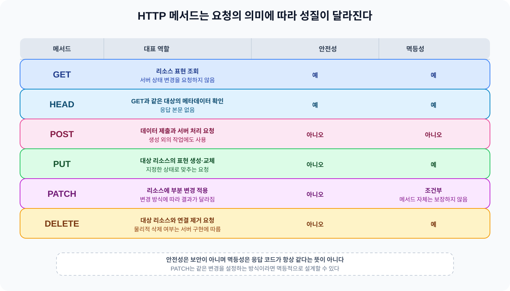
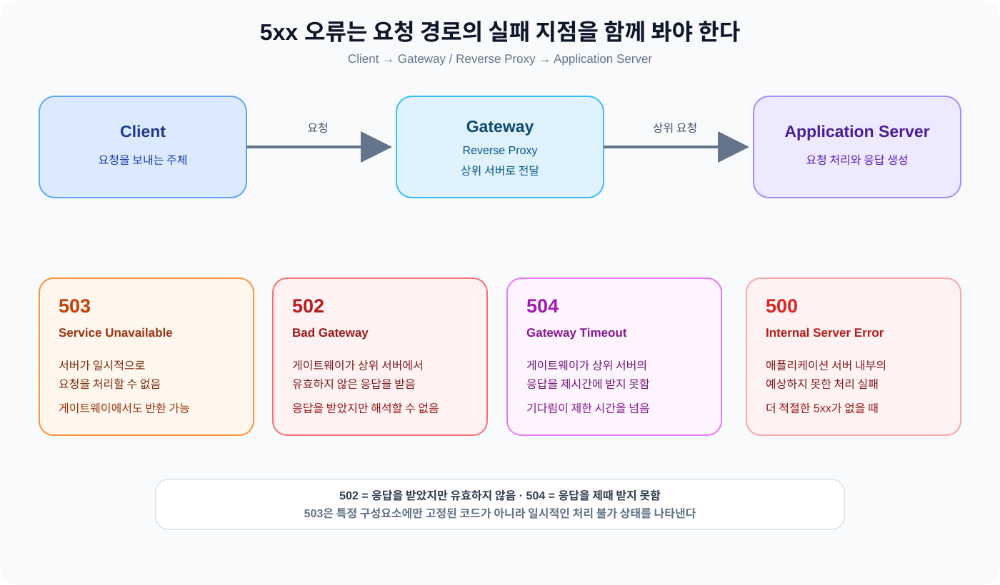

HTTP 요청은 서버에 무엇을 해 달라는 메시지이고 응답은 그 요청을 어떻게 처리했는지 알려주는 결과다. 그렇다면 요청에 어떤 작업을 원하는지와 처리 결과를 서버와 클라이언트는 어떤 규칙으로 주고받을까?

오늘은 Web 학습 과정에서 HTTP Request Methods와 HTTP Status Code를 한 흐름에 놓고 살펴봤다. 처음에는 메서드를 CRUD 명령으로 외우고 상태 코드는 성공과 실패를 나누는 숫자로 기억했다. 다시 보니 메서드는 요청의 의도를 표현하고 상태 코드는 그 요청을 처리한 결과를 구체적으로 알리는 역할에 가까웠다. 두 개념을 이어서 보면서 어디서 헷갈렸고 이해를 어떻게 고쳤는지 남겨 본다.

## 1. HTTP 메서드가 필요한 이유

이전에 HTTP와 웹의 기본 동작을 공부하면서 클라이언트가 서버에 요청을 보내고 서버가 응답을 돌려준다는 흐름을 이해했다. 이번에는 같은 URL을 요청하더라도 클라이언트가 무엇을 원하는지 서버에 어떻게 알려주는지가 궁금했다.

처음에는 GET은 조회, POST는 생성, PUT은 전체 수정, PATCH는 일부 수정, DELETE는 삭제 정도로 외웠다. API를 처음 접할 때는 유용한 출발점이다. 하지만 이 구분만 붙잡으면 POST를 생성에만 쓴다고 생각하거나 PUT을 데이터베이스의 전체 행을 무조건 덮어쓰는 동작으로 오해하기 쉽다.

HTTP 메서드는 대상 리소스에 어떤 의미의 요청을 보내는지 표현한다. 서버가 어떤 테이블을 읽거나 어떤 함수를 부를지는 HTTP가 정하지 않는다. 같은 POST라도 새 리소스를 만들거나 기존 표현에 데이터를 추가하거나 서버의 특정 처리를 요청한다. 서로 다른 메서드가 필요한 이유는 URL만으로 드러나지 않는 요청의 의도와 처리 규칙을 메시지에 함께 담기 위해서다.

## 2. HTTP 메서드는 요청의 의도를 표현한다

GET은 대상 리소스의 현재 표현을 요청한다. 사용자 목록을 가져오거나 특정 게시글을 조회하는 요청이 여기에 해당한다. 클라이언트가 서버 상태를 바꾸도록 요청하는 메서드는 아니므로 안전한 메서드로 분류된다.

HEAD는 GET과 같은 대상을 요청하지만 응답 본문 없이 헤더만 확인하는 메서드다. 파일의 크기나 수정 시점처럼 메타데이터만 확인하고 실제 내용을 전송받고 싶지 않을 때 사용한다. GET과 유사하지만 본문이 없다는 차이가 중요하다.

POST는 요청에 담긴 내용을 대상 리소스의 의미에 따라 처리해 달라는 메서드다. 새로운 리소스를 만들 때 자주 사용하지만 생성만을 뜻하지는 않는다. 서버에 데이터를 제출하거나 기존 리소스에 내용을 추가하거나 별도의 처리를 시작하는 요청도 POST로 표현한다.

PUT은 지정한 대상 리소스의 상태를 요청 내용으로 생성하거나 교체하려는 의도를 나타낸다. 클라이언트가 어느 리소스를 바꿀지 URI로 알고 있고 그 대상에 적용할 표현을 보낸다는 점에서 POST와 다르다.

PATCH는 리소스에 부분적인 변경을 적용하려는 메서드다. 이름만 바꾸거나 특정 설정 하나만 바꾸는 것처럼 전체 표현을 다시 보내지 않아도 되는 변경을 표현할 때 사용한다. 다만 PATCH가 어떤 변경 문법을 쓰는지와 그 변경이 여러 번 적용됐을 때 어떻게 되는지는 API 계약이 정한다.

DELETE는 대상 리소스와 현재 기능의 연결을 제거해 달라는 요청이다. HTTP 표준이 데이터베이스에서 실제 데이터가 반드시 물리적으로 삭제된다고 정하는 것은 아니다. 서버는 삭제 대신 보관 처리나 비활성화를 할 수도 있고 그 결과를 DELETE의 의미에 맞게 응답한다.

이 관점에서 메서드는 데이터베이스 작업 이름의 다른 표현이 아니다. 클라이언트가 어떤 리소스를 어떤 의도로 다루려는지 알려주는 공통 인터페이스다. 서버 내부 구현이 달라져도 요청과 응답의 의미를 일정하게 맞출 수 있다는 점에서 필요하다.

## 3. PUT과 PATCH는 무엇을 표현할까

PUT과 PATCH를 처음 공부할 때는 둘을 전체 수정과 일부 수정으로만 나누었다. API를 설계할 때 이 구분은 충분히 유용하지만 HTTP 표준의 의미까지 그 한 문장으로 줄이면 부족하다. PUT은 대상 리소스의 표현을 요청 내용으로 교체하는 의미이고 PATCH는 변경 작업을 적용하는 의미다.

다음과 같은 사용자 리소스가 있다고 가정한다.

~~~json
{
  "name": "Kim",
  "age": 25
}
~~~

이름만 `Lee`로 바꾸고 싶다면 PATCH는 변경할 필드만 요청에 담는다.

~~~http
PATCH /users/1
Content-Type: application/json

{
  "name": "Lee"
}
~~~

반면 PUT은 대상 리소스에 어떤 표현을 둘 것인지 보낸다는 의미가 강하다. 같은 변경을 PUT으로 표현한다면 리소스의 표현 전체를 보낸다.

~~~http
PUT /users/1
Content-Type: application/json

{
  "name": "Lee",
  "age": 25
}
~~~

여기서 PUT 요청에 필드 하나가 빠졌다고 서버가 항상 그 필드를 삭제하거나 기존 값을 유지한다고 정해져 있는 것은 아니다. 누락된 필드를 오류로 볼 수도 있고 기본값을 적용할 수도 있다. 어떤 표현을 완전한 리소스 상태로 볼지와 누락 필드를 어떻게 처리할지는 서버의 리소스 모델과 API 계약이 결정한다.

그래서 PUT과 PATCH의 차이는 변경 범위만이 아니다. PUT은 대상 리소스의 상태를 이 표현으로 교체하겠다는 요청이고 PATCH는 이 변경 작업을 적용하겠다는 요청이다. 이 차이를 알아야 클라이언트가 재시도나 요청 본문을 설계할 때 메서드의 특성을 고려한다.

## 4. 안전성과 멱등성은 보안과 응답 동일성이 아니다

이번 학습에서 가장 헷갈렸던 부분은 안전성이다. 처음에는 안전하다는 말을 보안이 잘 되어 있다는 뜻으로 이해했다. HTTP에서 안전성은 메서드의 정의상 클라이언트가 서버 상태를 바꾸도록 요청하지 않는 성질을 말한다.

안전한 메서드도 서버에 접근 로그를 남기거나 통계 수치를 갱신하는 부수 동작을 일으킬 수 있다. 이런 동작까지 전혀 없어야 하는 것은 아니다. 중요한 것은 클라이언트가 서버 상태 변경을 요청했는지가 기준이라는 점이다.

멱등성은 같은 요청을 한 번 보냈을 때와 여러 번 보냈을 때 서버에 의도된 효과가 같은 성질이다. 응답 본문이나 상태 코드가 매번 완전히 같아야 한다는 뜻은 아니다. RFC 9110도 멱등성을 요청의 의도된 효과를 기준으로 설명하고 요청 로그처럼 별도의 부수 효과는 매번 남을 수 있다고 구분한다.

GET은 안전하고 멱등적이다. PUT과 DELETE는 안전하지 않지만 멱등적이다. POST는 일반적으로 안전하지 않고 기본적으로 멱등성을 보장하지 않는다. PATCH도 메서드 자체가 멱등성을 보장하지 않는다. 예를 들어 `age`를 1 증가시키는 PATCH는 반복할 때마다 결과가 달라지지만 `name`을 특정 값으로 설정하는 PATCH는 API 설계에 따라 반복해도 같은 상태에 도달한다.

DELETE를 여러 번 요청하면 첫 번째 요청은 `204 No Content`를 반환하고 두 번째 요청은 `404 Not Found`를 반환하기도 한다. 그렇다고 바로 멱등성이 깨지는 것은 아니다. 첫 번째 요청 뒤 리소스가 없는 상태가 되었고 두 번째 요청 뒤에도 의도한 상태가 그대로라면 서버 상태에 대한 효과는 같다. 응답 코드의 동일성이 아니라 의도된 서버 상태의 결과를 비교해야 한다.

GET 요청 뒤에 접근 로그가 남는다고 해서 GET이 안전하지 않은 것도 아니다. 안전성과 멱등성은 보안 수준이나 서버에서 발생하는 모든 내부 동작을 한꺼번에 설명하는 단어가 아니다. 메서드가 표현하는 요청 의미를 기준으로 판단하는 성질이다.

*그림 1. HTTP 메서드는 요청의 의미에 따라 안전성과 멱등성이 달라진다. PATCH는 구현한 변경 방식에 따라 멱등적인 요청으로 설계할 수 있지만 메서드 자체가 이를 보장하지는 않는다.*

## 5. HTTP 상태 코드를 읽는 방법

HTTP 메서드가 클라이언트의 요청 의도를 나타낸다면 상태 코드는 서버가 요청을 처리한 결과를 나타낸다. 처음에는 `1xx`는 처리 중, `2xx`는 성공, `3xx`는 잘 모르겠고, `4xx`는 잘못된 요청, `5xx`는 서버 오류라고 단순하게 나누었다.

상태 코드는 특정 요청이 성공했는지만 표시하는 숫자가 아니다. 클라이언트가 다음에 무엇을 할지 판단할 수 있도록 처리 결과의 성격을 전달한다. 같은 GET이라도 조회에 성공할 수도 있고 리소스가 없을 수도 있으며 서버가 잠시 준비되지 않았을 수도 있다.

다섯 가지 범위는 다음과 같이 읽을 수 있다.

- `1xx Informational`: 요청을 계속 처리하는 중간 응답이다.
- `2xx Successful`: 요청을 성공적으로 처리했다.
- `3xx Redirection`: 다른 위치를 참조하거나 캐시된 결과를 사용하기 위해 추가 동작이 필요하다.
- `4xx Client Error`: 요청의 형식이나 인증·인가·리소스 상태 등 클라이언트 쪽 조건 때문에 처리하지 못했다.
- `5xx Server Error`: 서버가 요청을 처리하는 과정에서 실패했거나 상위 서버의 응답을 정상적으로 받지 못했다.

이 분류는 책임 소재를 단순히 나누는 표가 아니다. 4xx라도 API 계약에 따라 클라이언트가 요청을 고칠 수 있는 구체적인 정보를 담아야 하고 5xx라도 게이트웨이가 어느 상위 서버와 통신하다 실패했는지 확인해야 한다. 숫자를 외우기보다 어떤 상황을 다음 처리 주체에게 알려야 하는지 생각하는 편이 낫다.

## 6. 2xx 성공 응답은 성공의 모양을 나눈다

`200 OK`는 요청이 성공했다는 가장 일반적인 응답이다. 다만 성공의 의미는 메서드에 따라 달라진다. GET이라면 리소스 표현을 본문으로 보내며 HEAD라면 같은 조회에 대한 헤더만 보낸다. PUT이나 POST 뒤의 200은 처리 결과를 본문으로 설명하는 응답으로 사용한다.

`201 Created`는 요청의 결과로 새로운 리소스가 만들어졌다는 응답이다. POST에서 자주 사용하지만 특정 대상 URI에 새 표현을 만든 PUT에도 사용한다. 새로 만들어진 리소스의 URI를 `Location` 헤더로 알리는 경우가 많다.

`202 Accepted`는 요청을 받아 처리 대상으로 등록했지만 처리가 아직 끝나지 않았다. 다른 프로세스가 나중에 처리하는 작업이나 배치 처리에서 자주 떠올릴 만한 응답이다. 그렇다고 `202` 자체가 비동기 실행을 보장하는 것은 아니다. HTTP는 나중에 처리 결과를 자동으로 다시 보내는 방법을 제공하지 않으므로 클라이언트가 결과 조회 URI를 다시 요청하는 방식 등을 API가 별도로 정해야 한다.

`204 No Content`는 요청은 성공했지만 응답 본문으로 보낼 콘텐츠가 없는 성공 응답이다. 삭제가 완료되었거나 수정 결과를 본문으로 되돌려줄 필요가 없는 경우에 사용한다. `200`과 `204`의 차이는 성공 여부가 아니라 성공 결과를 응답 본문으로 전달할지에 있다.

## 7. 3xx는 다른 위치나 추가 동작을 알려준다

처음에는 `3xx`의 의미를 정확히 기억하지 못했다. 학습하면서 이 범위가 리다이렉션과 캐시된 결과 사용처럼 클라이언트가 현재 URI만 그대로 처리하지 않고 다른 동작을 고려해야 하는 응답이라는 점을 이해했다. 오늘은 리다이렉션과 관련된 네 가지 코드를 중심으로 봤다.

`301 Moved Permanently`는 리소스의 URI가 영구적으로 바뀐 경우이고 `302 Found`는 일시적인 이동이다. 두 응답 모두 `Location` 헤더로 이동할 URI를 알린다. 다만 301과 302의 역사적인 처리 관행 때문에 일부 사용자 에이전트는 POST를 리다이렉트하면서 GET으로 바꾸기도 한다.

`307 Temporary Redirect`와 `308 Permanent Redirect`는 각각 302와 301에 대응하는 임시·영구 이동이지만 리다이렉트할 때 원래 메서드를 유지해야 한다. POST로 보낸 요청이라면 POST로 다시 보내야 한다. 요청 본문을 가진 메서드를 다른 메서드로 바꿔도 되는지에 따라 서버가 선택해야 할 상태 코드가 달라지는 이유다.

리다이렉션에서 중요한 점은 이동한다는 단어만 기억하는 것이 아니다. 영구 이동인지 임시 이동인지와 요청 메서드를 보존해야 하는지를 함께 봐야 한다. 특히 상태 변경 요청을 자동으로 다시 보낼 수 있는지 신중하게 판단해야 한다.

## 8. 4xx는 요청을 고칠 지점을 알려준다

`400 Bad Request`는 잘못된 문법이나 메시지 형식처럼 서버가 요청 자체를 처리하기 어려운 경우에 사용한다. `400`이 모든 입력 검증 오류를 의미하는 것은 아니다. 요청이 어떤 단계에서 왜 처리되지 않았는지에 따라 더 구체적인 상태 코드를 선택할 수 있다.

`401 Unauthorized`는 이름과 달리 표준 의미상 인증되지 않은 상태에 가깝다. 서버가 요청 주체를 확인할 인증 정보가 없거나 유효하지 않아 인증이 필요한 상태다. `403 Forbidden`은 서버가 요청 주체를 파악했지만 해당 작업에 필요한 권한이 없어 거부하는 상황이다. 한쪽은 인증의 문제이고 다른 쪽은 인가의 문제로 나누어 보니 구분이 선명해졌다.

다만 보안상 리소스가 존재하는지 알려주지 않아야 한다면 서버는 `403` 대신 `404 Not Found`를 반환하기도 한다. 상태 코드만 보고 서버 내부의 모든 인증 흐름을 단정할 수는 없고 API의 보안 정책도 함께 봐야 한다.

`404 Not Found`는 요청한 리소스를 찾지 못한 경우다. `405 Method Not Allowed`는 리소스는 알고 있지만 해당 리소스에서 요청 메서드를 지원하지 않는 경우다. `405` 응답에는 그 리소스가 지원하는 메서드를 알려주는 `Allow` 헤더가 필요하다. 예를 들어 `Allow: GET, HEAD, PUT`처럼 클라이언트가 선택 가능한 메서드를 전달한다.

`409 Conflict`는 요청이 서버 리소스의 현재 상태와 충돌하는 경우에 사용한다. 이미 사용 중인 이름으로 변경하려 하거나 다른 변경과 동시에 같은 상태를 수정하려는 상황이 예가 될 수 있다. `422 Unprocessable Content`는 요청 형식은 이해했지만 내용의 의미상 지시를 처리할 수 없는 경우다. 문법이 깨진 요청과 의미상 허용되지 않는 요청을 나누어 설명할 때 도움이 된다.

그렇다고 `400`, `409`, `422`를 모든 API에 똑같이 적용하는 규칙으로 외우면 안 된다. 어떤 입력 오류를 400으로 묶을지, 현재 상태와의 충돌을 409로 표현할지, 의미 검증 실패를 422로 표현할지는 API 계약과 클라이언트가 오류를 어떻게 수정할지에 따라 정해야 한다.

## 9. 5xx는 요청 경로에서 실패한 지점을 찾게 한다

처음에는 `503 Service Unavailable`을 단순한 타임아웃 코드로 생각했다. 다시 요청 경로를 놓고 보니 `503`은 서버가 일시적으로 요청을 처리할 준비가 되지 않았다는 뜻이고 `504`는 게이트웨이나 프록시가 상위 서버의 응답을 정해진 시간 안에 받지 못한 경우에 가깝다.

`500 Internal Server Error`는 서버가 처리 중 예상하지 못한 문제를 만났지만 더 적절한 5xx 코드를 적용하기 어려운 일반적인 서버 오류다. 애플리케이션 내부의 예외나 처리 실패를 생각할 수 있지만 실제 원인은 로그와 추적 정보로 확인해야 한다.

`502 Bad Gateway`는 게이트웨이 또는 프록시가 상위 서버에 요청을 전달한 뒤 유효하지 않은 응답을 받은 상황이다. 애플리케이션 서버가 연결을 잘못 끊거나 프로토콜에 맞지 않는 응답을 보낸 경우처럼 게이트웨이가 응답을 해석하지 못하는 흐름을 떠올릴 수 있다.

`503 Service Unavailable`은 서버가 현재 요청을 처리할 준비가 되지 않은 상태다. 유지보수 중이거나 과부하가 걸린 경우처럼 일시적인 조건을 표현하며 애플리케이션 서버뿐 아니라 게이트웨이나 다른 요청 처리 서버가 반환하기도 한다. 회복 예상 시간을 알고 있다면 `Retry-After` 헤더를 함께 고려한다.

`504 Gateway Timeout`은 게이트웨이가 상위 서버의 응답을 기다렸지만 정해진 시간 안에 받지 못한 경우다. 그래서 502는 응답을 받았지만 유효하지 않았고 504는 제때 응답을 받지 못했다는 차이가 있다. 503은 특정 요청의 응답이 잘못되거나 늦었다는 의미보다 서버가 지금 요청을 받을 준비가 되었는지를 표현하는 코드다.

*그림 2. 500은 애플리케이션 처리 실패, 502는 게이트웨이가 받은 상위 서버 응답의 문제, 503은 일시적으로 요청을 처리할 수 없는 상태, 504는 게이트웨이가 상위 서버 응답을 제시간에 받지 못한 상황을 나타낸다.*

## 10. 메서드와 상태 코드는 함께 읽어야 한다

메서드만 보면 클라이언트가 무엇을 요청했는지 알 수 있고 상태 코드까지 보면 그 요청이 어떻게 끝났는지 알 수 있다. 같은 메서드라도 처리 결과에 따라 여러 상태 코드가 나올 수 있으므로 둘을 한 쌍으로 보는 편이 자연스럽다.

~~~http
GET /users/1
→ 조회 성공: 200 OK
→ 리소스 없음: 404 Not Found

POST /users
→ 생성 성공: 201 Created

DELETE /users/1
→ 삭제 성공, 응답 본문 없음: 204 No Content

PATCH /users/1
→ 변경 성공: 200 OK 또는 204 No Content
→ 리소스 상태 충돌: 409 Conflict
~~~

이 예시는 메서드와 상태 코드의 관계를 이해하기 위한 개념 설명이다. 실제 프로젝트에서 위 요청을 구현하거나 실행한 결과가 아니다. 특히 상태 코드는 HTTP 메서드만으로 결정되지 않는다. 서버가 실제로 무엇을 처리했는지와 API 계약에서 성공 결과를 어떤 형태로 전달하기로 했는지를 함께 고려해야 한다.

## 11. 이전 학습과 백엔드 개발에서 연결해 보기

브라우저는 HTML이나 이미지 같은 리소스를 가져올 때 HTTP 요청을 보낸다. 이번에 메서드를 공부하면서 브라우저가 요청의 목적을 GET이나 다른 메서드로 표현한다는 점을 더 구체적으로 볼 수 있었다. 응답을 받은 뒤에는 상태 코드에 따라 리소스를 사용하거나 리다이렉션을 따라가거나 오류를 표시한다.

이전 글에서 정리한 [Browser 동작 원리와 Cookie / Session](https://w00lam.github.io/posts/browser-cookie-session/)에서는 브라우저가 응답을 해석하고 Cookie와 Session으로 로그인 상태를 이어가는 흐름을 살펴봤다. 오늘은 그 요청과 응답 안에서 메서드는 요청의 의도를 나타내고 상태 코드는 처리 결과를 알린다는 부분을 보완했다. 인증 정보가 요청에 포함되어도 어떤 메서드로 무엇을 요청하는지와 그 결과를 어떤 코드로 응답하는지는 별도의 설계 문제다.

Java/Spring 백엔드에서는 Spring MVC가 HTTP 메서드별 요청 처리를 어노테이션으로 구분한다. `@GetMapping`, `@PostMapping`, `@PutMapping`, `@PatchMapping`, `@DeleteMapping`을 사용하면 URL만 보고 분기하는 것보다 API의 의도가 코드에 드러난다. `ResponseEntity`를 쓰면 성공 결과에 맞는 상태 코드와 헤더도 함께 명시한다.

다음은 오늘 개념을 코드에 연결해 보기 위한 짧은 예시다. 실제로 작성하거나 실행한 코드는 아니며, 생성 결과에 `201`과 `Location`을 함께 표현한다는 점만 보여준다.

~~~java
@RestController
@RequestMapping("/users")
class UserController {

    @GetMapping("/{id}")
    ResponseEntity<UserResponse> find(@PathVariable long id) {
        return ResponseEntity.ok(service.find(id));
    }

    @PostMapping
    ResponseEntity<UserResponse> create(@RequestBody CreateUserRequest request) {
        UserResponse created = service.create(request);
        URI location = URI.create("/users/" + created.id());
        return ResponseEntity.created(location).body(created);
    }
}
~~~

이 코드에서 중요한 것은 어노테이션을 많이 사용하는 데 있지 않다. GET과 POST를 구분해 요청의 의도를 표현하고 생성 결과에는 `201`과 새 리소스의 위치를 전달한다는 점이다. 수정이나 삭제에서도 처리 결과에 맞는 `200`, `204`, `409` 등을 골라야 클라이언트가 다음 동작을 판단하게 된다.

## 12. 오늘의 정리

- HTTP 메서드는 단순한 CRUD 명령이 아니라 대상 리소스에 대한 요청 의도를 나타낸다.
- 안전성은 보안과 같은 뜻이 아니고 멱등성은 응답이 항상 같다는 뜻이 아니다. 멱등성은 의도된 서버 효과를 기준으로 판단한다.
- PUT과 PATCH는 변경 범위뿐 아니라 요청이 표현하는 의미가 다르다. PUT은 표현의 교체를 요청하고 PATCH는 변경 작업을 적용한다.
- HTTP 상태 코드는 성공과 실패만 나누지 않는다. 요청 처리 결과가 무엇인지 클라이언트가 판단할 수 있도록 구체적인 정보를 전달한다.
- `401`과 `403`, `400`과 `422`, `502`와 `503`과 `504`처럼 비슷한 코드는 숫자보다 발생 원인을 기준으로 구분해야 한다.
- 백엔드 API를 설계할 때는 요청 메서드와 응답 상태 코드를 따로 정하지 말고 요청의 의도와 처리 결과를 함께 고려해야 한다.

처음에는 메서드 이름과 상태 코드 숫자를 외우는 데 집중했다. 학습을 이어 가면서 중요한 것은 GET이 몇 번 코드와 연결되는지보다 어떤 의도로 요청했고 서버가 어떤 결과를 돌려주었는지를 읽는 일이라는 점을 알게 됐다. 이 기준을 잡으면 PUT과 PATCH의 차이나 401과 403의 차이도 단순 암기보다 요청 흐름 속에서 이해할 수 있다.

### 관련 글

* [HTTP와 HTTPS — 웹 데이터는 어떻게 오가고 보호될까?](https://w00lam.github.io/posts/http-https-web-communication/) — HTTP 요청과 응답, HTTPS의 보호를 정리한 글
* [Browser 동작 원리와 Cookie / Session — 브라우저는 화면을 그리는데 로그인 상태는 어떻게 유지할까?](https://w00lam.github.io/posts/browser-cookie-session/) — 브라우저의 응답 처리와 로그인 상태 연결을 정리한 글

### 참고 자료 (Sources)

* **RFC Editor:** [RFC 9110 — HTTP Semantics](https://www.rfc-editor.org/rfc/rfc9110.html) — HTTP 메서드의 의미, 안전성과 멱등성, `Location`과 `Allow`, 주요 상태 코드의 정의를 확인했다.
* **MDN:** [HTTP request methods](https://developer.mozilla.org/en-US/docs/Web/HTTP/Reference/Methods) — GET, HEAD, POST, PUT, PATCH, DELETE의 역할과 메서드별 안전성·멱등성 분류를 확인했다.
* **MDN:** [HTTP response status codes](https://developer.mozilla.org/en-US/docs/Web/HTTP/Reference/Status) — 상태 코드의 다섯 가지 분류와 주요 2xx, 3xx, 4xx, 5xx 응답의 차이를 확인했다.
