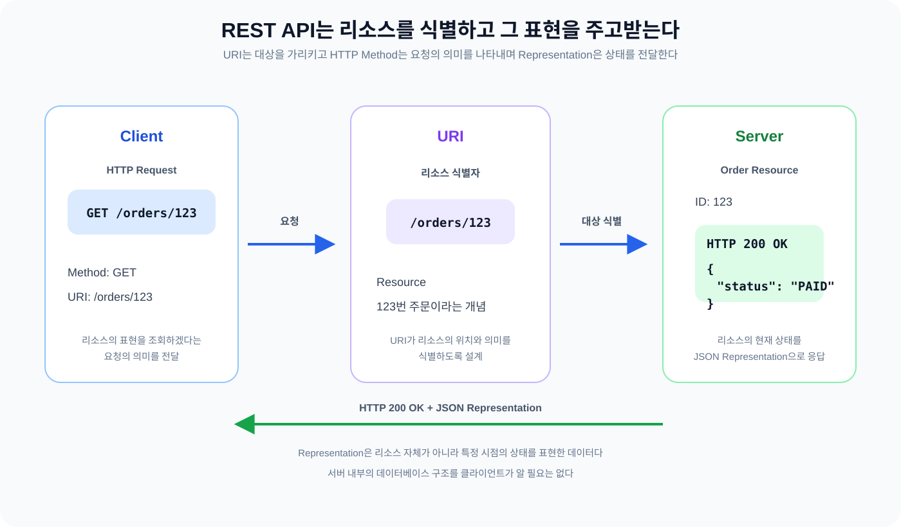
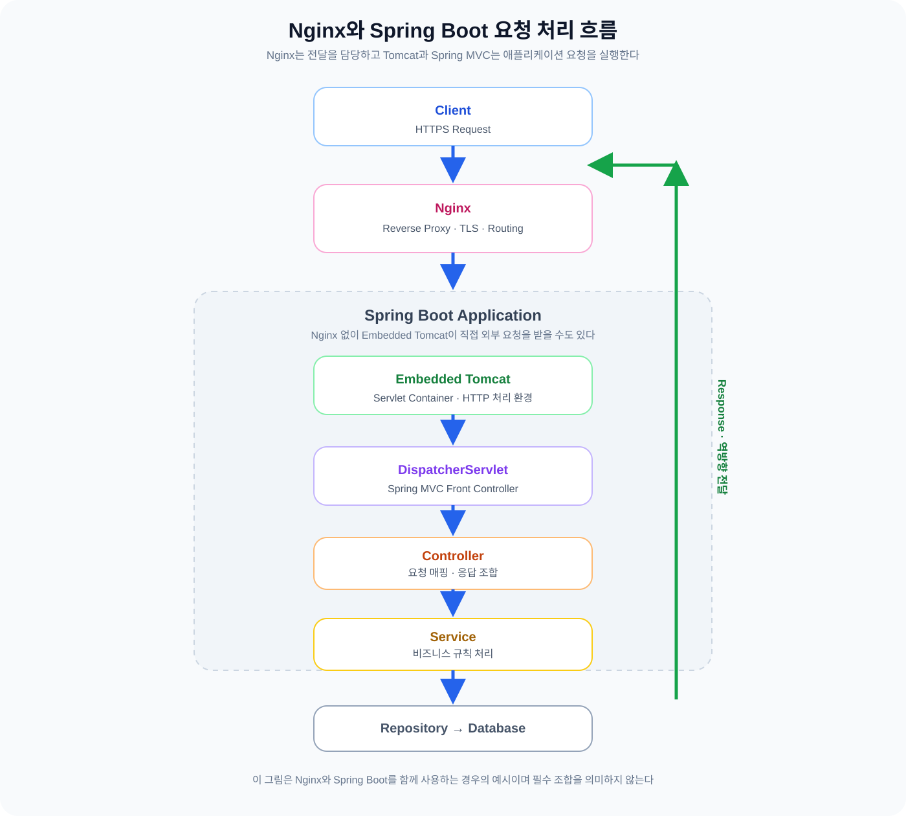

어제는 HTTP Request Methods와 HTTP Status Code를 공부하면서 클라이언트가 어떤 요청을 보내고 서버가 어떤 응답을 반환하는지 살펴봤다. 오늘은 그 흐름을 API 설계와 서버 내부의 요청 처리 구조까지 확장해 봤다. HTTP를 활용해 API를 설계하는 REST의 원칙과 클라이언트가 요청한 리소스를 표현하는 방법이 궁금했다.

웹 서버와 WAS가 요청을 나누어 처리하는 방식도 이어서 살펴봤다. Spring Boot에서 HTTP 요청이 어떤 경로로 Controller까지 도달하는지, Nginx와 WAS를 꼭 분리해야 하는지도 궁금했다. 정의를 외우는 데 그치지 않고 이런 구분이 왜 생겼는지, 실제 요청이 어떤 순서로 흘러가는지 이해하는 데 집중했다.

## 1. REST API

### 1.1 REST API란?

REST는 Representational State Transfer의 약자다. REST API는 REST라는 아키텍처 스타일의 제약 조건을 따르도록 설계한 API를 말한다. 따라서 REST API를 단순히 HTTP로 통신하는 API라고 설명하면 범위가 너무 넓다. HTTP를 사용하는 API라고 해서 모든 API가 RESTful한 것은 아니다.

오늘 처음에는 REST API를 애플리케이션끼리 통신하기 위한 규약이라고 이해했다. 이 표현은 HTTP API를 처음 접할 때는 도움이 되지만 REST의 핵심을 충분히 설명하지 못한다. REST는 특정 프레임워크나 프로토콜의 이름이 아니라 네트워크 기반 시스템을 설계할 때 적용하는 제약 조건의 모음이다.

제약 조건은 시스템을 일부러 복잡하게 만드는 규칙이 아니다. 클라이언트와 서버의 책임을 나누고, 요청을 서로 독립적으로 처리하며, 중간 구성요소도 메시지를 이해할 수 있게 한다. 그 결과 시스템의 일부를 교체하거나 확장하기 쉬워진다. 각 제약 조건이 필요한 이유를 함께 보면 다음과 같다.

- Client-Server: 사용자 화면과 데이터·기능에 대한 관심사를 나눈다. 클라이언트와 서버를 독립적으로 발전시킬 수 있어 한쪽의 변경이 다른 쪽 구현에 미치는 영향이 줄어든다.
- Stateless: 서버가 이전 요청에서 얻은 클라이언트 세션 상태에 기대지 않고 각 요청을 처리한다. 요청에 필요한 정보가 메시지에 담기므로 서버를 추가하거나 장애가 난 뒤 다른 서버가 요청을 이어받기 쉽다.
- Cacheable: 응답을 재사용해도 되는지 표시한다. 캐시 가능한 응답은 같은 요청을 매번 원본 서버까지 보내지 않아 네트워크 비용과 서버 부하를 줄인다.
- Uniform Interface: 리소스를 식별하고 표현으로 조작하며, 메시지 자체가 의미를 설명하고, 하이퍼미디어로 다음 전이를 안내하는 일관된 인터페이스를 사용한다. REST를 다른 네트워크 스타일과 구분하는 중심 제약이다.
- Layered System: 클라이언트가 중간 프록시나 게이트웨이의 단계와 내부 구조를 몰라도 되도록 계층을 나눈다. 보안, 캐시, 로드 밸런싱 같은 기능을 중간 계층에 둘 수 있다.
- Code on Demand: 서버가 클라이언트에 실행 가능한 코드를 내려 기능을 확장하는 선택적 제약이다. 모든 REST 시스템이 이 제약을 사용하는 것은 아니다.

Stateless와 Uniform Interface는 뒤에서 리소스와 요청 처리 흐름을 살펴볼 때 다시 등장한다. 두 단어의 정의만 외우기보다 요청을 만들고 서버가 그 요청을 해석하는 장면에 대입해 보는 편이 이해에 도움이 된다.

### 1.2 Resource, URI, Representation

REST를 공부할 때 가장 먼저 헷갈린 것은 Resource, URI, Representation이 서로 다른 역할을 가진다는 점이었다. 세 용어를 하나의 주문 데이터로 묶어 생각하지 않기 위해 다음 요청을 기준으로 나누어 봤다.

~~~http
GET /orders/123

HTTP/1.1 200 OK
Content-Type: application/json

{
  "id": 123,
  "status": "PAID"
}
~~~

이 요청에서 Resource는 123번 주문이라는 개념이다. 실제 주문 객체가 서버의 데이터베이스에 어떤 테이블로 저장되어 있는지는 여기서 드러나지 않는다. URI `/orders/123`은 그 주문을 가리키는 식별자다. HTTP Method `GET`은 식별한 대상의 표현을 조회하겠다는 의도를 담는다. 요청을 처리한 결과가 `200 OK`로 돌아왔다는 점도 함께 볼 수 있다.

응답 본문의 JSON은 주문 리소스 자체가 아니라 그 리소스의 상태를 표현한 결과다. 같은 주문을 XML로 표현할 수도 있고 다른 JSON 구조로 표현할 수도 있다. 어떤 형식을 사용할지는 요청의 `Accept` 헤더와 API 계약 같은 조건에 따라 결정된다. 리소스가 시간에 따라 달라질 수 있는 개념이라면 Representation은 특정 시점의 현재 상태나 서버에 반영하고 싶은 상태를 메시지로 옮긴 데이터다.

URI는 동작 이름보다 리소스를 중심으로 잡는 편이 일반적이다. `GET /orders/123`에서는 `/orders/123`이 주문을 식별하고 `GET`이 조회라는 뜻을 맡는다. `GET /getOrder?id=123`처럼 URI에 동작을 넣는 설계도 경우에 따라 동작한다. 그래도 URI는 대상, HTTP Method는 의도를 표현하도록 역할을 나누면 요청을 읽는 사람이 API의 의미를 더 빨리 파악한다.

### 1.3 Stateless와 Uniform Interface

Stateless를 처음에는 서버가 어떤 상태도 저장하지 않는다는 뜻으로 생각했다. 하지만 REST에서 말하는 Stateless는 서버에 데이터가 없어야 한다는 의미가 아니다. 서버는 주문 데이터, 사용자 정보, 세션 저장소 같은 상태를 보관한다.

이 내용을 기술적으로 풀면 다음과 같이 표현한다.

> 각 요청을 처리할 때 필요한 클라이언트의 세션 상태를 이전 요청에 의존하지 않는다.

서버가 요청을 이해하고 처리하는 데 필요한 정보가 현재 요청 안에 포함되어야 한다. 이전 요청을 처리한 서버 인스턴스가 메모리에 보관한 세션 정보가 있어야만 다음 요청을 처리해야 한다면, 요청 사이의 서버 측 컨텍스트에 의존하게 된다. 이 구조에서 서버를 여러 대로 늘리려면 세션을 공유하거나 같은 사용자를 같은 서버로 보내는 추가 장치가 필요하다.

여기서 Cookie와 Session을 함께 떠올리면 헷갈리는 부분이 생긴다. HTTP가 기본적으로 무상태라는 사실과 애플리케이션이 세션을 사용하는 것은 서로 모순처럼 보인다. 일반적인 세션 로그인에서는 브라우저가 Cookie에 세션 ID를 담아 보내고 서버는 그 ID로 Session을 조회한다. 각 요청에 세션 ID가 포함되어 서버가 필요한 상태를 찾는 구조라면, 요청 자체가 서버의 이전 기억에 의존해야만 의미를 갖는 방식과는 구분된다.

세션 기반 인증이 REST의 Stateless 제약을 언제나 완전히 만족한다고 단정하기도 어렵다. 서버의 세션 상태에 의존하는 상호작용은 REST를 엄격하게 적용한 의미와 긴장 관계에 있기 때문이다. 오늘은 Cookie와 Session의 구현 방식 자체보다, 요청 처리에 필요한 클라이언트의 세션 상태를 이전 요청의 암묵적인 기억에 맡기지 않는다는 뜻에 초점을 맞췄다.

Uniform Interface는 클라이언트와 서버가 일관된 인터페이스로 상호작용하도록 하는 제약이다. 자판기를 떠올리면 이해하기 쉽다. 사용자는 내부 모터나 재고 관리 로직을 몰라도 버튼과 결제 방법이라는 정해진 인터페이스로 음료를 구매한다.

다만 Uniform Interface를 내부 구현을 숨기는 일로만 설명하면 부족하다. REST가 말하는 일관된 인터페이스에는 다음 네 가지가 들어간다.

- 리소스 식별: URI로 어떤 리소스를 대상으로 하는지 알 수 있어야 한다.
- 표현을 통한 리소스 조작: 클라이언트는 리소스의 표현을 주고받으며 조회나 변경을 요청한다.
- 자기 서술적 메시지: Method, URI, 헤더, 미디어 타입과 본문이 메시지의 의미를 이해하는 데 필요한 정보를 제공한다.
- HATEOAS: 응답이 현재 애플리케이션 상태에서 가능한 다음 동작을 하이퍼미디어로 안내한다.

이 방식의 장점은 클라이언트가 서버 내부 클래스나 데이터베이스 구조를 몰라도 약속된 인터페이스를 사용하게 한다는 데 있다. 반대로 너무 일반적인 인터페이스를 쓰면 특정 애플리케이션에 최적화된 호출보다 효율이 떨어질 수 있다는 trade-off도 있다.

*그림 1. URI는 리소스를 식별하고 HTTP Method는 요청의 의미를 나타낸다. 서버는 리소스의 현재 상태를 Representation으로 만들어 응답한다.*

### 1.4 HATEOAS

HATEOAS는 Hypermedia as the Engine of Application State의 약자다. 클라이언트가 서버 응답에 포함된 하이퍼미디어 링크를 따라 현재 상태에서 가능한 다음 동작을 발견할 수 있도록 하는 제약이다.

주문을 예로 들면 주문의 상태에 따라 가능한 작업이 달라질 수 있다. 결제가 완료된 주문은 취소할 수 있지만 배송 중인 주문은 취소할 수 없다고 가정해 보자. 결제 완료 주문의 표현에 취소 링크를 포함하면 다음과 같이 나타낼 수 있다.

~~~json
{
  "id": 123,
  "status": "PAID",
  "_links": {
    "self": { "href": "/orders/123" },
    "cancel": { "href": "/orders/123/cancellation", "method": "PATCH" }
  }
}
~~~

배송 중인 주문에는 `self` 링크만 있거나 배송 조회처럼 현재 상태에서 허용된 링크만 포함한다.

~~~json
{
  "id": 123,
  "status": "SHIPPING",
  "_links": {
    "self": { "href": "/orders/123" },
    "tracking": { "href": "/orders/123/tracking", "method": "GET" }
  }
}
~~~

응답에 링크가 하나라도 있다고 HATEOAS를 구현했다고 보기는 어렵다. 단순한 `self` 링크는 현재 리소스의 위치를 다시 알려주는 정보일 수 있다. HATEOAS의 핵심은 현재 상태에서 가능한 전이를 서버가 표현하고, 클라이언트가 그 안내를 따라 다음 동작을 발견하게 하는 데 있다.

현실의 HTTP API가 REST API라고 불리더라도 HATEOAS까지 구현하지 않는 경우가 많다. URI와 HTTP Method, JSON 표현을 사용하는 API와 REST의 모든 제약 조건을 엄격하게 적용한 API를 같은 수준으로 부르지 않도록 구분할 필요가 있다.

### 1.5 HTTP Method와 REST API

어제 학습한 HTTP Method는 REST API에서 리소스에 수행할 작업의 의미를 표현하는 데 연결된다.

- GET: 리소스의 표현을 조회한다.
- POST: 대상 리소스의 의미에 따라 요청을 처리하거나 새로운 리소스 생성을 요청한다.
- PUT: 대상 URI의 리소스를 요청 표현으로 생성하거나 전체 교체하려는 의미를 나타낸다.
- PATCH: 리소스에 부분적인 변경을 적용하려는 의미를 나타낸다.
- DELETE: 대상 리소스와의 연결을 제거하려는 의미를 나타낸다.

PUT과 PATCH는 처음에는 전체 수정과 일부 수정으로만 나누었다. 이 구분은 출발점으로 쓸 수 있지만, PUT은 대상 리소스를 이 표현으로 맞추겠다는 의미가 강하고 PATCH는 변경 작업을 적용한다는 의미가 핵심이다. PUT 요청에 필드가 빠졌을 때 기존 값을 유지할지 삭제할지는 API 계약이 정한다. HTTP가 데이터베이스 행의 처리 방식을 대신 정해 주지는 않는다.

주문 생성에서도 두 메서드의 차이를 볼 수 있다. 클라이언트가 새 주문의 URI를 정할 수 없고 서버가 ID를 생성한다면 `POST /orders`로 컬렉션에 주문 생성을 요청하는 방식이 자연스럽다. 반대로 클라이언트가 대상 URI를 알고 있어 `/orders/123`의 표현을 그 상태로 만들겠다고 요청한다면 PUT의 의미에 가까워진다.

HTTP Method는 반환 데이터의 형태를 정하는 이름이 아니다. 같은 JSON을 반환하더라도 조회인지 생성인지 부분 변경인지에 따라 요청의 의미가 달라진다. 메서드와 URI를 함께 읽어야 클라이언트가 무엇을 요청했는지 제대로 이해하게 된다.

### 1.6 REST API와 비즈니스 규칙

HTTP Method가 PATCH라고 해서 서버가 모든 상태 변경을 허용하는 것은 아니다. 주문 상태 변경은 API의 모양보다 비즈니스 규칙에 따라 결정된다.

- 결제 완료 → 주문 취소 가능
- 배송 중 → 주문 취소 불가능

배송 중인 주문에 취소 요청이 도착하면 서버는 현재 주문 상태를 확인하고 변경을 거부해야 한다. 이때 사용자의 권한이 부족한 상황이 아니라 현재 리소스 상태가 요청과 충돌한 상황이라면 `409 Conflict`가 더 자연스러운 표현이 될 수 있다. 반면 인증된 사용자가 해당 주문을 취소할 권한이 없다면 `403 Forbidden`을 검토한다. 두 상태 코드는 모두 요청을 거부할 수 있지만 원인이 권한인지 리소스 상태와의 충돌인지가 다르다.

동일한 좌석에 여러 사용자가 동시에 예약을 요청하는 상황도 같은 방식으로 봐야 한다. URI와 Method를 REST 원칙에 맞게 설계해도 두 요청이 같은 좌석을 차지하려는 경쟁 자체가 사라지지는 않는다. 캐시도 이미 처리된 요청을 재사용하거나 응답 전송을 줄이는 기능이지 중복 요청과 동시성 문제를 자동으로 해결하는 장치는 아니다. 좌석의 정합성을 보장하려면 별도의 트랜잭션 경계나 락 같은 동시성 제어가 필요하다.

REST API는 요청의 대상을 표현하고 의미를 전달하는 인터페이스다. 리소스의 변경 가능 여부, 사용자 권한, 동시성으로 인한 충돌은 서버가 가진 비즈니스 규칙과 데이터 정합성의 문제다. API 설계만으로 모든 애플리케이션 문제를 해결할 수 있다고 생각하지 않기로 했다.

## 2. Web Server / WAS

### 2.1 Web Server와 WAS의 차이

두 번째 주제는 Web Server와 WAS다. 처음에는 “웹 서버는 HTTP 요청을 처리하고 WAS는 애플리케이션 로직을 처리한다”라고 구분했다. 출발점으로는 괜찮지만 기능을 너무 딱 잘라 나눈 설명이었다.

Web Server는 HTTP 요청과 응답을 처리하고 HTML, CSS, JavaScript, 이미지 같은 정적 리소스를 제공한다. 설정에 따라 요청을 다른 서버로 전달하는 프록시 역할도 맡는다. 대표적인 예가 Nginx다.

WAS는 애플리케이션 실행 환경을 제공하고 요청에 따라 서버 측 애플리케이션이 실행되도록 지원한다. 데이터베이스 조회나 비즈니스 규칙 적용처럼 요청마다 결과가 달라지는 처리는 WAS에서 실행되는 애플리케이션 코드와 연결된다. Tomcat은 Servlet을 실행할 환경을 제공하는 대표적인 서블릿 컨테이너다.

웹 서버와 WAS의 기능이 완전히 갈라지는 것은 아니다. Tomcat도 HTTP 연결을 받아 Servlet으로 요청을 전달하므로 WAS가 HTTP 요청을 직접 처리한다. Nginx와 Tomcat을 함께 두는 것은 역할을 나누는 선택이지, 둘 중 하나만 HTTP를 처리한다는 뜻은 아니다.

### 2.2 정적 콘텐츠와 동적 콘텐츠

정적 콘텐츠는 요청이 들어올 때마다 애플리케이션 로직을 실행하지 않고 파일이나 미리 준비된 데이터를 제공하는 리소스다. HTML, CSS, JavaScript, 이미지 파일이 예다.

동적 콘텐츠는 요청 정보나 애플리케이션 상태에 따라 처리 결과가 달라질 수 있는 콘텐츠다. 사용자 정보 조회, 주문 상태 조회, 데이터베이스 조회 결과를 이용한 JSON 응답이 여기에 해당한다.

여기서 중요한 기준은 파일 확장자가 아니다. JSON 파일을 그대로 읽어 반환하면 정적 콘텐츠가 될 수 있고, HTML 템플릿을 사용자 정보에 맞춰 렌더링하면 동적 콘텐츠가 된다. 어떤 리소스가 정적인지 동적인지는 요청을 처리할 때 별도의 애플리케이션 로직과 데이터 조회가 필요한지로 구분하는 편이 정확하다.

### 2.3 Spring Boot와 내장 Tomcat

Spring Boot를 공부하면서 Tomcat이 비즈니스 로직까지 직접 실행한다고 생각했던 부분도 수정했다. Spring Boot는 애플리케이션이 실행되도록 자동 설정과 의존성 구성을 제공한다. Servlet 기반 웹 애플리케이션을 실행할 때는 내장 Tomcat 같은 Servlet Container가 함께 구성된다. 그래서 외부 Tomcat을 따로 설치하지 않아도 애플리케이션이 HTTP 요청을 받는다.

각 구성요소의 역할을 나누면 다음과 같다.

- Spring Boot: 애플리케이션 실행과 자동 설정을 돕고 Spring MVC와 내장 웹 서버를 구성한다.
- Embedded Tomcat: 포트를 열고 HTTP 요청을 받아 Servlet이 실행될 수 있는 Servlet Container 환경을 제공한다.
- Servlet: Servlet 규약에 맞춰 HTTP 요청과 응답을 처리하는 자바 웹 구성요소다.
- DispatcherServlet: Spring MVC의 Front Controller로서 요청을 해석하고 알맞은 핸들러를 찾도록 조정한다.
- Controller: 매핑된 요청을 받아 애플리케이션의 다음 계층을 호출하고 응답으로 반환할 값을 만든다.

클라이언트가 요청을 보내면 내장 Tomcat이 먼저 연결을 수락하고 HTTP 요청을 읽는다. 그 요청은 Servlet인 DispatcherServlet으로 전달된다. DispatcherServlet은 URI와 HTTP Method를 보고 매핑된 핸들러를 찾은 다음 Path Variable이나 요청 본문 같은 값을 메서드 인자로 준비한다. 이후 Controller 메서드를 호출하고, Controller는 Service를 호출해 비즈니스 로직을 실행한다. 반환된 값은 Spring MVC가 응답 표현으로 바꾸며 DispatcherServlet과 Tomcat을 지나 다시 클라이언트에 도착한다.

~~~java
@GetMapping("/orders/{id}")
public OrderResponse getOrder(@PathVariable Long id) {
    return orderService.findById(id);
}
~~~

이 코드는 개념을 설명하기 위한 예시이며 실제 프로젝트 코드가 아니다. 핵심은 `@GetMapping`으로 등록된 Controller 메서드가 HTTP 요청과 연결된다는 점이다. Tomcat이 `orderService.findById(id)`를 직접 실행하는 것이 아니다. Tomcat은 Servlet 실행 환경을 제공하고 DispatcherServlet이 Spring MVC의 요청 처리를 조정하며 Controller와 Service가 애플리케이션 로직을 담당한다.

### 2.4 Nginx와 Reverse Proxy

Nginx를 애플리케이션 앞에 배치하면 클라이언트의 HTTP 요청을 받아 설정에 따라 백엔드 서버로 전달한다. 이 역할을 Reverse Proxy라고 한다. Nginx는 요청을 지정한 백엔드로 보내고 응답을 받아 다시 클라이언트에게 전달한다.

Spring Boot 애플리케이션과 함께 사용하는 경우의 흐름은 다음처럼 그릴 수 있다.

~~~text
Client
  → Nginx
  → Spring Boot / Embedded Tomcat
  → DispatcherServlet
  → Controller
  → Service
  → Response
~~~

Nginx는 외부 요청을 어디로 전달할지 결정하고 HTTPS 연결을 종료하거나 정적 파일을 제공한다. 설정에 따라 경로별 요청을 라우팅하고 여러 백엔드 인스턴스로 요청을 분산하는 것도 가능하다. 반면 주문 조회나 권한 판단처럼 애플리케이션의 의미를 이해해야 하는 비즈니스 로직은 Spring Boot 애플리케이션이 처리한다.

Nginx를 추가한다고 성능이 무조건 좋아지는 것은 아니다. 프록시 계층은 라우팅과 TLS 처리와 부하 분산에 도움을 주지만, 구성과 네트워크 홉과 운영 대상도 늘린다. 추가하기 전에 해결하려는 문제가 무엇인지부터 확인해야 한다.

*그림 2. Nginx와 Spring Boot를 함께 사용하는 경우의 예시다. Nginx는 Reverse Proxy로 요청을 전달하고, Tomcat과 Spring MVC는 애플리케이션 요청을 실행한다. 두 구성요소를 반드시 함께 사용해야 한다는 뜻은 아니다.*

### 2.5 Web Server와 WAS를 반드시 분리해야 할까?

웹 서버와 WAS를 분리하는 구성이 흔하다는 이유로 항상 그렇게 해야 한다고 생각했다. 하지만 Spring Boot 애플리케이션은 내장 Tomcat으로 외부 HTTP 요청을 직접 받는다. 단일 인스턴스에서 정적 파일 제공이나 HTTPS 종료, 별도 라우팅, 여러 백엔드로의 부하 분산이 필요하지 않다면 Nginx 없이 시작하는 선택도 충분히 가능하다.

그렇다고 단일 인스턴스에서는 Nginx가 필요 없다고 결론 내릴 수는 없다. HTTPS 연결을 앞단에서 종료해야 할 수도 있고, 백엔드 포트를 인터넷에 직접 노출하지 않으려 할 수도 있다. `/api`와 정적 파일을 서로 다른 곳으로 보내거나, 나중에 백엔드 인스턴스를 늘릴 계획이 있다면 Nginx의 역할이 생긴다. 인증서를 어디서 관리할지와 정적 리소스를 어디에서 제공할지도 함께 확인해야 한다.

“웹 서버와 WAS는 반드시 분리해야 한다”를 규칙으로 외우지 않기로 했다. 현재 요구사항과 운영 복잡도를 비교해 필요한 구성요소만 선택하는 편이 중요하다. 기술을 하나 더 넣는다고 좋은 설계가 되는 것은 아니며, 그 기술이 해결할 문제가 분명한지가 기준이다.

### 2.6 Reverse Proxy와 운영 설정

Nginx를 앞단에 배치하면 애플리케이션 코드 외에도 요청 경로를 운영하는 설정이 생긴다. 외부에 공개할 포트와 Nginx가 백엔드로 전달할 주소를 정하고, 백엔드가 정상적으로 응답하는지 확인하는 Health Check와 연결·응답 Timeout을 고려해야 한다. 여러 인스턴스를 둔다면 장애가 난 인스턴스를 분산 대상에서 제외하는 처리도 필요하다.

컨테이너 환경에서는 `localhost`를 특히 조심해야 한다. 각 컨테이너의 `localhost`는 다른 컨테이너가 아니라 해당 컨테이너 자신을 가리킨다. Nginx 컨테이너에서 `localhost:8080`으로 요청하면 Nginx 컨테이너 안의 8080 포트를 찾게 된다. 같은 Docker Compose 네트워크에 있는 Spring Boot 서비스에 접근할 때는 서비스 이름과 컨테이너가 실제로 열어 둔 포트를 사용해야 한다.

특정 Docker Compose 파일이나 프로젝트 설정은 분석하지 않고 개념 수준에서만 정리했다. Reverse Proxy가 요청을 전달하는 구조를 먼저 이해해야 포트, Timeout, Health Check, 컨테이너 네트워크 설정이 각각 어느 구간을 제어하는지 구분할 수 있기 때문이다.

## 3. 오늘 학습하면서 수정한 이해

REST API는 처음에 HTTP로 애플리케이션끼리 통신하는 규약이라고 생각했다. 이제는 그 설명이 HTTP API의 일반적인 모습을 말할 뿐 REST를 정의하지는 않는다고 본다. HTTP를 쓴다는 사실만으로 REST 제약 조건을 만족하는 것은 아니다. REST는 Client-Server, Stateless, Cacheable, Uniform Interface, Layered System 같은 제약 조건으로 시스템의 상호작용 방식을 정하는 아키텍처 스타일이다. URI와 HTTP Method를 정하는 데서 끝나지 않고 리소스 식별, 표현, 자기 서술적 메시지, 상태 전이까지 함께 살펴야 한다.

Stateless도 서버에 어떤 상태도 저장하지 않는다는 뜻으로 오해했다. 지금은 각 요청이 이전 요청에서 유지한 클라이언트의 세션 상태에 기대지 않고 처리될 수 있어야 한다고 설명한다. Cookie와 Session을 연결할 때도 브라우저가 세션 ID를 보내는 흐름과 서버가 세션 상태를 보관하는 사실을 따로 본다. 세션 데이터를 저장한다는 이유만으로 요청이 무조건 Stateful해진다고 단정하지 않으려는 이유도 여기에 있다.

Web Server와 WAS는 웹 서버가 HTTP를 처리하고 WAS가 애플리케이션 로직만 처리한다고 나누었다. 지금은 두 구성요소의 주된 역할은 다르지만 경계가 절대적인 것은 아니며 WAS도 HTTP 요청을 직접 받을 수 있다고 이해한다. Spring Boot가 내장 Tomcat을 사용하면 외부 웹 서버 없이 애플리케이션을 실행할 수 있고, Nginx는 HTTPS 종료나 라우팅이나 부하 분산 같은 요구사항이 있을 때 앞단에 선택적으로 둘 수 있다.

Tomcat과 Spring MVC도 같은 역할로 묶지 않는다. Tomcat은 Servlet이 실행되는 환경을 제공하고 DispatcherServlet은 Spring MVC에서 요청 처리를 조정한다. Controller와 Service가 실제 애플리케이션 로직을 담당한다는 흐름까지 나누어 보니, 요청이 어느 계층에서 처리되는지 더 선명해졌다.

## 4. 이전 학습과 연결해 보기

이전 [Browser 동작 원리와 Cookie / Session](https://w00lam.github.io/posts/browser-cookie-session/)에서 브라우저가 HTTP 요청을 보내고 응답을 해석하는 흐름과 로그인 상태가 요청 사이에 이어지는 방식을 공부했다. 오늘은 그 요청이 REST API에서 리소스와 표현으로 어떻게 설명되는지, Stateless를 이해할 때 Cookie와 Session을 어떤 관점에서 구분해야 하는지 연결했다.

어제 정리한 [HTTP Request Methods와 Status Code](https://w00lam.github.io/posts/http-methods-status-codes/)에서는 Method가 요청의 의도를, Status Code가 처리 결과를 나타낸다는 점을 살펴봤다. 오늘은 그 개념을 REST API 설계에 연결해 GET, POST, PUT, PATCH, DELETE가 리소스와 어떤 의미로 결합하는지 다시 확인했다. 주문 상태와 권한의 차이를 보면서 `403 Forbidden`과 `409 Conflict`도 원인에 맞게 구분해야 한다는 점을 이어서 정리했다.

Spring MVC의 내부 요청 흐름은 [Spring MVC HTTP 요청 처리 흐름 — DispatcherServlet부터 Jackson까지](https://w00lam.github.io/posts/spring-mvc-http-request-flow/)에서 따로 정리한 내용과 이어진다. 오늘은 그 흐름을 Tomcat과 Nginx까지 확장했다. 브라우저에서 출발한 요청이 어디에서 HTTP로 받아지고, 어느 지점에서 Spring MVC의 Controller와 Service로 넘어가는지 한 단계 넓게 보았다.

## 5. 오늘의 정리

- REST API는 HTTP를 사용하는 것만으로 완성되지 않는다. 리소스와 표현을 구분하고 REST의 제약 조건을 함께 이해해야 한다.
- URI는 리소스를 식별하고 HTTP Method는 리소스에 수행하려는 작업의 의미를 나타낸다. 응답 JSON은 리소스 자체가 아니라 리소스를 표현한 데이터다.
- Stateless는 서버가 데이터를 전혀 저장하지 않는다는 의미가 아니다. 각 요청이 이전 요청에서 유지한 클라이언트의 세션 상태에 기대지 않고 처리되어야 한다.
- HATEOAS는 응답에 링크가 있다는 사실보다 현재 상태에서 가능한 다음 전이를 서버가 안내하는 데 의미가 있다. REST라고 부르는 모든 HTTP API가 HATEOAS를 구현하는 것은 아니다.
- Web Server와 WAS는 역할이 다르지만 반드시 별도 프로세스나 별도 서버로 구성해야 하는 것은 아니다. WAS도 HTTP 요청을 직접 처리한다.
- Spring Boot는 내장 Tomcat으로 애플리케이션을 실행한다. Tomcat은 Servlet 실행 환경을 제공하고 DispatcherServlet은 Spring MVC의 요청 처리를 조정한다.
- Nginx를 사용하면 요청 전달, HTTPS 종료, 라우팅, 부하 분산 같은 역할을 분리할 수 있지만 관리 대상과 설정 복잡도도 늘어난다.
- 기술을 추가할 때는 단일 인스턴스인지 아닌지만 보지 말고 실제 요구사항과 운영 복잡도를 함께 비교해야 한다.

REST API와 Web Server / WAS를 따로 외우기보다 하나의 요청이 리소스로 식별되고 표현으로 전달되며, 서버 안에서는 웹 실행 환경과 애플리케이션 로직을 거쳐 처리되는 흐름으로 연결해 보았다. HTTP를 사용한다고 REST가 되는 것도 아니고, 웹 서버와 WAS를 나눈다는 관습만으로 Nginx가 필요한 것도 아니다. API의 의미와 요청 처리 책임, 운영 환경의 요구사항을 함께 보고 판단해야 한다는 점이 오늘의 결론이다.

### 관련 글

* [Browser 동작 원리와 Cookie / Session — 브라우저는 화면을 그리는데 로그인 상태는 어떻게 유지할까?](https://w00lam.github.io/posts/browser-cookie-session/) — 브라우저의 HTTP 요청과 Cookie / Session 흐름을 정리한 글
* [HTTP Request Methods와 Status Code — 요청의 의도와 처리 결과는 어떻게 전달될까?](https://w00lam.github.io/posts/http-methods-status-codes/) — HTTP Method와 Status Code의 의미를 정리한 글
* [Spring MVC HTTP 요청 처리 흐름 — DispatcherServlet부터 Jackson까지](https://w00lam.github.io/posts/spring-mvc-http-request-flow/) — Spring MVC 내부의 요청 처리 흐름을 정리한 글

### 참고 자료 (Sources)

* **Roy Fielding:** [Architectural Styles and the Design of Network-based Software Architectures](https://ics.uci.edu/~fielding/pubs/dissertation/top.htm) — REST의 아키텍처 스타일과 Client-Server, Stateless, Cache, Uniform Interface, Layered System, Code on Demand 제약을 설명할 때 활용했다.
* **MDN:** [REST](https://developer.mozilla.org/en-US/docs/Glossary/REST) — REST의 기본 의미와 일반적인 HTTP API가 모든 REST 제약을 만족하지는 않는다는 점을 확인했다.
* **MDN:** [Client-server overview](https://developer.mozilla.org/en-US/docs/Learn_web_development/Extensions/Server-side/First_steps/Client-Server_overview) — 서버가 동적 요청을 처리하는 기본 흐름과 정적·동적 콘텐츠를 설명할 때 활용했다.
* **Spring Boot Reference:** [Servlet Web Applications](https://docs.spring.io/spring-boot/reference/web/servlet.html) — Spring Boot의 Servlet 기반 웹 애플리케이션과 내장 Servlet Container 지원을 확인했다.
* **Spring Framework Reference:** [DispatcherServlet](https://docs.spring.io/spring-framework/reference/web/webmvc/mvc-servlet.html) — DispatcherServlet이 Front Controller로서 Spring MVC 요청 처리를 조정하는 구조를 설명할 때 활용했다.
* **NGINX Documentation:** [NGINX Reverse Proxy](https://docs.nginx.com/nginx/admin-guide/web-server/reverse-proxy/) — Reverse Proxy가 요청을 백엔드로 전달하고 응답을 다시 클라이언트에 보내는 흐름과 부하 분산 가능성을 확인했다.
