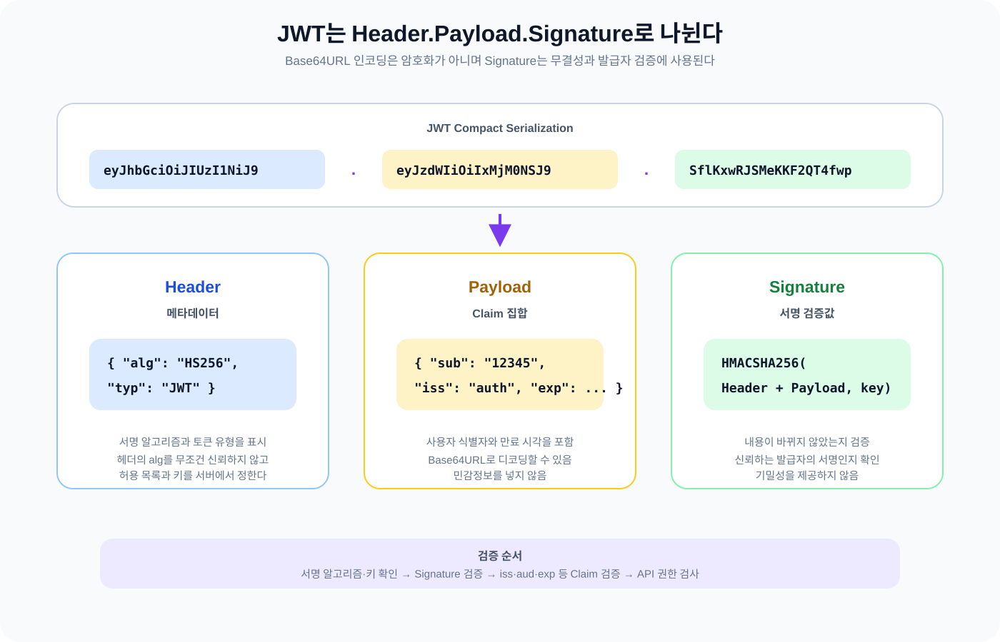
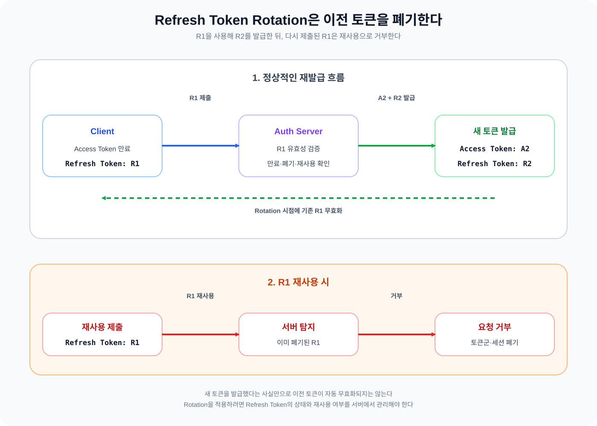

어제는 REST API와 Web Server / WAS를 공부하면서 클라이언트의 요청이 리소스로 해석되고 서버 안에서 애플리케이션 로직으로 이어지는 흐름을 살펴봤다. 오늘은 그 요청을 보낸 사용자가 누구인지, 외부 서비스가 가진 권한을 우리 애플리케이션에 어떻게 맡길 수 있는지까지 범위를 넓혔다.

OAuth와 JWT는 로그인 과정에서 함께 등장하는 경우가 많다. 그래서 처음에는 두 기술이 모두 로그인 처리를 담당한다고 생각하기 쉬웠다. 하지만 OAuth는 외부 리소스에 대한 권한 위임을 다루고 JWT는 인증 정보를 전달하고 검증하는 토큰 형식이다. 오늘은 두 기술이 어떤 문제를 나누어 해결하는지, 실제 요청 흐름에서 어떻게 연결되는지를 중심으로 공부했다.

## 1. OAuth

### 1.1 OAuth가 필요한 이유

사용자가 Google 계정으로 어떤 애플리케이션에 로그인하는 상황을 생각해 봤다. 애플리케이션이 Google의 아이디와 비밀번호를 직접 받아 보관한다면 사용자는 자신의 계정 정보를 제3자에게 맡겨야 한다. 애플리케이션이 비밀번호를 안전하게 보관하지 못하거나 다른 목적으로 사용하면 피해가 커진다.

OAuth는 이런 방식 대신 사용자의 비밀번호를 애플리케이션에 전달하지 않고 제한된 접근 권한을 위임하도록 한다. 사용자는 Google에서 로그인과 동의를 진행하고 애플리케이션은 허용된 범위의 리소스만 요청한다. OAuth 2.0이 제3자 애플리케이션에 HTTP 서비스의 제한된 접근 권한을 부여하는 프레임워크라는 설명도 이 흐름과 이어진다.

처음에는 OAuth를 사용자 인증 프로토콜이라고 생각했다. 하지만 인증(Authentication)은 사용자가 누구인지 확인하는 과정이고 인가(Authorization)는 특정 리소스에 접근할 권한이 있는지 확인하는 과정이다. OAuth의 중심은 사용자의 비밀번호를 확인하는 데 있지 않고 리소스 접근 권한을 위임하는 데 있다.

소셜 로그인에서는 외부 서비스와 연동해 사용자의 신원을 확인하고 애플리케이션의 로그인 상태를 만들 수 있다. 다만 OAuth 자체와 사용자 인증을 위한 OpenID Connect를 같은 것으로 설명하면 안 된다. 오늘은 OAuth의 권한 위임 흐름과 그 결과를 자체 서비스의 인증으로 연결하는 일반적인 설계에 집중했다.

### 1.2 OAuth의 주요 구성요소

OAuth에는 다음 네 가지 역할이 등장한다.

- Resource Owner: 리소스의 소유자다. Google 계정을 사용하는 사용자에 해당한다.
- Client: 외부 서비스의 리소스에 접근하려는 애플리케이션이다.
- Authorization Server: 사용자의 로그인과 동의를 처리하고 Authorization Code나 Access Token을 발급한다.
- Resource Server: Access Token을 확인한 뒤 허용된 리소스를 제공한다.

Authorization Server와 Resource Server는 같은 서비스 제공자가 운영하는 경우가 있다. 그래도 둘의 책임은 나누어 봐야 한다. Authorization Server는 어떤 권한을 허용할지 결정하고 토큰을 발급한다. Resource Server는 전달받은 토큰을 검증한 뒤 실제 사용자 정보나 보호된 API 응답을 제공한다.

### 1.3 Authorization Code Grant

Authorization Code를 사용하는 전체 흐름을 Google 로그인을 예로 정리했다.

1. 사용자가 애플리케이션에서 Google 로그인을 요청한다.
2. 브라우저가 Google의 Authorization Server로 이동한다.
3. 사용자가 Google에서 로그인하고 애플리케이션이 요청한 권한에 동의한다.
4. Google이 등록된 Redirect URI로 Authorization Code를 전달한다.
5. 애플리케이션이 Authorization Code를 사용해 토큰 교환을 요청한다.
6. Authorization Server가 Access Token을 발급한다.
7. 애플리케이션이 Access Token으로 Resource Server에 사용자 정보를 요청한다.

브라우저 리다이렉트 단계에서 Access Token을 바로 전달하지 않고 Authorization Code를 먼저 전달하는 이유가 궁금했다. 처음에는 이 구조를 세션 하이재킹과 직접 연결했다. 더 정확하게는 브라우저가 받은 짧은 수명의 코드를 별도의 토큰 교환 단계에서 검증하는 구조다. Authorization Code는 보호된 API를 호출하는 Access Token이 아니며, 토큰 교환을 위한 일회성에 가까운 중간 자격 증명으로 이해했다.

인가 코드가 탈취되면 공격자가 토큰 교환을 시도하기도 한다. 그래서 Authorization Code Grant만 보는 것으로 충분하지 않고 Redirect URI 검증과 PKCE 같은 추가 보호도 함께 봐야 한다.

*그림 1. 브라우저에는 Authorization Code가 돌아오고 Client는 이 코드를 토큰 교환에 사용한다. 발급된 Access Token은 Resource Server에 사용자 정보를 요청할 때 사용한다.*

### 1.4 OAuth 보안: State와 PKCE

State와 PKCE는 모두 OAuth 흐름을 보호하지만 해결하려는 문제가 다르다.

State는 클라이언트가 시작한 인가 요청과 Redirect URI로 돌아온 응답을 연결하는 값이다. 클라이언트가 만든 요청에 대한 응답인지 확인할 수 있어 로그인 CSRF와 같은 위험을 줄이는 데 도움이 된다. State를 사용한다고 Authorization Code 자체의 탈취 문제가 해결되는 것은 아니다.

PKCE는 Authorization Code가 가로채인 상황에서 공격자가 코드만으로 토큰을 발급받기 어렵게 한다. 클라이언트는 임의의 `code_verifier`를 만들고 그 값에서 `code_challenge`를 계산한다. 인가 요청에는 `code_challenge`를 보내고 토큰 교환 요청에는 원래의 `code_verifier`를 제출한다. Authorization Server는 두 값이 올바른 관계인지 검증한다.

따라서 코드를 가로챈 공격자가 `code_verifier`까지 가지고 있지 않다면 정상적인 토큰 교환을 완료하기 어렵다. State는 요청과 응답의 연결을 확인하고 PKCE는 코드 교환의 비밀을 확인한다는 식으로 구분했다.

### 1.5 OAuth와 자체 JWT의 관계

Google OAuth를 이용한 로그인 뒤에 우리 서비스가 자체 JWT를 발급하는 설계를 일반적인 예시로 정리했다.

1. 사용자가 Google 로그인을 요청한다.
2. 애플리케이션이 Authorization Code를 전달받는다.
3. Authorization Code를 Google Access Token으로 교환한다.
4. Google Resource Server에서 사용자 정보를 조회한다.
5. 자체 데이터베이스에서 Google 사용자 식별자에 연결된 회원을 조회한다.
6. 회원이 없다면 서비스 정책에 따라 회원 등록을 처리한다.
7. 자체 서비스가 사용할 JWT를 발급한다.
8. 이후 자체 API 요청에는 자체 JWT를 사용한다.

처음에는 외부 로그인으로 사용자를 확인한 뒤에도 별도의 로그인 과정을 한 번 더 거쳐야 한다고 생각했다. 하지만 외부 서비스가 확인한 사용자 식별자를 우리 서비스의 회원과 연결하고 자체 인증 토큰을 발급하면 다음 요청부터는 자체 API의 규칙으로 사용자를 판단한다.

이때 Google Access Token과 자체 JWT를 같은 토큰으로 보면 안 된다. Google Access Token은 Google이 제공하는 보호된 리소스에 접근하기 위한 토큰이다. 자체 JWT는 우리 서비스가 발급하고 우리 API가 검증하는 인증 정보다. 발급 주체와 사용 대상이 다르므로 만료, 권한, 검증 키도 각각 관리해야 한다. 이 흐름은 학습을 위한 일반적인 설계 예시이며 실제 프로젝트 구현 경험을 뜻하지 않는다.

## 2. JWT (JSON Web Token)

### 2.1 JWT가 필요한 이유

이전에 Cookie와 Session을 공부하면서 서버가 사용자의 로그인 상태를 저장하고 브라우저가 Session ID를 보내는 흐름을 정리했다. Session 기반 인증에서는 서버가 세션 식별자로 서버 측 상태를 조회한다. 서버가 여러 인스턴스로 늘어나면 세션 저장소를 공유하거나 요청을 같은 서버로 보내는 전략이 필요하다.

JWT 기반 Stateless 인증에서는 서버가 이전 요청의 인증 세션을 저장하지 않아도 현재 요청에 포함된 토큰을 검증한다. 처음에는 Stateless를 각 요청이 개별적으로 상태를 가진다는 뜻으로 생각했다. 정확하게는 서버가 이전 요청의 인증 상태를 기억하지 않아도 매 요청을 독립적으로 검증한다는 의미에 가깝다.

JWT를 사용한다고 서버 측 상태 관리가 완전히 없어지는 것은 아니다. Refresh Token을 저장하거나 로그아웃한 토큰을 무효화하거나 Refresh Token Rotation을 추적하려면 별도 저장소가 필요해질 수 있다. JWT는 세션보다 항상 우수한 방식이 아니라 상태를 어디에 두고 어떤 요구사항을 선택할지 달라지는 방식이다.

### 2.2 JWT 구조

오늘은 일반적인 서명 JWT를 기준으로 구조를 나누었다.

~~~text
Header.Payload.Signature
~~~

Header에는 토큰 유형과 서명 알고리즘 같은 메타데이터가 들어간다. Payload에는 사용자 식별 정보와 만료 시각 같은 Claim이 들어간다. Signature는 Header와 Payload를 바탕으로 만들어지며 내용이 바뀌지 않았는지, 신뢰할 수 있는 발급자가 서명했는지를 검증할 때 사용한다.

JWT 문자열의 각 부분은 Base64URL로 표현된다. 그래서 서명 키가 없어도 Header와 Payload는 디코딩된다. 처음에는 Signature가 있으므로 Payload도 외부에서 읽을 수 없다고 생각했다. 하지만 일반적인 서명 JWT의 Payload는 암호화되지 않는다. Base64URL 인코딩은 암호화가 아니다.

따라서 Payload에 비밀번호나 주민등록번호 같은 민감한 정보를 넣으면 안 된다. Signature는 Payload의 기밀성을 보장하지 않고 무결성과 서명 검증을 담당한다. 기밀성이 필요하다면 서명과 암호화를 구분해 별도의 암호화 방식이나 JWE 사용 여부를 검토해야 한다.

*그림 2. JWT는 Header와 Payload와 Signature를 점으로 구분한다. Payload는 디코딩할 수 있지만 Signature와 Claim 검증이 끝나기 전에는 신뢰할 수 있는 인증 정보로 사용하면 안 된다.*

### 2.3 JWT Claim과 검증

JWT에서 오늘 확인한 주요 Claim은 다음과 같다.

- `iss`: 토큰 발급자
- `sub`: 토큰의 주체
- `aud`: 토큰을 사용할 대상
- `exp`: 토큰 만료 시각
- `iat`: 토큰 발급 시각
- `nbf`: 토큰을 사용할 수 있는 시작 시각

서명이 유효하더라도 Claim 검증을 생략하면 안전하지 않다. 예를 들어 `iss`가 우리 서비스가 신뢰하는 발급자가 아니라면 서명이 맞아도 토큰을 거부해야 한다. `exp`가 지났다면 만료된 토큰이다. `aud`가 `payment-api`로 설정된 토큰을 `order-api`가 받았다면 현재 API의 대상이 아니므로 거부해야 한다.

이 예시를 통해 서명 검증에 성공했다고 해서 모든 API에서 토큰을 사용할 수 있는 것은 아니라는 점을 구분했다. 토큰이 누가 발급했는지, 누구를 대상으로 하는지, 아직 유효한지 확인하는 과정과 해당 사용자가 현재 API의 특정 기능을 사용할 권한이 있는지 판단하는 과정은 별개다.

### 2.4 HMAC과 RSA 서명

JWT 서명 알고리즘으로 학습한 HS256과 RS256은 키 구조가 다르다.

HS256은 대칭키 방식이다. 발급 서버와 검증 서버가 같은 비밀키를 알고 있어야 한다. 검증 서버도 같은 키로 서명을 만들 수 있으므로 비밀키를 여러 서버에 배포할 때 관리 범위를 신중하게 정해야 한다.

RS256은 비대칭키 방식이다. 발급 서버는 개인키로 서명하고 검증 서버는 공개키로 서명을 확인한다. 여러 API 서버가 토큰을 검증해야 한다면 공개키만 배포해도 된다는 장점이 있다. 검증 서버마다 토큰을 발급할 수 있는 개인키를 보관할 필요가 없기 때문이다.

처음에는 비대칭키 방식에서 한쪽이 발급과 검증을 모두 담당한다고 단순하게 이해했다. 실제로 중요한 차이는 역할을 나누는 주체가 아니라 개인키와 공개키가 수행하는 작업이다. 개인키는 서명에 쓰이고 공개키는 검증에 쓰인다. 서명은 내용을 숨기는 암호화와도 다르다.

### 2.5 Access Token과 Refresh Token

Access Token은 보호된 API를 호출할 때 사용한다. Refresh Token은 Access Token이 만료됐을 때 새 Access Token을 발급받기 위한 자격 증명으로 사용한다. 일반적으로 Access Token은 짧은 유효기간을 갖고 Refresh Token은 더 긴 유효기간을 갖도록 설계한다.

학습 중에는 Access Token이 만료되면 Refresh Token을 사용한다고만 답했다. 이후에는 Refresh Token의 유효기간이 남았는지, 폐기되지 않았는지, 현재 클라이언트와 연결된 토큰인지 확인해야 새 토큰을 발급한다는 점까지 보완했다. Refresh Token이 존재한다는 이유만으로 재발급해서는 안 된다.

Refresh Token Rotation도 같은 맥락에서 이해했다. `R1`을 제출해 새 Access Token과 `R2`를 발급했다면 기존 `R1`을 더 이상 사용할 수 없게 만든다. 그 뒤 `R1`이 다시 제출되면 토큰 재사용으로 보고 요청을 거부하고 관련 세션을 폐기하는 정책을 둘 수 있다. 새 토큰을 발급했다는 사실만으로 이전 토큰이 자동으로 무효화되지는 않으며, 그 상태를 명시적으로 관리해야 한다.

*그림 3. Access Token이 만료되면 서버는 Refresh Token을 검증한 뒤 새 Access Token과 다음 Refresh Token을 발급한다. Rotation 뒤에는 이전 `R1`의 재사용을 거부해야 한다.*

### 2.6 로그아웃과 JWT 무효화

JWT 기반 인증에서 로그아웃을 생각할 때 Access Token과 Refresh Token을 나누어 봐야 한다. Refresh Token을 무효화해도 이미 발급된 Access Token은 만료 전까지 유효한 상태가 남는다. 즉시 로그아웃을 보장하려면 별도의 무효화 전략이 필요하다.

예를 들어 Redis 같은 저장소에 무효화된 토큰의 식별자나 세션 상태를 기록하고 요청마다 확인한다. 이 경우 JWT를 사용하더라도 서버 측 저장소를 조회하게 된다. 서버가 이전 인증 상태를 전혀 기억하지 않는 Stateless의 장점과 즉시 무효화라는 요구사항 사이에는 선택의 trade-off가 있다.

### 2.7 JWT 보안과 저장 위치

JWT를 `localStorage`에 저장하면 JavaScript가 값을 읽을 수 있다. XSS가 발생하면 악성 스크립트가 저장된 토큰을 탈취할 가능성이 있다. `HttpOnly Cookie`는 JavaScript에서 쿠키 값을 직접 읽지 못하게 제한하는 방법이다.

하지만 `HttpOnly`를 사용한다고 CSRF가 자동으로 막히지는 않는다. 브라우저가 쿠키를 요청에 자동으로 첨부할 수 있기 때문이다. XSS와 CSRF는 서로 다른 공격 문제이며 저장 위치 하나로 모두 해결할 수 없다. 쿠키 속성, CSRF 방어, HTTPS를 요청의 성격과 함께 설계해야 한다.

### 2.8 Spring Security에서 JWT 검증

Spring Security에서 JWT 인증 요청이 처리되는 개념적 흐름을 다음처럼 정리했다.

~~~text
Client
  → Authorization: Bearer JWT
  → SecurityFilterChain
  → JWT 서명과 Claim 검증
  → Authentication 생성
  → SecurityContext 설정
  → 인가 검사
  → Controller
~~~

JWT 검증이 끝나면 인증 정보를 `Authentication`으로 만들고 `SecurityContext`에 설정한다. 그 뒤 현재 사용자가 요청한 API에 필요한 권한을 가지고 있는지 인가 검사를 진행한다.

유효한 인증 정보가 없거나 JWT 검증에 실패하면 일반적으로 `401 Unauthorized`가 적절하다. 인증에는 성공했지만 필요한 권한이 없다면 `403 Forbidden`을 반환한다. 예를 들어 `USER` 권한을 가진 사용자가 `ADMIN` 전용 API에 접근하면 403으로 구분한다.

여기서도 JWT의 서명이 유효하다는 사실과 특정 API 접근 권한이 있다는 사실은 다르다. 이번에는 개념적 흐름을 학습했으므로 실제로 구현하지 않은 Spring Security 설정 코드나 프로젝트 경험을 작성하지 않았다.

## 3. 오늘 학습하면서 달라진 이해

오늘은 OAuth와 JWT를 각각 외우기보다 인증 요청의 어느 단계에서 어떤 문제를 해결하는지 연결했다.

OAuth에서는 다음 이해가 달라졌다.

- OAuth는 사용자 인증 자체가 아니라 제한된 리소스 접근 권한을 위임하는 프레임워크다.
- Authorization Code는 보호된 API를 호출하는 Access Token이 아니다.
- State는 인가 요청과 응답을 연결하고 PKCE는 코드 교환에 필요한 비밀을 확인한다.
- Google Access Token과 자체 JWT는 발급 주체와 사용 대상이 다르다.

JWT에서는 다음 내용을 분명히 했다.

- Stateless는 서버가 아무 상태도 저장하지 않는다는 말이 아니라 이전 인증 세션을 기억하지 않아도 요청을 검증한다는 뜻이다.
- Signature는 암호화가 아니라 무결성과 서명 검증에 사용된다.
- HS256과 RS256은 대칭키와 비대칭키를 사용하는 방식이 다르다.
- Access Token과 Refresh Token은 보호된 API 호출과 토큰 재발급이라는 역할이 다르다.
- JWT를 사용해도 즉시 무효화나 Rotation을 위해 서버 측 상태가 필요해질 수 있다.
- JWT의 서명과 Claim을 검증하는 과정과 API 접근 권한을 판단하는 과정은 나누어야 한다.

처음에 잘못 이해한 내용을 지우고 정답만 남기는 것보다, 어떤 질문에서 이해가 바뀌었는지 기록하니 두 기술의 경계가 더 분명해졌다. OAuth가 외부 권한 위임을 끝내면 자체 서비스는 그 결과를 바탕으로 로그인 상태를 만들 수 있고, JWT는 이후 요청에서 그 인증 정보를 전달하는 한 가지 형식이 될 수 있다.

## 4. 백엔드 개발과 연결해 보기

Java와 Spring Boot 백엔드에서 인증 기능을 설계한다면 OAuth와 JWT를 한 역할로 묶지 않는 편이 좋다. OAuth는 Google 같은 외부 서비스와 권한을 주고받는 경계를 담당한다. 외부 서비스에서 사용자 정보를 확인한 뒤 자체 회원 식별자를 찾고, 우리 서비스의 API에 맞는 JWT를 발급하는 것은 그 다음 단계다.

Spring Security에서는 요청에 담긴 Bearer JWT를 검증하고 `Authentication`을 만든 뒤 `SecurityContext`를 기준으로 인가를 판단한다. 이때 발급자, 대상, 만료 시각, 서명 알고리즘과 키를 검증하는 책임과 `ADMIN` 같은 애플리케이션 권한을 확인하는 책임을 나누어야 한다.

서버가 여러 인스턴스로 확장될 때 Session 기반 인증과 JWT 기반 인증의 상태 관리 방식도 달라진다. JWT는 요청만으로 검증할 수 있어 서버 사이의 인증 상태 공유를 줄일 수 있지만, Refresh Token Rotation과 즉시 로그아웃을 위해 저장소가 필요해질 수 있다. 반대로 세션은 서버 측 상태를 관리하는 대신 로그아웃과 만료를 다루기 쉬운 면이 있다.

그래서 JWT가 모든 상황에서 세션보다 낫다고 결론 내리지는 않았다. 인증 상태를 즉시 없애야 하는지, 토큰을 어디에 저장할지, 여러 서버가 어떤 키를 공유할지, 운영 복잡도를 감당할 수 있는지를 보고 선택해야 한다. 오늘 정리한 내용은 실제 프로젝트 구현 사례가 아니라 인증 구조를 이해하기 위한 일반적인 설계 관점이다.

## 5. 이전 학습과 오늘의 정리

이전 [Browser 동작 원리와 Cookie / Session](https://w00lam.github.io/posts/browser-cookie-session/)에서는 브라우저가 Cookie를 저장하고 Session ID를 요청에 보내 로그인 상태를 이어가는 흐름을 공부했다. 오늘은 그 방식과 JWT 기반 인증을 비교하면서 서버가 인증 상태를 어디에 두는지 다시 살펴봤다.

[HTTP Request Methods와 Status Code](https://w00lam.github.io/posts/http-methods-status-codes/)에서 정리한 401 Unauthorized와 403 Forbidden도 JWT 흐름에서 다시 등장했다. 인증 정보가 없거나 유효하지 않은 경우와 인증은 됐지만 권한이 부족한 경우를 구분하는 데 필요한 상태 코드였다.

어제 작성한 [REST API와 Web Server / WAS](https://w00lam.github.io/posts/rest-api-web-server-was/)와 연결하면 OAuth와 JWT는 결국 API 요청의 일부가 된다. 외부 서비스에서 권한을 위임받는 과정이 끝난 뒤 자체 API 요청의 `Authorization` 헤더에 인증 정보를 담고, 서버의 필터와 인가 단계를 거쳐 Controller까지 요청을 전달하는 흐름으로 이어진다.

오늘의 내용을 정리하면 다음과 같다.

- OAuth는 사용자의 비밀번호를 제3자 애플리케이션에 전달하지 않고 제한된 리소스 접근 권한을 위임한다.
- Authorization Code, Access Token, 자체 JWT는 전달되는 위치와 사용 대상이 다르다.
- State와 PKCE는 서로 다른 OAuth 공격 위험을 줄이는 장치다.
- JWT의 Payload는 일반적으로 암호화되지 않으므로 민감정보를 넣으면 안 된다.
- JWT는 서명과 Claim을 검증한 뒤에야 인증 정보로 신뢰한다.
- Access Token 만료와 Refresh Token Rotation은 토큰 발급과 상태 관리 정책까지 함께 봐야 한다.
- 인증(Authentication)과 인가(Authorization)를 나누면 401과 403의 의미도 정확하게 설명된다.

외부 서비스의 계정을 우리 서비스에 연결하는 OAuth 흐름과, 그 결과를 자체 API 요청에서 검증하는 JWT 흐름을 하나로 이어서 보니 두 기술의 역할이 정리됐다. OAuth는 권한을 맡기는 과정에 가깝고 JWT는 그 결과로 만들어진 인증 정보를 요청에 싣고 검증하는 형식 중 하나다.

### 관련 글

* [인증 방식의 이해: Session vs JWT와 Spring ArgumentResolver 활용](https://w00lam.github.io/posts/session-jwt-spring/) — Session과 JWT 인증의 차이, Spring에서 인증 정보를 다루는 흐름을 정리한 글
* [세션 기반 인증에서 JWT 기반 인증으로 전환하면서 정리한 것들](https://w00lam.github.io/posts/session-to-jwt-auth/) — Session에서 JWT 기반 인증으로 전환할 때 달라지는 상태 관리 관점을 정리한 글
* [Spring Security 요청 처리 흐름과 DispatcherServlet](https://w00lam.github.io/posts/spring-security-request-dispatcherservlet/) — Spring Security의 인증·인가와 DispatcherServlet 요청 흐름을 정리한 글
* [세션 인증은 서버가 여러 대가 되면 어떻게 동작할까?](https://w00lam.github.io/posts/session-auth-multi-server/) — 여러 서버에서 Session과 JWT의 상태 관리 방식을 비교한 글

### 참고 자료 (Sources)

* **RFC Editor:** [RFC 6749 — The OAuth 2.0 Authorization Framework](https://www.rfc-editor.org/rfc/rfc6749.html) — OAuth의 목적, 주요 구성요소, Authorization Code와 Access Token의 흐름을 확인했다.
* **RFC Editor:** [RFC 7636 — Proof Key for Code Exchange by OAuth Public Clients](https://www.rfc-editor.org/rfc/rfc7636.html) — Authorization Code interception attack과 `code_verifier`, `code_challenge`의 관계를 확인했다.
* **RFC Editor:** [RFC 7519 — JSON Web Token (JWT)](https://www.rfc-editor.org/rfc/rfc7519.html) — JWT의 Claim과 서명·암호화 구조, 등록 Claim의 의미를 확인했다.
* **RFC Editor:** [RFC 7515 — JSON Web Signature (JWS)](https://www.rfc-editor.org/rfc/rfc7515.html) — JWS의 서명 구조와 MAC·디지털 서명의 역할을 확인했다.
* **OWASP:** [JSON Web Token Cheat Sheet](https://cheatsheetseries.owasp.org/cheatsheets/JSON_Web_Token_Cheat_Sheet) — JWT 저장, 서명 알고리즘, 무효화와 재사용 방지에 관한 보안 고려사항을 확인했다.
