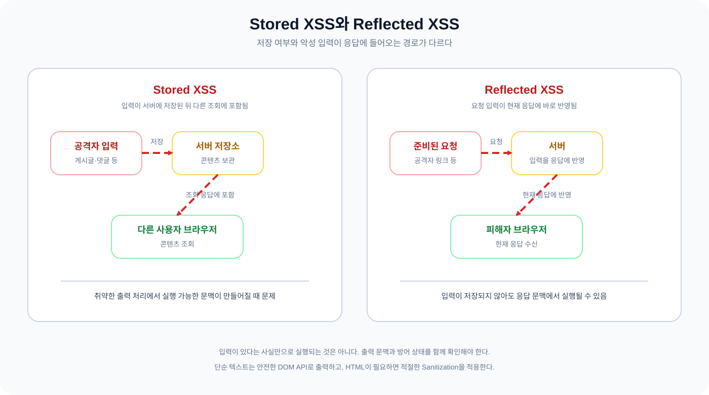

어제는 OAuth와 JWT를 공부하면서 외부 서비스의 권한 위임과 우리 서비스의 인증 정보를 나누어 보았다. 오늘은 그 인증 정보가 실제 요청에서 어떻게 확인되는지와 요청을 처리하는 동안 어떤 정보를 남겨야 하는지를 이어서 살펴봤다. 마지막으로 인증된 브라우저에서도 발생하는 CSRF와 XSS를 비교했다.

처음에는 인증이 끝나면 요청을 믿어도 된다고 생각했다. 로그는 많이 남길수록 장애 분석에 유리하고 보안 공격은 인증되지 않은 사용자가 일으키는 문제라고 단순하게 정리했다. 하지만 세 주제를 이어서 보니 서버는 요청의 주체와 권한을 구분하고 필요한 사실만 기록해야 하며 브라우저가 인증 정보를 자동으로 보내거나 입력을 코드로 해석하는 상황도 따로 방어해야 했다. 오늘 질문하면서 달라진 이해를 정리해 본다.

## 1. Authentication과 Authorization

### 1.1 인증과 인가는 무엇이 다를까?

Authentication은 사용자가 누구인지 확인하는 과정이다. Authorization은 인증된 사용자가 특정 자원이나 기능에 접근할 권한이 있는지 확인하는 과정이다. 이름이 비슷해서 처음에는 둘을 한 번에 처리하는 로그인 절차처럼 생각했다.

상태 코드도 처음에는 헷갈렸다. 인증에 실패하면 `404 Not Found`를 반환한다고 이해했지만 일반적인 구분은 `401 Unauthorized`와 `403 Forbidden`에 가깝다. 인증 정보가 없거나 유효하지 않아 사용자를 확인하지 못한 경우가 `401`이다. 인증은 됐지만 필요한 권한이 없으면 `403`이다. 다만 리소스의 존재 여부를 숨기기 위해 보안 정책상 `404`를 반환하는 설계도 있으므로 상태 코드 하나만 보고 모든 내부 처리 규칙을 단정하면 안 된다.

이 차이를 요청 흐름에 놓으니 질문이 조금 바뀌었다. `401`은 “누구인지 확인할 수 있는가?”에 대한 결과이고 `403`은 “누구인지는 알지만 이 작업을 허용할 것인가?”에 대한 결과다. 인증과 인가를 나누어야 실패 처리와 권한 정책도 각각 설명하게 된다.

### 1.2 Session과 Token을 다시 연결해 보기

이전에 [Cookie / Session](https://w00lam.github.io/posts/browser-cookie-session/)을 공부할 때는 브라우저가 Cookie에 Session ID를 저장하고 서버가 세션 정보를 조회하는 흐름을 정리했다. OAuth와 JWT를 공부한 어제는 요청에 담긴 토큰을 검증해 인증 정보를 확인하는 방식을 살펴봤다.

Session 기반 방식은 서버가 인증 상태를 관리한다. 서버가 여러 대가 되면 각 서버의 로컬 세션만으로는 같은 사용자의 요청을 어느 서버가 받느냐에 따라 결과가 달라질 수 있다. 공유 세션 저장소를 사용하거나 요청을 특정 서버로 보내는 전략이 필요한 이유다.

Token 기반 Stateless 방식은 각 요청에 필요한 인증 정보를 토큰에 담고 서버가 이를 검증한다. 그렇다고 서버에 어떤 상태도 없어지는 것은 아니다. Refresh Token을 관리하거나 로그아웃한 토큰을 무효화하거나 재사용을 탐지하려면 별도의 저장소가 필요해진다. 두 방식은 어느 하나가 항상 우월한 선택이 아니라 인증 상태를 어디에 둘지와 운영 요구사항을 어떻게 선택할지의 문제로 보게 됐다.

### 1.3 Spring Security의 인증 처리 흐름

Spring Security에서 인증 객체가 만들어지는 과정과 저장되는 과정을 같은 단계로 생각했던 것이 오늘의 가장 큰 혼동이었다. 처음에는 `AuthenticationProvider`가 인증을 마치고 `SecurityContext`에 결과까지 저장한다고 이해했다.

정리한 흐름은 다음과 같다.

1. 인증 필터가 로그인 정보나 Bearer Token 같은 인증 요청을 읽는다.
2. 인증 필터가 인증 전의 `Authentication`을 만들어 `AuthenticationManager`에 전달한다.
3. `AuthenticationManager`가 적절한 `AuthenticationProvider`에 인증을 위임한다.
4. `AuthenticationProvider`가 자격 증명을 검증하고 인증된 `Authentication`을 반환한다.
5. 인증 필터가 반환된 인증 결과를 `SecurityContext`에 설정한다.
6. 이후 인가 단계가 현재 인증 정보의 권한을 확인하고 Controller로 요청을 이어 보낸다.

`SecurityFilterChain`은 이런 보안 필터들을 요청 앞단에 배치하고 순서에 따라 처리하도록 구성한다. `AuthenticationManager`는 인증 처리 방식 자체를 결정하는 API이고 `AuthenticationProvider`는 특정 인증 방식의 검증을 담당한다. `SecurityContext`는 현재 요청의 인증 정보를 보관하는 장소다.

*그림 1. 인증 요청은 인증 필터에서 시작해 `AuthenticationManager`와 `AuthenticationProvider`를 거친다. Provider가 `SecurityContext`에 직접 저장하는 것이 아니라 인증 필터가 반환된 결과를 설정하는 개념적 흐름이다. 실제 필터와 처리 방식은 인증 메커니즘에 따라 달라질 수 있다.*

여기서 `Authentication` 객체를 생성하는 것만으로 `SecurityContext`에 자동 저장되는 것은 아니다. 인증을 수행하는 필터가 반환된 결과를 설정하는 책임까지 가지고 있기 때문이다. 이 구분을 하고 나니 인증 객체의 생성과 현재 요청에 인증 상태를 반영하는 일이 다른 단계라는 점이 분명해졌다.

### 1.4 URL 단위 인가와 메서드 단위 인가

URL 단위 인가는 HTTP 요청 경계에서 적용한다. 예를 들어 모든 사용자가 `GET`으로 게시글을 조회하지만 `POST`와 `DELETE`는 `ADMIN` 권한이 있어야 한다는 정책을 `SecurityFilterChain`에 표현한다.

~~~java
@Bean
SecurityFilterChain securityFilterChain(HttpSecurity http) throws Exception {
    http
        .authorizeHttpRequests(authorize -> authorize
            .requestMatchers(HttpMethod.GET, "/posts/**").permitAll()
            .requestMatchers(HttpMethod.POST, "/posts/**").hasRole("ADMIN")
            .requestMatchers(HttpMethod.DELETE, "/posts/**").hasRole("ADMIN")
            .anyRequest().authenticated()
        );

    return http.build();
}
~~~

이 코드에서 `hasRole("ADMIN")`은 일반적으로 `ROLE_ADMIN` 권한을 확인하는 축약 표현이다. 반면 `hasAuthority("ROLE_ADMIN")`은 전달한 권한 문자열을 그대로 비교한다. `hasRole`과 `hasAuthority`를 섞어 쓰면 접두어를 어디에서 붙이는지 놓치기 쉬우므로 권한 명명 규칙을 먼저 정해야 한다.

메서드 단위 인가는 메서드 호출 경계에서 적용한다. `@EnableMethodSecurity`를 활성화한 뒤 `@PreAuthorize`를 사용하면 Controller가 아니라 Service 메서드에 더 세밀한 정책을 둘 수 있다.

~~~java
@EnableMethodSecurity
@Configuration
class MethodSecurityConfig {
}

@PreAuthorize("hasAuthority('POST_DELETE')")
public void deletePost(long postId) {
    // 게시글 삭제
}
~~~

URL 단위 인가는 요청 경계에서 기본적인 접근을 막는 역할을 하고 메서드 단위 인가는 실제 기능을 수행하는 위치에서 권한을 한 번 더 확인하는 역할을 한다. 두 방식을 반드시 중복해서 사용해야 한다는 뜻은 아니지만 적용 범위와 책임이 다르다는 점은 구분해야 한다.

또 하나 분리해야 할 것이 CSRF 검증이다. `POST` 요청에 `ADMIN` 권한이 있다고 해도 CSRF 보호가 켜져 있고 토큰이 유효하지 않으면 요청이 거부된다. 인가 정책을 통과하는 것과 요청이 보안 필터의 모든 검증을 통과하는 것은 같은 일이 아니다.

### 1.5 인증과 인가 실패는 어디에서 처리할까?

인증에 필요한 정보가 없거나 인증에 실패한 요청은 `AuthenticationEntryPoint`가 처리한다. 로그인 화면으로 이동시키거나 `401` 응답을 반환하는 식이다. 인증은 됐지만 권한이 부족한 요청은 `AccessDeniedHandler`가 처리하며 일반적으로 `403` 응답과 연결한다.

`ExceptionTranslationFilter`는 필터 체인에서 발생한 `AuthenticationException`과 `AccessDeniedException`을 받아 현재 인증 상태에 맞는 진입점이나 거부 처리기로 연결한다. 그래서 인증과 인가 로직을 각각 작성하는 것과 실패 응답을 외부에 전달하는 경로를 나누어 이해할 수 있었다.

예를 들어 익명 사용자가 `GET /posts/1`에 접근하면 공개 정책에 따라 성공한다. 익명 사용자가 관리자 전용 `POST /posts`에 접근하면 인증이 필요하므로 `401` 흐름으로 간다. `USER` 권한으로 인증한 사용자가 같은 요청을 보내면 인증은 성공했지만 권한이 부족하므로 `403` 흐름으로 구분한다. `ADMIN` 권한 사용자라도 CSRF 검증 대상 요청에 유효한 토큰이 없으면 인가와 별개로 거부된다.

## 2. Logging Level

### 2.1 로그는 많이 남기는 것이 목적이 아니다

애플리케이션에서 발생하는 모든 정보를 무조건 출력하면 장애 원인을 더 쉽게 찾을 수 있을 것 같았다. 하지만 실제로는 로그가 너무 많아지면 중요한 사건이 다른 메시지에 묻히고 저장 비용과 검색 비용도 커진다.

로깅은 애플리케이션의 동작과 장애 원인을 파악하는 데 필요한 정보를 선택해서 기록하는 일이다. 어떤 상황을 어느 수준으로 남길지 정해야 운영 중에 로그를 읽을 수 있다.

### 2.2 로그 레벨과 출력 기준

일반적인 로그 레벨은 다음처럼 이해했다.

- `TRACE`: 메서드 안의 세부 흐름처럼 가장 많은 진단 정보를 남긴다.
- `DEBUG`: 개발이나 문제 재현에 필요한 상세 정보를 남긴다.
- `INFO`: 애플리케이션의 주요 상태 변화와 정상적인 처리 흐름을 남긴다.
- `WARN`: 당장 처리는 됐지만 장애로 이어질 수 있는 이상 상황을 알린다.
- `ERROR`: 요청이나 작업을 정상적으로 완료하지 못한 오류를 남긴다.

로그 레벨을 `INFO` 이상으로 설정했다는 말은 숫자가 큰 로그만 출력한다는 뜻이 아니다. 보통 `INFO`, `WARN`, `ERROR`가 출력되고 `DEBUG`, `TRACE`는 제외된다는 뜻이다. 반대로 `DEBUG`로 낮추면 `DEBUG`와 그보다 중요한 레벨이 함께 출력된다.

~~~java
private static final Logger log = LoggerFactory.getLogger(PostService.class);

log.trace("post 조회 상세 단계: postId={}", postId);
log.debug("post 조회 시작: postId={}", postId);
log.info("post 조회 완료: postId={}", postId);
log.warn("Redis 조회 실패. DB fallback을 사용한다: postId={}", postId);
log.error("post 저장 실패: postId={}", postId, exception);
~~~

패키지별로 로그 레벨을 다르게 설정할 수도 있다. 애플리케이션 코드는 `DEBUG`로 확인하되 프레임워크의 상세 로그는 `INFO`로 유지하는 식이다.

~~~yaml
logging:
  level:
    com.example.blog: DEBUG
    org.springframework.security: INFO
~~~

오늘은 이 코드가 실제로 출력되는지 실행한 것이 아니라 로그 호출이 각 레벨에 어떤 의미를 가지는지 연결해 본 예시다. 실제 출력 여부는 설정과 Appender, 배포 환경에 따라 달라진다.

### 2.3 SLF4J와 Logback은 어떤 관계일까?

SLF4J와 Logback을 모두 로깅 도구라고 뭉뚱그려 부르기 쉬웠다. 이렇게 나누면 SLF4J는 로깅 API를 제공하는 추상화 계층이고 Logback은 실제 로그 출력과 관리를 수행하는 구현체다.

애플리케이션 코드가 SLF4J의 `Logger`를 사용하면 코드가 특정 구현체의 API에 직접 묶이지 않는다. 배포 시 Logback과 다른 로깅 구현체를 선택하더라도 애플리케이션 코드의 변경을 줄일 수 있다. 다만 실제로 어떤 구현체가 연결되는지는 의존성과 설정에 달려 있으므로 SLF4J를 사용한다고 항상 같은 출력 방식이 보장되는 것은 아니다.

*그림 2. 애플리케이션은 SLF4J가 제공하는 로깅 API를 호출하고 Logback 같은 구현체가 실제 출력과 관리를 담당한다. 구현체를 바꿀 수 있다는 점은 추상화의 장점이며 실제 연결은 의존성과 설정을 따른다.*

### 2.4 WARN과 ERROR는 장애 여부만으로 나누지 않는다

처음에는 장애가 발생하면 무조건 `ERROR`를 사용한다고 생각했다. 하지만 로그 레벨은 문제가 발생했다는 사실뿐 아니라 처리 결과와 운영상 심각도까지 함께 고려해 선택해야 했다.

예를 들어 Redis 연결이 실패했지만 DB를 조회하는 대체 경로로 요청을 정상 처리했다면 `WARN`으로 남길 수 있다. 시스템이 기대한 빠른 경로를 사용하지 못했다는 이상 징후는 있지만 사용자 요청은 완료됐기 때문이다. 반대로 Redis와 DB 모두 사용할 수 없어 요청을 처리하지 못했다면 `ERROR`가 더 적절하다.

이 구분은 모든 서비스에 같은 정답으로 적용되는 규칙은 아니다. Redis 장애가 곧 서비스 전체 장애인 시스템이라면 대체 경로가 있어도 `ERROR`로 관리하는 편이 맞다. 로그 레벨은 서비스의 운영 정책과 알림 기준에 맞춰 정해야 한다.

여기서 Redis 조회 실패 후 DB를 직접 조회하는 것은 일반적으로 Retry가 아니라 Fallback이다.

- Retry: 실패한 작업을 같은 경로에서 다시 시도한다.
- Fallback: 기존 경로를 사용할 수 없을 때 대체 경로로 처리한다.

같은 Redis 조회를 다시 시도하면 Retry이고 Redis 대신 DB를 조회하면 Fallback이다. 두 처리를 구분해야 로그 메시지와 장애 대응 방식도 달라진다.

### 2.5 민감정보와 요청 추적

로그는 장애 분석에 도움을 주지만 새로운 보안 위험을 만들면 안 된다. 비밀번호, Access Token, 세션 비밀값 같은 인증 관련 정보는 로그에 남기지 않는다. 사용자 식별자가 필요하다면 서비스 정책에 맞는 최소한의 식별 정보만 사용하고 토큰 전체를 기록하는 방식은 피해야 한다.

여러 서버와 외부 시스템을 거치는 요청을 찾으려면 Request ID나 Trace ID를 로그에 함께 넣을 수 있다. 이 값은 요청을 연결하는 식별자이지 인증 토큰이나 비밀번호가 아니다. 로그를 검색하기 쉽게 해 주지만 그 자체가 요청의 권한을 증명하는 값은 아니다.

### 2.6 DB가 느리다고 쿼리만 의심하면 안 된다

DB 응답 시간이 증가했다는 로그를 보고 처음에는 쿼리 자체가 느려졌다고 생각하기 쉽다. 하지만 실제 지연은 네트워크 문제일 수도 있고 커넥션 풀이 고갈됐거나 커넥션을 오래 점유한 결과일 수도 있다. DB 안에서 쿼리가 실행되는 시간 자체가 늘어난 경우도 있다.

로그로 확인하는 것은 요청이 언제 시작됐고 언제 DB 호출을 보냈으며 언제 응답을 받았는지 같은 사실이다. 커넥션 대기 시간과 실제 쿼리 실행 시간을 분리하려면 메트릭이나 DB의 실행 계획과 같은 추가 지표가 필요하다. 로그 한 줄만으로 원인을 단정하지 않기로 한 이유다.

## 3. CSRF와 XSS

### 3.1 인증된 사용자에게도 공격이 발생하는 이유

인증이 끝났다는 말은 서버가 요청 주체를 확인한다는 뜻이지 모든 요청이 사용자의 의도에 따라 발생했다는 뜻은 아니다. 브라우저가 인증 Cookie를 자동으로 포함하거나 서버가 입력을 HTML과 JavaScript로 해석하면 인증된 사용자의 권한이 공격에 이용된다.

CSRF와 XSS는 모두 웹 보안 주제지만 공격 원리는 다르다. CSRF는 사용자의 인증 상태를 이용해 의도하지 않은 요청을 발생시키는 공격이고 XSS는 신뢰할 수 없는 입력을 브라우저가 실행 가능한 코드로 해석하게 만드는 공격이다.

### 3.2 CSRF는 어떻게 동작할까?

CSRF는 Cross-Site Request Forgery의 약자다. 사용자가 대상 서버에 로그인한 상태에서 공격자가 준비한 페이지를 방문하면 그 페이지가 대상 서버로 상태 변경 요청을 유도한다. 브라우저가 요청 조건에 맞는 Cookie를 자동으로 포함하면 서버는 그 요청을 로그인한 사용자의 요청으로 판단한다.

중요한 점은 공격자가 인증 Cookie의 값을 직접 읽어야 하는 것은 아니라는 것이다. 공격자는 피해자의 브라우저가 요청을 보내도록 유도할 뿐이고 Cookie를 읽지 못해도 공격이 성립한다. 다만 Cookie가 모든 교차 출처 요청에 항상 포함되는 것은 아니다. `SameSite` 속성과 브라우저의 Cookie 전송 정책에 따라 전송 여부가 달라진다.

*그림 3. 공격자는 Cookie 값을 읽지 않아도 피해자의 브라우저가 대상 서버로 요청을 보내도록 유도한다. `SameSite` 정책과 요청 조건에 따라 Cookie가 전송되지 않을 수도 있으며 서버가 CSRF Token을 요구하면 토큰 검증에서 요청이 거부된다.*

CSRF Token은 요청이 정상적인 애플리케이션 흐름에서 만들어졌는지 확인하는 값이다. 보호 대상 요청에 유효한 토큰이 없거나 값이 맞지 않으면 서버가 요청을 거부한다. 인증과 인가에 성공한 요청이어도 CSRF 검증을 통과하지 못하면 처리하지 않는 이유다.

### 3.3 POST만 보호하면 충분할까?

학습 초반에는 CSRF 방어를 `POST` 요청에만 적용하는 것으로 생각했다. 하지만 기준은 메서드 이름 자체가 아니라 서버 상태를 변경하는지 여부다. `PUT`, `PATCH`, `DELETE`처럼 상태를 변경하는 요청도 보호 대상이다.

`GET`은 원칙적으로 안전한 조회 용도로 사용해야 한다. GET에서 주문을 삭제하거나 상태를 변경하도록 API를 설계하면 브라우저의 링크 방문이나 미리 가져오기 같은 동작이 상태 변경으로 이어질 수 있어 CSRF 판단도 어려워진다.

Spring Security는 일반적으로 `POST` 같은 비안전 HTTP 메서드에 CSRF 보호를 적용한다. 그렇다고 모든 애플리케이션에서 설정을 그대로 두면 된다는 뜻은 아니다. Cookie 기반 인증인지, 별도의 `Authorization` 헤더를 사용하는 API인지, 실제 요청이 상태를 변경하는지 확인한 뒤 정책을 선택해야 한다.

### 3.4 XSS는 입력이 브라우저에서 코드가 되는 문제다

XSS는 Cross-Site Scripting의 약자다. 신뢰할 수 없는 입력이 브라우저에서 실행 가능한 코드로 해석되는 공격이다.

Stored XSS는 악성 입력이 서버나 데이터베이스에 저장된 뒤 다른 사용자의 화면에 표시되면서 실행되는 유형이다. 게시글이나 댓글처럼 여러 사용자가 조회하는 콘텐츠를 저장할 때 문제가 된다.

Reflected XSS는 공격자가 준비한 요청의 입력이 서버 응답에 반영되고 피해자의 브라우저에서 실행되는 유형이다. 검색어와 오류 메시지를 응답 HTML에 그대로 넣는 상황을 떠올리면 된다.

두 유형의 차이는 악성 입력이 저장되는지와 어떤 경로로 응답에 들어가는지에 있다. 입력이 존재한다고 항상 XSS가 발생하는 것은 아니다. 브라우저가 실행 가능한 문맥으로 해석하는 위치에 삽입되고 방어가 부족할 때 문제가 된다.

*그림 4. Stored XSS는 공격자 입력이 서버에 저장된 뒤 다른 사용자의 조회 응답으로 전달된다. Reflected XSS는 준비된 요청의 입력이 저장되지 않고 현재 응답에 반영된다. 두 경우 모두 취약한 출력 문맥에서 실행 가능한 입력으로 해석될 때 문제가 된다.*

### 3.5 `innerHTML`과 `textContent`

문자열을 화면에 표시하는 짧은 예제로 `innerHTML`과 `textContent`의 차이를 확인했다.

~~~javascript
const untrusted = "<strong>사용자가 입력한 문자열</strong>";

preview.innerHTML = untrusted;
safePreview.textContent = untrusted;
~~~

`innerHTML`은 문자열을 HTML로 해석한다. 문자열 안의 태그가 실제 요소가 될 수 있으므로 신뢰할 수 없는 입력을 그대로 넣으면 위험한 문맥이 만들어질 수 있다. `textContent`는 문자열을 일반 텍스트 노드로 처리하므로 위 예제에서는 태그가 화면에 글자로 표시된다.

단순히 사용자가 입력한 문자열을 보여주는 목적이라면 `textContent`나 값 전용 API처럼 안전한 DOM API를 우선 사용한다. HTML을 실제로 허용해야 하는 요구사항이 있다면 허용할 태그와 속성을 기준으로 Sanitization을 거친 뒤 사용해야 한다. `innerHTML`을 무조건 금지한다는 뜻이 아니라 입력의 신뢰도와 출력 문맥을 함께 판단해야 한다는 뜻이다.

### 3.6 XSS 방어 계층과 `HttpOnly`

오늘 확인한 XSS 방어 방법은 각각 책임이 다르다.

- 안전한 DOM API와 문맥에 맞는 출력 처리는 입력이 실행 가능한 코드로 해석되지 않게 한다.
- HTML Sanitization은 HTML을 허용해야 할 때 위험한 태그와 속성을 제거한다.
- CSP는 브라우저가 실행 가능한 리소스와 스크립트의 범위를 제한하는 추가 방어 계층이다.
- `HttpOnly`는 JavaScript가 Cookie 값을 직접 읽지 못하게 제한한다.

`HttpOnly`를 사용하면 XSS 상황에서 Cookie 값을 바로 읽어 탈취하는 위험을 줄인다. 하지만 브라우저가 조건에 맞는 Cookie를 요청에 포함하는 것까지 막는 속성은 아니다. 이 때문에 `HttpOnly`를 사용해도 CSRF 방어가 자동으로 완료되는 것은 아니다.

CSP도 단독으로 모든 XSS를 해결하는 장치가 아니다. 애플리케이션의 출력 처리와 입력 흐름을 올바르게 설계한 뒤 CSP를 추가 방어로 사용해야 한다. 한 가지 보안 설정을 다른 공격 유형의 해결책으로 확장해 이해하지 않기로 했다.

### 3.7 CSRF와 XSS를 한 표로 비교하기

| 구분 | CSRF | XSS |
| --- | --- | --- |
| 공격의 핵심 | 인증된 브라우저가 의도하지 않은 요청을 보냄 | 신뢰할 수 없는 입력이 브라우저에서 코드로 해석됨 |
| 주로 악용하는 것 | Cookie의 자동 전송과 사용자의 권한 | 취약한 출력 문맥과 브라우저의 HTML·스크립트 해석 |
| 공격자의 Cookie 읽기 | 직접 읽지 않아도 가능 | JavaScript로 읽으려는 시도가 가능하지만 `HttpOnly`로 제한할 수 있음 |
| 주요 방어 | CSRF Token, Cookie 정책, 요청 출처 검증 | 안전한 출력 처리, Sanitization, CSP, `HttpOnly` 등 |

두 공격은 인증 상태와 브라우저를 함께 다루지만 같은 문제는 아니다. CSRF는 “누가 요청을 시작했는가?”를 검증하는 문제에 가깝고 XSS는 “입력이 어떤 문맥에서 어떻게 해석되는가?”를 통제하는 문제에 가깝다.

## 4. 백엔드 개발과 오늘의 정리

Java와 Spring Boot 백엔드에서 인증 기능을 설계할 때는 먼저 인증과 인가의 책임을 나누어야 한다. 인증 필터는 자격 증명을 검증하는 구성요소에 요청하고 결과를 `SecurityContext`에 설정한다. 그 뒤 URL이나 메서드 경계에서 필요한 권한을 확인한다.

로깅도 같은 기준으로 책임을 나누어야 한다. 인증 실패와 권한 부족을 서로 다른 상태와 로그로 구분하고 Request ID나 Trace ID로 요청 흐름을 연결한다. `ERROR`를 많이 남기는 것이 좋은 운영은 아니며 fallback으로 처리된 경고와 실제 요청 실패를 구분해야 장애 알림도 의미를 갖는다.

브라우저 기반 인증을 사용한다면 서버의 인증·인가 정책만으로 충분하지 않다. Cookie가 자동으로 전송될 수 있는 요청에는 CSRF 방어가 필요하고 사용자 입력을 HTML로 출력하는 경로에는 XSS 방어가 필요하다. `HttpOnly`와 CSP는 유용하지만 각각의 책임을 넘어선 해결책으로 사용하면 안 된다.

오늘 학습한 내용은 다음과 같다.

- Authentication은 사용자가 누구인지 확인하고 Authorization은 인증된 사용자의 권한을 확인한다.
- 일반적으로 인증 실패는 `401`, 인증은 됐지만 권한이 부족한 경우는 `403`으로 구분한다.
- `AuthenticationManager`는 적절한 `AuthenticationProvider`에 인증을 위임하고 인증 필터가 결과를 `SecurityContext`에 설정한다.
- `hasRole("ADMIN")`은 일반적으로 `ROLE_ADMIN`을 확인하고 `hasAuthority`는 전달한 권한 문자열을 비교한다.
- 로그 레벨은 정보의 중요도와 처리 결과를 보고 선택하며 `WARN`과 `ERROR`는 서비스 운영 정책에 따라 달라질 수 있다.
- Redis 조회 실패 후 DB를 조회하는 것은 같은 작업을 다시 하는 Retry보다 대체 경로를 사용하는 Fallback에 가깝다.
- CSRF는 인증 Cookie가 자동으로 포함될 수 있는 요청을 악용하고 XSS는 신뢰할 수 없는 입력을 실행 가능한 코드로 해석하게 만든다.
- `textContent`는 단순 텍스트 출력에 적합하고 HTML을 허용해야 한다면 Sanitization과 CSP 같은 추가 방어를 함께 검토한다.

어제 공부한 OAuth와 JWT가 인증 정보를 어떻게 위임하고 전달하는지에 대한 질문이었다면 오늘은 그 정보가 실제 요청에서 어떻게 확인되고 어떤 권한으로 이어지는지에 대한 질문이었다. 인증에 성공한 요청도 인가와 CSRF 검증을 별도로 통과해야 하며 화면에 출력되는 문자열도 브라우저가 어떤 방식으로 해석하는지 확인해야 한다. 백엔드 개발에서 “인증됐다”는 말 뒤에 어떤 검증과 기록이 남아야 하는지 조금 더 구체적으로 보게 됐다.

### 관련 글

* [OAuth와 JWT — 사용자 권한 위임과 인증 정보 검증은 어떻게 이어질까?](https://w00lam.github.io/posts/oauth-jwt/) — OAuth의 권한 위임과 JWT 기반 인증 정보 검증을 정리한 글
* [Browser 동작 원리와 Cookie / Session — 브라우저는 화면을 그리는데 로그인 상태는 어떻게 유지할까?](https://w00lam.github.io/posts/browser-cookie-session/) — Cookie의 자동 전송과 Session 기반 로그인 상태를 정리한 글
* [HTTP Request Methods와 Status Code — 요청의 의도와 처리 결과는 어떻게 전달될까?](https://w00lam.github.io/posts/http-methods-status-codes/) — HTTP 메서드와 `401`, `403`을 포함한 상태 코드의 의미를 정리한 글
* [인증 방식의 이해: Session vs JWT와 Spring ArgumentResolver 활용](https://w00lam.github.io/posts/session-jwt-spring/) — Session과 JWT의 상태 관리 차이를 정리한 글
* [Spring Security 요청 처리 흐름과 DispatcherServlet](https://w00lam.github.io/posts/spring-security-request-dispatcherservlet/) — Spring Security 필터와 Spring MVC 요청 흐름을 연결한 글
* [세션 인증은 서버가 여러 대가 되면 어떻게 동작할까?](https://w00lam.github.io/posts/session-auth-multi-server/) — 여러 서버에서 Session 상태를 관리하는 방식을 정리한 글

### 참고 자료 (Sources)

* **Spring Security:** [Servlet Authentication Architecture](https://docs.spring.io/spring-security/reference/servlet/authentication/architecture.html) — `SecurityContext`, `Authentication`, `AuthenticationManager`, `AuthenticationProvider`의 관계를 확인했다.
* **Spring Security:** [Authorize HttpServletRequests](https://docs.spring.io/spring-security/reference/servlet/authorization/authorize-http-requests.html) — URL 단위 인가와 `hasRole`, `hasAuthority`의 차이를 확인했다.
* **Spring Security:** [Method Security](https://docs.spring.io/spring-security/reference/servlet/authorization/method-security.html) — `@EnableMethodSecurity`와 `@PreAuthorize`를 통한 메서드 단위 인가를 확인했다.
* **Spring Security:** [Cross Site Request Forgery (CSRF)](https://docs.spring.io/spring-security/reference/servlet/exploits/csrf.html) — 비안전 HTTP 메서드에 대한 CSRF 보호와 `CsrfToken` 처리 흐름을 확인했다.
* **SLF4J:** [SLF4J Manual](https://www.slf4j.org/manual.html) — 로깅 API와 구현체를 분리하는 추상화 계층의 역할을 확인했다.
* **Logback:** [Architecture](https://logback.qos.ch/manual/architecture.html) — Logger, Appender, Layout과 Logback의 구현체 역할을 확인했다.
* **OWASP:** [Cross-Site Request Forgery Prevention Cheat Sheet](https://cheatsheetseries.owasp.org/cheatsheets/Cross-Site_Request_Forgery_Prevention_Cheat_Sheet.html) — Cookie 자동 전송과 CSRF Token 기반 방어를 확인했다.
* **OWASP:** [Cross Site Scripting Prevention Cheat Sheet](https://cheatsheetseries.owasp.org/cheatsheets/Cross_Site_Scripting_Prevention_Cheat_Sheet.html) — 안전한 Sink인 `textContent`, HTML Sanitization과 CSP의 한계를 확인했다.

<!-- HUMANIZE-SUMMARY
원본/윤문본 글자수: 16,430 → 16,342
변경률: 19.4% (본문 라인 단위 편집 기준 21/108)
카테고리별 탐지: A-2 0 → 0, A-10 16 → 0, C-11 1 → 0, D-1 3 → 0, H-1 0 → 0
자체검증: 6/6 통과
등급: A — S1 잔존 0건, S2 핵심 패턴 0건, 기술 블로그 register 유지
주요 변경 하이라이트:
- 인증 실패와 인가 실패를 401·403의 요청 흐름으로 분리
- AuthenticationProvider의 검증과 인증 필터의 SecurityContext 설정 책임을 분리
- WARN·ERROR와 Retry·Fallback을 처리 결과 기준으로 구분
- CSRF의 Cookie 자동 전송과 XSS의 브라우저 출력 해석을 서로 다른 방어 문제로 정리
-->
