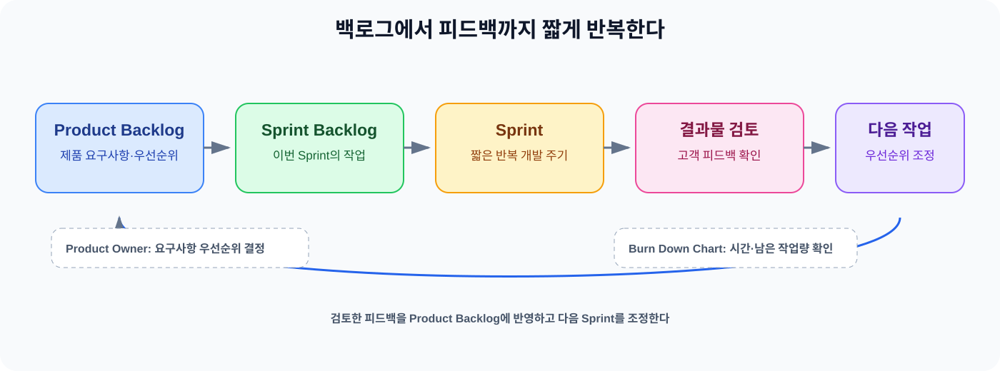
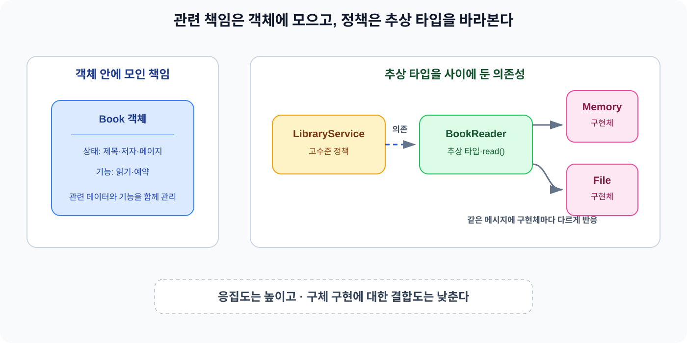

요구사항을 처음부터 끝까지 모두 확정한 뒤 개발을 시작할 수 있을까? 사용자가 무엇을 원하는지와 시장의 조건이 계속 바뀌는 환경에서는 처음 세운 요구사항을 마지막까지 그대로 유지하기 어렵다. 폭포수처럼 계획과 요구사항을 먼저 고정하는 방식은 변화가 적을 때는 전체 흐름을 관리하기 좋지만 개발 중에 방향이 바뀌면 이미 정한 계획과 실제 필요한 결과 사이의 차이가 커질 수 있다.

이런 상황에서 애자일은 짧은 주기로 결과물을 만들고 고객과 팀의 피드백을 받아 다음 작업을 조정하는 방식으로 변화에 대응한다. 그런데 요구사항이 바뀌는 문제는 개발 과정에만 있는 것이 아니다. 코드도 한 곳의 변경이 여러 곳으로 퍼지지 않도록 책임과 의존성을 정리해야 한다. 이전에 [Java 캡슐화와 접근 제어자 — 객체는 왜 자신의 상태를 숨겨야 할까](/posts/java-encapsulation-access-modifier/)와 [Java 상속과 객체 관계 — 코드 재사용보다 중요한 것](/posts/java-inheritance-object-relationship/)을 따로 정리했다면, 오늘은 그 개념을 객체지향의 전체 설계와 SOLID까지 연결해 보았다.

## 1. 애자일은 짧은 주기와 피드백으로 변화에 대응한다

폭포수 모델은 요구사항을 초기에 분석하고 계획한 순서에 따라 개발을 진행한다. 전체 계획을 먼저 세우면 일정과 비용을 관리하기 쉽다는 장점이 있지만 요구사항을 처음부터 정확히 확정해야 한다는 전제가 필요하다. 실제로 개발하면서 사용자가 원한 것과 우리가 이해한 것이 다르다는 사실을 알게 된다. 변화가 많은 프로젝트에서는 이 차이를 마지막에 발견할수록 수정 비용이 커진다.

애자일은 이런 불확실성을 개발 과정에 포함한다. 여기서 애자일은 특정 방법론 하나를 가리키는 말이 아니다. SDLC가 개발 단계와 순서를 구체화한 과정이라면 Approach는 비슷한 특징을 가진 개발 접근법을 묶은 개념이다. 애자일은 Approach이고 Scrum과 XP는 애자일에 속하는 구체적인 방법론이다. 따라서 애자일과 Scrum을 같은 뜻으로 사용하면 안 된다.

애자일 선언의 가치는 프로세스와 도구보다 개인과 상호작용을, 포괄적인 문서보다 작동하는 소프트웨어를, 계약 협상보다 고객과의 협력을, 계획을 따르는 것보다 변화에 대응하는 것을 더 중요하게 둔다. 계획을 세우지 않는다는 뜻이 아니라 계획을 고정해 변화와 충돌시키기보다 실제 결과와 피드백을 보고 다음 판단을 조정한다는 방향에 가깝다.

애자일의 목표는 고객 가치를 제공하는 것이다. Timebox 단위로 개발을 반복하고 작고 잦은 결과물을 전달하면 고객이 필요한 것과 결과물 사이의 차이를 일찍 확인할 수 있다. 팀 안에서는 만든 결과를 확인하고 고객이나 다른 부서가 사용한 반응을 통해 외부 피드백을 얻는다. 다만 애자일을 적용한다고 비용이나 품질이나 생산성이 자동으로 높아지는 것은 아니다. 고객 가치와 변화 대응을 위해 피드백을 개발 흐름에 넣는 접근이라고 이해해야 한다.

Scrum은 애자일을 실천하는 구체적인 방식이다. 먼저 제품에 필요한 요구사항과 우선순위를 Product Backlog에 담는다. 이 목록은 제품 전체를 바라보는 목록이다. 반면 Sprint Backlog는 특정 Sprint의 목표를 달성하기 위해 Product Backlog에서 선택한 작업 목록이다. Product Backlog가 제품 전체의 요구사항과 우선순위를 담는다면, Sprint Backlog는 이번 주기에 실제로 진행할 작업을 담는다.

Product Owner는 Backlog를 정의하고 요구사항의 우선순위를 정한다. 팀은 우선순위가 반영된 작업 중 Sprint 목표에 필요한 내용을 정해 짧은 개발 주기를 진행한다. Sprint는 반복 개발 주기이며 학습 기록에서는 보통 2주에서 4주 정도의 주기로 설명했다. Sprint가 끝나면 실행 가능한 결과물을 만들고 고객과 함께 결과물을 검토한다. 이때 받은 피드백은 그 자리에서 모든 것을 즉시 바꾸는 것이 아니라 이후 작업을 조정하는 데 반영한다.

Burn Down Chart는 이 과정에서 시간에 따라 남은 작업량을 확인하는 도구다. 가로축은 시간이고 세로축은 남은 작업량이다. 이 차트로 진행 상황과 남은 작업량을 파악할 수 있지만 프로젝트의 성공이나 결과물의 품질을 보장하는 지표는 아니다.



*짧은 개발 주기와 피드백으로 다음 작업을 조정한다*

## 2. 객체지향은 데이터와 기능을 객체에 모아 변경 영향을 줄인다

도서 관리 프로그램을 만든다고 해 보자. 책의 제목과 저자와 페이지 같은 데이터가 있고 책을 읽거나 예약하는 기능도 필요하다. 구조적 프로그래밍에서는 책의 데이터와 책을 다루는 함수가 따로 놓일 수 있다. 각각의 내용이 어디에 있는지는 알 수 있어도 어떤 데이터와 기능이 함께 바뀌어야 하는지 연결 관계를 파악하기 어려워진다.

객체지향 프로그래밍은 관련 데이터와 그 데이터를 다루는 기능을 객체 안에 함께 둔다. 책의 속성과 읽기와 예약 같은 기능을 책 객체에 모으면 책과 관련된 책임과 경계를 따라 코드를 읽을 수 있다. 관련 내용이 가까이 모이면서 응집도를 높이고 중복을 줄여 유지보수에 도움을 줄 수 있다. 물론 객체지향을 사용한다는 이유만으로 이런 효과가 자동으로 생기는 것은 아니며 어떤 책임을 어느 객체에 둘지 설계하는 과정이 필요하다.

### 추상화는 공통 속성과 행동을 골라 표현한다

추상화는 여러 구체적인 대상에서 필요한 공통 속성이나 행동을 골라 일반적인 개념으로 표현하는 것이다. 아우디와 BMW와 벤츠를 각각 따로 다루기보다 공통된 특징을 가진 자동차라는 개념으로 묶을 수 있다. 이렇게 공통 개념을 기준으로 사용하는 코드를 만들면 새로운 브랜드를 추가할 때 사용하는 쪽의 변경을 줄일 수 있다.

추상화는 추상 클래스 하나를 만드는 문법에 한정되지 않는다. 어떤 대상의 공통점을 뽑아 어떤 개념과 책임으로 표현할지 정하는 설계 관점이다. 인터페이스는 추상화를 표현하는 수단 중 하나일 뿐이다.

### 캡슐화는 내부 구현을 감추고 결합도를 낮춘다

캡슐화는 객체가 내부에서 기능을 어떻게 구현하는지 감추고 외부에는 필요한 기능만 제공하는 설계다. 외부 코드가 객체의 내부 상태와 구현 순서를 직접 알게 되면 내부 변경이 여러 호출자에게 영향을 준다. 반대로 객체가 자신의 상태와 기능을 함께 관리하고 외부에는 요청할 방법만 제공하면 구현을 바꿔도 변경이 퍼지는 범위를 줄일 수 있다.

이 과정에서 응집도와 결합도를 함께 보게 된다. 응집도는 서로 관련된 데이터와 기능이 한곳에 모여 있는 정도이고, 결합도는 한 객체가 다른 객체의 구현과 얼마나 강하게 묶여 있는지를 나타낸다. 관련 책임은 객체 안에 모아 응집도를 높이고 불필요한 의존은 줄여 결합도를 낮추는 방향이 변경에 대응하기 좋다. `private` 같은 접근 제어자는 정보 은닉을 돕는 문법적 수단이지 캡슐화의 전체 의미는 아니다.

### 상속은 자연스러운 IS-A 관계에서 확장한다

상속은 공통 특성을 일반화해 부모 타입과 자식 타입의 관계로 표현하는 방법이다. 벤츠가 자동차의 한 종류라는 관계처럼 IS-A가 자연스럽고 공통 기능을 확장해야 할 때 상속을 고려할 수 있다. 단순히 비슷한 코드를 재사용하려고 상속하면 부모의 변경이 여러 자식에게 영향을 주거나 실제로는 맞지 않는 관계를 코드에 만들 수 있다.

서로 다른 종류의 객체가 기능만 공유하는 상황이라면 객체 조립을 우선 고려할 수 있다. 객체 조립은 한 객체가 다른 객체를 참조해 기능을 함께 사용하는 방식이다. 상속보다 구조가 복잡해질 수도 있지만 관계가 맞지 않는 상속보다 변경에 유연할 수 있다.

### 다형성은 같은 요청에 구현체마다 다르게 반응한다

다형성은 서로 다른 구현체가 같은 추상 타입이나 메시지를 통해 각자의 방식으로 동작하는 특성이다. 호출하는 쪽은 구체적인 클래스가 무엇인지 직접 알거나 타입마다 조건문을 나누지 않고 공통된 요청을 보낸다. 실제 동작은 각 구현체가 자신의 방식으로 수행하므로 새로운 구현을 추가할 때 기존 호출 코드를 덜 건드릴 수 있다.

```java
interface BookReader {
    Book read(String isbn);
}

final class LibraryService {
    private final BookReader reader;

    Book open(String isbn) {
        return reader.read(isbn);
    }
}

final class MemoryBookReader implements BookReader {
    // 메모리에서 책을 읽는 구현
}

final class FileBookReader implements BookReader {
    // 파일에서 책을 읽는 구현
}
```

`LibraryService`는 `BookReader`라는 추상 타입에 요청하고 `MemoryBookReader`와 `FileBookReader`는 같은 `read` 메시지에 각자의 방식으로 반응한다. 이 코드는 Spring의 DI 동작을 설명하려는 것이 아니라 상위 코드가 구체 구현체가 아닌 추상 타입을 바라보는 관계를 보여 주기 위한 예시다.

### SOLID는 책임과 의존성을 조정하는 기준이다

SOLID는 서로 떨어진 암기 항목이라기보다 객체의 책임과 의존성을 어떻게 배치할지 판단하는 기준으로 이해했다.

- **SRP(단일 책임 원칙)**: 클래스가 하나의 책임과 하나의 변경 이유를 갖도록 한다. 서로 다른 변경 이유가 한 클래스에 섞이면 한 책임의 변경이 다른 책임의 코드까지 건드릴 수 있으므로 책임을 나누어 변경 영향을 줄인다.
- **OCP(개방-폐쇄 원칙)**: 확장에는 열려 있고 변경에는 닫히도록 설계한다. 기존 코드를 절대 수정하지 않는다는 뜻이 아니라 새로운 기능을 확장으로 수용해 기존 기능을 사용하는 코드의 수정 범위를 줄이려는 원칙이다.
- **LSP(리스코프 치환 원칙)**: 하위 타입을 상위 타입 대신 사용해도 상위 타입을 사용하던 코드가 정상적으로 동작해야 한다. 하위 타입이 상위 타입에서 기대한 동작을 깨뜨리지 않아야 한다.
- **ISP(인터페이스 분리 원칙)**: 인터페이스를 사용하는 클라이언트를 기준으로 나눈다. 클라이언트가 사용하지 않는 기능까지 의존하지 않게 하면 필요하지 않은 인터페이스 변경의 영향을 줄일 수 있다.
- **DIP(의존 역전 원칙)**: 고수준 정책이 저수준 구현에 직접 의존하지 않게 한다. 둘 사이에 추상 타입을 두고 저수준 구현체가 그 추상 타입을 구현하게 하면 구현이 바뀌어도 고수준 정책으로 변경이 번지는 일을 줄일 수 있다.



*역할과 추상 타입을 분리하면 변경이 다른 코드로 퍼지는 범위를 줄일 수 있다*

객체지향 설계는 기능을 먼저 찾고 세분화한 뒤 알맞은 객체에 책임을 할당하는 흐름으로 시작한다. 그 기능에 필요한 데이터를 객체에 넣고 해당 데이터를 사용하는 기능을 같은 객체에 배치한다. 이후 기능을 캡슐화하고 객체들이 메서드 요청을 어떻게 주고받을지 정한다. 이 과정을 거치면 클래스 목록을 먼저 늘리는 것보다 변경될 책임과 객체 사이의 협력을 기준으로 구조를 바라볼 수 있다.

## 3. 학습 중 바뀐 이해

애자일을 공부하기 전에는 폭포수 방식의 어려움을 단순히 “중간에 수정하기 어렵다” 정도로 생각했다. 요구사항을 처음부터 끝까지 정확히 유지하기 힘든 불확실성이 핵심이라는 점을 이해하면서 애자일의 반복과 피드백이 왜 필요한지 연결할 수 있었다. 애자일은 계획을 버리는 방식이 아니라 짧은 결과물을 기준으로 실제 반응을 확인하고 다음 작업을 조정하는 접근이었다.

또 애자일을 Scrum과 같은 뜻으로 사용하려 했다. SDLC와 Approach를 구분하고 애자일은 개발 접근법이며 Scrum은 그 접근법을 실천하는 구체적인 방법론이라는 관계를 나누어 이해했다. Product Backlog는 제품 전체의 요구사항과 우선순위이고 Sprint Backlog는 하나의 Sprint 목표를 위한 작업 목록이라는 차이도 함께 정리했다. Sprint Review의 피드백도 즉시 전부 반영하는 것이 아니라 결과물을 검토한 뒤 이후 작업에 반영하는 흐름으로 표현하는 것이 정확했다. Burn Down Chart는 성공 여부를 판단하는 도구가 아니라 시간에 따른 남은 작업량과 진행 상황을 확인하는 도구였다.

객체지향에서는 처음에 구조적 프로그래밍의 한계를 “책이 종류별로 흩어져 있다”고 표현했다. 다시 정리해 보니 책 자체가 흩어진다는 뜻이 아니라 책의 데이터와 책을 다루는 기능이 분리되어 연결 관계를 파악하기 어려워질 수 있다는 뜻이었다. 관련 데이터와 기능을 객체에 모으면 책임과 경계를 따라 코드를 볼 수 있고 중복을 줄이는 데 도움이 된다.

이때 응집도와 결합도의 관계도 조금 더 분명해졌다. 관련 내용은 한 객체 안에 모아 응집도를 높이고 다른 객체의 구체 구현에 대한 의존은 줄여 결합도를 낮추면 한 변경이 다른 코드로 퍼지는 범위를 줄일 수 있다. 추상화는 인터페이스 문법 하나가 아니라 공통 개념을 모델링하는 설계였다. 상속은 코드 재사용보다 IS-A 관계와 기능 확장에 맞는지를 먼저 판단해야 했다. 관계가 맞지 않고 기능만 공유한다면 객체 조립을 고려한다.

SOLID도 다섯 문장을 따로 외우는 데서 끝나지 않았다. SRP는 변경 이유가 섞이지 않게 책임을 나눈다. OCP는 확장으로 새 기능을 받아 기존 사용 코드의 수정을 줄인다. LSP는 하위 타입이 상위 타입의 기대를 깨지 않게 한다. ISP는 클라이언트가 쓰는 기능만 의존하게 인터페이스를 나눈다. DIP는 고수준 정책과 저수준 구현 사이에 추상 타입을 둔다. 서로 다른 원칙처럼 보이지만 결국 책임과 의존성을 조정해 변경 영향을 줄이는 기준이라는 점으로 묶어 이해했다.

## 4. 오늘의 정리

- 애자일은 특정 방법론 하나가 아니라 변화에 대응하기 위한 개발 접근법이며 Scrum은 이를 실천하는 구체적인 방식이다.
- Product Backlog는 제품 전체의 요구사항과 우선순위를 담고 Sprint Backlog는 특정 Sprint 목표를 위한 작업을 담는다.
- Sprint 결과물을 고객과 검토하고 피드백을 이후 작업에 반영하면서 고객 가치를 제공한다.
- Burn Down Chart는 시간에 따른 남은 작업량과 진행 상황을 확인하는 도구이며 프로젝트의 성공이나 품질을 보장하지 않는다.
- 객체지향은 관련 데이터와 기능을 객체에 모아 책임과 경계를 파악하기 쉽게 하고 응집도와 유지보수에 도움을 줄 수 있다.
- 추상화·캡슐화·상속·다형성은 공통 개념과 구현 경계와 타입 관계와 요청 처리 방식을 정리하는 설계 기준이다.
- SOLID는 객체의 책임과 의존성을 조정해 변경의 영향을 줄이기 위한 원칙이다.

오늘은 애자일과 객체지향을 하나의 개념으로 섞기보다 서로 다른 위치에서 변화에 대응하는 방법으로 나누어 보았다. 애자일은 개발 과정에서 짧은 주기와 피드백으로 요구사항 변화에 대응한다. 객체지향 설계는 책임과 의존성을 정리해 코드 변경이 퍼지는 범위를 줄이려 한다. 고객의 피드백을 받아 다음 작업을 조정하는 일과 변경하기 쉬운 코드를 설계하는 일은 같은 것은 아니지만 변화가 생겼을 때 전체를 다시 흔들지 않도록 준비한다는 점에서 이어진다.

### 참고 자료 (Sources)

* **Gyoogle:** [애자일(Agile)](https://gyoogle.dev/blog/computer-science/software-engineering/Agile.html) — 애자일의 등장 배경과 협력·피드백, Scrum의 Product Backlog와 Sprint 흐름을 확인
* **Gyoogle:** [애자일(Agile) 정리 2](https://github.com/gyoogle/tech-interview-for-developer/blob/master/Computer%20Science/Software%20Engineering/%EC%95%A0%EC%9E%90%EC%9D%BC%28Agile%292.md) — Agile이 개발 접근법이라는 점과 고객 가치, Product Owner, Burn Down Chart 설명을 확인
* **Gyoogle:** [객체지향 프로그래밍](https://gyoogle.dev/blog/computer-science/software-engineering/Object-Oriented%20Programming.html) — 객체지향의 등장 배경과 네 가지 특징, SOLID 원칙을 확인

<!-- HUMANIZE-SUMMARY
원본 초안 글자수: 약 9,900자
윤문본 글자수: 약 9,900자
변경률: 약 18% (문장 호흡, 반복 표현, 연결어, 섹션 제목을 조정)
카테고리별 최종 점검: A-1 0건, A-2 0건, A-10 0건, C-11 0건, D-1 0건, H-1 0건, I-1 0건, J-2 0건.
자체검증: 6/6 통과
등급: A — S1 잔존 0건, S2 잔존 2건, 실제 학습 범위와 기존 TIL 문체를 보존하면서 문장 흐름을 다듬었다.
주요 변경 하이라이트:
- 애자일을 개발 접근법으로, Scrum을 구체적인 실천 방식으로 구분했다.
- Product Backlog와 Sprint Backlog를 제품 전체 목록과 이번 주기 작업 목록으로 나누었다.
- 객체지향의 응집도와 결합도를 변경 영향과 연결해 설명했다.
- OCP를 기존 코드를 절대 수정하지 않는 규칙이 아니라 확장으로 변경 범위를 줄이는 원칙으로 정리했다.
- DIP와 다형성을 추상 타입과 구현체의 관계를 보여 주는 짧은 코드로 설명했다.
-->
