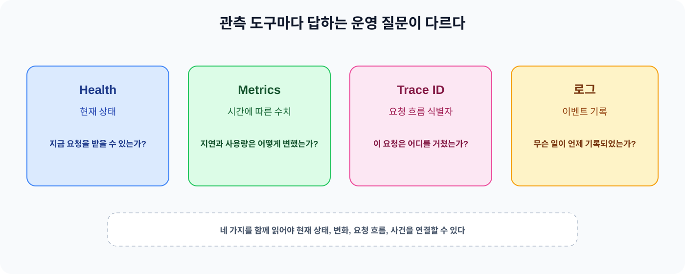
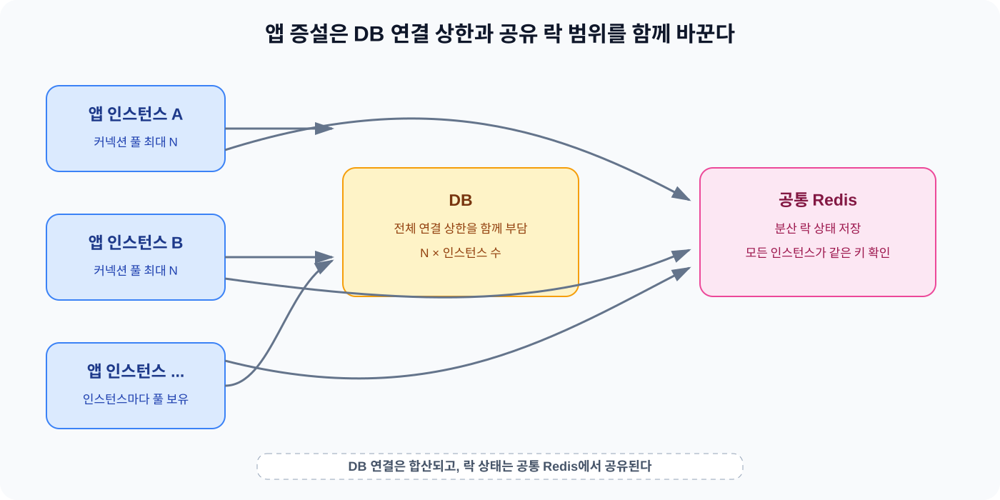

서비스를 운영할 때 서버가 응답한다는 사실만 확인해서는 현재 상태나 처리 용량을 판단하기 어렵다. 한 번의 상태 확인은 지금 요청에 응답할 수 있는지를 보여줄 뿐이고, 시간에 따른 지연이나 자원 사용량과 요청 흐름까지 알려주지는 않는다.

오늘은 Health와 Metrics가 각각 어떤 질문에 답하는지부터 살펴봤다. 이어서 Trace ID와 p95와 로그를 연결해 요청을 따라가는 방법을 정리하고, 배포 확인과 롤백을 거쳐 처리 용량과 자원 증설을 판단하는 흐름으로 확장했다. 운영 상태와 비용과 확장성을 하나의 숫자로 단정하지 않고 관측값과 설정값과 실제 청구액을 구분하는 것이 오늘의 핵심이었다.

## 1. Health와 Metrics는 다른 질문에 답한다

Health endpoint는 애플리케이션이나 구성 요소가 현재 어떤 상태인지 확인하는 데 사용한다. 데이터베이스 연결을 얻을 수 있는지나 애플리케이션이 요청을 받을 준비가 되었는지처럼 지금의 상태를 빠르게 판단하는 질문에 가깝다. Spring Boot Actuator의 `health` endpoint도 실행 중인 애플리케이션의 상태 정보를 제공하며, 여러 Health Indicator의 결과를 모아 전체 상태를 만든다.

Metrics는 시간에 따라 관찰할 수 있는 수치다. 요청 수와 응답 시간과 오류율과 CPU와 메모리 사용량처럼 일정한 기간의 변화를 보고 서비스가 어떤 흐름을 보이는지 판단하는 데 사용한다. Health가 현재 상태를 확인하는 스냅샷이라면 Metrics는 상태가 어떻게 변했는지 비교하는 기록에 가깝다.

여기서 endpoint가 응답한다는 사실과 운영 환경에서 메트릭이 수집되고 있다는 사실을 섞으면 안 된다. 애플리케이션이 metrics endpoint를 노출하거나 로컬에서 값을 조회할 수 있어도 수집기가 해당 endpoint를 주기적으로 읽고 저장한다는 보장은 없다. 노출과 수집과 보관과 대시보드 조회는 각각 확인해야 하는 단계다.

## 2. Trace ID와 p95와 로그는 서로 다른 관측 수단이다

Trace ID는 하나의 요청이 여러 컴포넌트를 거치는 흐름을 연결하는 식별자다. 요청이 애플리케이션에 들어와 다른 서비스나 DB 호출로 이어졌을 때 같은 Trace ID를 로그에 남기면 관련 이벤트를 한 요청의 흐름으로 묶어 볼 수 있다. Trace ID가 알려주는 질문은 “이 요청이 어디를 거쳤는가”에 가깝다.

p95는 지연 시간 분포를 요약하는 백분위수다. 관측한 응답 시간을 작은 값부터 정렬했을 때 95% 지점에 해당하는 응답 시간이 p95다. 평균보다 늦은 요청이 얼마나 있는지 살펴볼 때 유용하지만, p95 하나만으로 오류 원인이나 특정 요청의 경로를 알 수는 없다. Trace ID는 요청을 찾는 식별자이고 p95는 여러 요청의 지연 분포를 요약한 지표이므로 서로 대체할 수 없다.

로그는 특정 시점에 발생한 이벤트의 기록이다. 오류 메시지와 상태 변화와 요청 처리 결과를 남길 수 있지만, 인스턴스의 로컬 디스크에만 의존하면 인스턴스 교체나 재시작 뒤에 기록을 계속 보관하기 어렵다. 여러 인스턴스의 로그를 함께 검색하고 Trace ID로 요청을 연결하려면 외부 로그 수집과 보관이 필요하다.

*그림 1. Health는 현재 상태를, Metrics는 시간에 따른 수치를, Trace ID는 요청 흐름을, 로그는 이벤트를 확인하는 데 사용한다.*

## 3. 배포 확인과 롤백은 운영 판단의 일부다

배포가 끝났다는 메시지만으로 새 버전이 정상 동작한다고 판단할 수는 없다. 배포 후 smoke check를 실행하면 애플리케이션이 시작되었는지와 주요 요청이 기본적으로 처리되는지처럼 가장 중요한 동작을 짧게 확인할 수 있다. 이 확인은 전체 부하나 모든 기능을 검증하는 테스트가 아니라 새 버전이 최소한의 운영 조건을 만족하는지 보는 절차다.

문제가 확인되면 이전에 정상 동작하던 실행 산출물로 되돌리는 롤백을 고려한다. 롤백의 목적은 원인을 모두 해결하는 것이 아니라 장애가 계속되는 시간을 줄이고 알려진 정상 상태를 회복하는 데 있다. 이후 원인을 조사하고 다시 배포할 수 있는 시간을 확보한다.

문서에 롤백 절차가 적혀 있다는 사실과 실제 운영 환경에서 롤백이 실행되었다는 사실은 다르다. 배포 기록과 smoke check 결과와 실제 롤백 로그처럼 확인할 수 있는 근거가 없으면 “실행했다”고 표현하지 않는다. 운영 글에서 계획과 관측된 사실을 나누는 이유도 여기에 있다.

## 4. 처리 용량은 RPS 하나로 단정하지 않는다

RPS는 초당 처리 요청 수를 나타내지만 그 숫자만으로 안정적인 처리 용량을 정할 수는 없다. 요청을 많이 받았더라도 오류가 늘거나 지연 시간이 허용 범위를 넘었다면 서비스가 그 부하를 안정적으로 처리했다고 보기 어렵다.

처리 용량을 판단할 때는 성공 처리량과 오류율과 p95 지연 시간을 함께 본다. 여기에 CPU와 메모리 사용량과 DB 커넥션 풀과 Redis 상태를 연결한다. 같은 RPS에서도 쿼리 시간이 길어지거나 DB 연결 대기가 생기면 결과가 달라질 수 있기 때문이다. 하나의 지표가 변한 시점에 다른 지표도 함께 변했는지 확인해야 원인에 가까이 갈 수 있다.

업무 규칙에 따른 거절과 서버 오류도 구분해야 한다. 사용량 한도나 유효하지 않은 요청처럼 예상된 업무 조건에 따른 거절은 서버가 요청을 처리하지 못해 발생한 오류와 의미가 다르다. 두 응답을 같은 오류율로 묶으면 서비스의 실제 상태를 잘못 판단할 수 있다.

부하 테스트에서 확인한 값은 그 테스트의 동시 사용자 수와 요청 패턴과 데이터와 실행 환경에서 관찰한 값이다. 같은 결과를 현재 운영 환경의 처리 용량이라고 일반화하지 않는다. 운영 용량은 실제 트래픽과 자원 지표와 오류와 지연을 함께 관찰하면서 판단해야 한다.

## 5. HikariCP 풀 포화 신호와 원인을 나눈다

HikariCP 커넥션 풀 상태를 볼 때는 Active와 Idle 커넥션 수와 대기 중인 스레드 수를 함께 본다. Active는 사용 중인 커넥션이고 Idle은 바로 사용할 수 있는 커넥션이다. 커넥션을 얻으려는 스레드가 기다리고 있는지와 커넥션 획득 시간이 초과되었는지도 풀의 상태를 판단하는 단서가 된다.

풀의 최대 설정값만으로 실제 포화 여부를 확정할 수는 없다. 설정상 최대 크기에 도달했더라도 요청이 짧게 끝나 대기가 없을 수 있고, 반대로 최대치에 도달하지 않아도 쿼리나 트랜잭션이 오래 걸리면 대기가 생길 수 있다. HikariCP의 모니터링 값은 측정 시점의 스냅샷이므로 단일 값보다 시간 흐름과 대기 발생을 함께 확인해야 한다.

풀 포화 신호와 그 원인도 나눠서 봐야 한다. 커넥션 획득 대기가 늘었다는 것은 풀이 요청을 즉시 수용하지 못했다는 신호다. 그 원인이 풀 크기 부족인지 쿼리 시간이 긴 것인지 트랜잭션이 커넥션을 오래 점유한 것인지 DB 자체가 기다리는 상태인지는 별도로 확인해야 한다. 특정 상태값 하나만 보고 애플리케이션 인스턴스의 문제라고 단정하지 않는 이유다.

## 6. 수직 확장과 수평 확장은 DB 연결에도 영향을 준다

수직 확장은 한 인스턴스에 더 많은 CPU와 메모리 같은 자원을 추가하는 방식이다. 수평 확장은 애플리케이션 인스턴스의 수를 늘려 요청을 여러 인스턴스로 나누는 방식이다. 두 방식은 애플리케이션의 처리 자원을 늘리는 방법이지만 DB와 같은 외부 자원의 수용 능력까지 자동으로 늘려 주지는 않는다.

수평 확장에서는 인스턴스마다 DB 커넥션 풀이 존재할 수 있다. 따라서 설정상 DB 연결 가능량의 상한은 다음처럼 생각할 수 있다.

`인스턴스별 최대 풀 크기 × 인스턴스 수`

이 식은 실제로 항상 그만큼 연결을 사용한다는 뜻이 아니라 각 인스턴스의 설정이 허용하는 전체 연결 규모를 보는 계산이다. 앱 인스턴스를 늘리면 DB로 향할 수 있는 연결 수의 상한도 함께 커진다. DB의 CPU와 메모리와 동시 처리 능력이 그대로라면 연결 대기와 DB 부하가 더 커질 수 있다. 애플리케이션을 수평 확장할 때는 앱 인스턴스 수만 보지 않고 DB가 감당할 연결량과 쿼리 처리 능력도 함께 확인해야 한다.

이 내용은 앞서 정리한 [TLS Handshake와 Load Balancing — 통신은 어떻게 보호하고 요청은 어떻게 분산할까?](https://w00lam.github.io/posts/tls-handshake-load-balancing/)에서 여러 인스턴스로 요청을 나누는 흐름과도 이어진다. 요청을 분산하는 것과 각 인스턴스가 외부 자원에 만드는 부하는 별개의 문제다.

## 7. 여러 인스턴스의 분산 락은 공통 Redis를 사용한다

여러 애플리케이션 인스턴스가 같은 범위의 작업을 한 번만 실행해야 한다면 각 인스턴스의 로컬 메모리만으로는 락 상태를 공유할 수 없다. 인스턴스 A가 자신의 메모리에 락을 기록해도 인스턴스 B는 그 값을 볼 수 없기 때문이다.

같은 락을 사용하려면 여러 인스턴스가 접근하는 공통 Redis에 락 상태를 저장해야 한다. 각 인스턴스가 같은 키와 같은 공유 자원을 기준으로 락을 확인하고 획득해야 서로의 상태를 볼 수 있다. 이때 Redis는 인스턴스별 로컬 자원이 아니라 애플리케이션 인스턴스가 함께 사용하는 공유 자원이다.

Redis를 공통으로 사용한다고 해서 애플리케이션의 모든 상태가 자동으로 공유되는 것은 아니다. 로컬 메모리의 값과 공통 Redis의 값은 보관 위치와 공유 범위가 다르다. 분산 락을 적용할 때는 어떤 상태를 여러 인스턴스가 함께 봐야 하는지부터 정하고 그 상태를 공통 자원에 두어야 한다. Redis의 다른 장애 대응 전략이나 구성 방식은 오늘 범위에 포함하지 않았다.

*그림 2. 인스턴스별 커넥션 풀의 설정상 상한은 합산되고, 분산 락 상태는 공통 Redis에서 공유한다.*

앞서 정리한 [저장 프로시저와 Redis — DB에서 실행할 작업과 메모리에 둘 데이터는 어떻게 정할까?](https://w00lam.github.io/posts/stored-procedure-redis/)에서 Redis를 데이터와 연산의 요구에 따라 선택하는 저장소로 살펴봤다면, 오늘은 여러 인스턴스가 같은 상태를 확인하는 공유 자원이라는 관점으로 연결했다.

## 8. 실제 비용과 예상 비용을 구분한다

AWS의 실제 청구액은 사용한 자원과 사용량을 기준으로 확정된 비용을 확인하는 값이다. 반면 AWS Cost Explorer의 forecast나 Pricing Calculator의 결과는 과거 사용량이나 계획한 사용량을 바탕으로 앞으로의 비용을 예측하거나 계산한 값이다. 예상 비용은 실제 청구액과 달라질 수 있으므로 둘을 같은 숫자로 기록하지 않는다.

예상 비용에는 계산 조건이 함께 있어야 한다. 사용 시간과 리전과 인스턴스 유형과 저장 공간과 네트워크 사용량과 할인이나 약정 적용 여부에 따라 결과가 달라진다. 조건을 바꾸면 같은 자원 이름이라도 예상 비용이 달라질 수 있다. 실제 청구액을 확인하지 않았다면 금액을 추정해 실제 지출처럼 표현하지 않고 어떤 조건의 예상값인지 먼저 적는다.

## 9. 백엔드 개발에서는 관측값과 설정값을 함께 읽는다

백엔드 개발에서 운영 관점을 연결한다는 것은 지표를 많이 붙이는 것만을 뜻하지 않는다. Health는 현재 상태 확인에 쓰고 Metrics는 시간 변화와 자원 사용을 확인하며 Trace ID와 로그는 특정 요청의 흐름을 찾는 데 사용한다. 각 도구가 답하는 질문을 나누면 장애가 발생했을 때 어디부터 확인할지 정하기 쉬워진다.

확장 판단도 같은 방식으로 해야 한다. 인스턴스 수와 풀 최대 크기는 설정값이고 Active와 대기 스레드와 p95와 오류율은 관측값이다. 설정을 바꾸기 전에 실제로 어떤 대기가 생겼는지 확인하고, 인스턴스를 늘리기 전에 DB 연결과 DB 처리 능력이 함께 감당할 수 있는지 살펴야 한다. 운영 환경에서 근거가 부족한 원인을 단정하지 않는 태도는 코드의 입력과 결과를 구분하는 것만큼 중요하다.

## 10. 학습 중 바뀐 이해

처음에는 Health endpoint가 정상 응답하면 운영 메트릭도 수집되고 있다고 생각했다. 이제는 Health가 현재 상태를 확인하는 방식이고 Metrics는 시간에 따라 기록하고 수집해야 하는 수치라는 점을 구분한다. endpoint가 노출되어 있다는 사실만으로 실제 수집과 보관까지 확인할 수는 없다.

Trace ID와 p95도 같은 종류의 지표로 묶지 않게 됐다. Trace ID는 하나의 요청 흐름을 연결하는 식별자이고 p95는 여러 응답 시간의 분포를 요약한 값이다. 로그는 이벤트를 남기며 인스턴스가 교체될 수 있는 환경에서는 외부 수집이 필요할 수 있다는 점까지 연결했다.

HikariCP의 특정 상태값이 높다는 이유만으로 애플리케이션 인스턴스 자체를 문제의 원인으로 단정하지 않게 됐다. 풀 대기와 쿼리 시간과 트랜잭션 점유와 DB 대기를 나눠 확인해야 한다. 기존에 확인한 RPS 결과 하나도 현재 처리 용량으로 일반화하지 않고 해당 부하 테스트 조건에서 관찰한 값으로 남겨야 한다.

앱 인스턴스를 늘리면 처리 자원만 늘어난다고 생각했지만 인스턴스마다 커넥션 풀이 있다면 DB 연결 가능량의 상한도 함께 커질 수 있다는 점을 확인했다. 앱을 늘리는 판단은 DB의 연결 수와 처리 능력까지 포함해서 해야 한다. 비용도 마찬가지로 실제 청구액과 조건을 둔 예상 비용을 구분해야 한다.

## 11. 오늘의 정리

- Health는 현재 애플리케이션이나 구성 요소의 상태를 확인하고 Metrics는 시간에 따른 요청과 지연과 자원 사용량을 관찰한다.
- Trace ID는 요청 흐름을 연결하는 식별자이고 p95는 지연 시간 분포의 95백분위 응답 시간이며 로그는 이벤트 기록이다.
- 배포 후 smoke check로 기본 동작을 확인하고 문제가 있으면 이전 실행 산출물로 롤백할 수 있지만 문서에 적힌 절차와 실제 실행 사실은 구분한다.
- 처리 용량은 RPS 하나로 정하지 않고 성공 처리량과 오류율과 p95와 CPU와 메모리와 DB와 Redis 상태를 함께 본다.
- HikariCP 풀의 포화 신호와 원인을 구분하고 Active와 Idle과 대기 스레드와 커넥션 획득 시간과 DB 대기를 함께 확인한다.
- 수평 확장은 인스턴스별 DB 커넥션 풀의 설정상 상한을 늘릴 수 있으며 앱 인스턴스 수가 DB 처리 능력을 자동으로 늘리지는 않는다.
- 여러 인스턴스가 같은 분산 락을 사용하려면 락 상태를 공통 Redis에서 공유해야 한다.
- 실제 AWS 청구액과 사용 조건으로 계산한 예상 비용은 서로 다른 값이며 예상 비용에는 계산 조건을 함께 남겨야 한다.

오늘은 운영 상태와 처리 용량과 비용을 각각 다른 근거로 판단해야 한다는 점을 정리했다. Health가 정상이라는 한 줄만으로 서비스가 여유롭다고 말할 수 없고, RPS 하나만으로 확장 시점을 정할 수도 없다. 요청 흐름과 지연 분포와 자원 대기와 DB 연결과 비용의 근거를 같은 시간 범위에서 확인해야 운영 판단에 가까워진다.

### 참고 자료 (Sources)

* **Spring Boot:** [Actuator Endpoints](https://docs.spring.io/spring-boot/3.4/reference/actuator/endpoints.html) — Health와 Metrics endpoint의 역할과 노출 개념을 확인했다.
* **Spring Boot:** [Metrics](https://docs.spring.io/spring-boot/3.4/reference/actuator/metrics.html) — 기록된 메트릭을 확인하는 방식을 살펴봤다.
* **Micrometer Tracing:** [Glossary](https://docs.micrometer.io/tracing/reference/glossary.html) — Trace와 Span과 Trace ID를 로그와 연결하는 개념을 확인했다.
* **Micrometer:** [Histograms and Percentiles](https://docs.micrometer.io/micrometer/reference/1.13/concepts/histogram-quantiles.html) — p95 같은 백분위수의 의미를 확인했다.
* **HikariCP:** [MBean Monitoring and Management](https://github.com/brettwooldridge/HikariCP/wiki/MBean-%28JMX%29-Monitoring-and-Management) — Active와 Idle과 Total과 대기 스레드 지표를 확인했다.
* **AWS:** [Managing connections](https://docs.aws.amazon.com/prescriptive-guidance/latest/hyperscale-aurora-mysql/manage-connections.html) — 애플리케이션 인스턴스 증가와 DB 연결량의 관계를 확인했다.
* **AWS Cost Management:** [Forecasting with Cost Explorer](https://docs.aws.amazon.com/cost-management/latest/userguide/ce-forecast.html) — 예측 청구액과 실제 청구액의 차이를 확인했다.
* **AWS Cost Management:** [Generating estimates with Pricing Calculator](https://docs.aws.amazon.com/cost-management/latest/userguide/pricing-calculator.html) — 계획한 사용량을 바탕으로 한 비용 추정의 성격을 확인했다.
* **Redis:** [Distributed Locks with Redis](https://redis.io/docs/latest/develop/clients/patterns/distributed-locks/) — Redis 기반 분산 락에서 공유 자원을 사용하는 기본 동작을 확인했다.

<!-- HUMANIZE-SUMMARY
원문 초안 글자수: 약 8,900자
윤문본 글자수: 약 8,650자
변경률: 약 14% (문장 호흡, 반복 표현, 연결어와 단정 표현을 조정)
카테고리별 최종 점검: A-1 0건, A-2 0건, A-7 0건, A-8 0건, C-11 0건, D-1 0건, H-1 0건, I-1 0건, J-2 0건.
자체검증: 6/6 통과
등급: A — S1 잔존 0건, S2 잔존 2건 이하, 기존 TIL 문체와 기술적 의미를 보존했다.
주요 변경 하이라이트:
- Health endpoint와 Metrics 수집을 현재 상태와 시간에 따른 관측으로 분리했다.
- Trace ID와 p95를 요청 식별자와 지연 분포 지표로 구분했다.
- HikariCP 풀 포화 신호와 DB·쿼리·트랜잭션 원인을 나누어 설명했다.
- 앱 인스턴스 증설이 DB 연결 상한을 키울 수 있다는 관계를 계산식으로 정리했다.
- 실제 AWS 청구액과 조건을 둔 예상 비용을 구분했다.
-->
